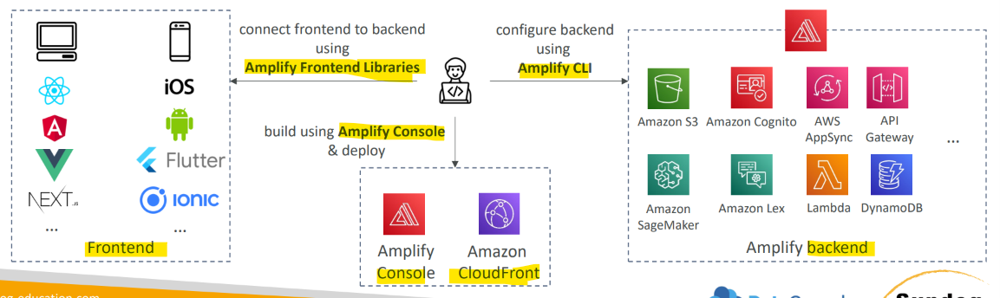

# AIP: Amplify

[Back](../index.md)

- [AIP: Amplify](#aip-amplify)
  - [Amplify](#amplify)

---

## Amplify

- `AWS Amplify`
  - a complete set of tools and services from Amazon Web Services that helps front-end and full-stack developers build and **deploy web and mobile applications** quickly without managing complex cloud infrastructure manually.
  - It acts as a bridge between your **application code** and underlying **AWS services**

- developers use **Amplify libraries**, a `command-line interface (CLI)`, or `TypeScript` **definitions** to declare what their app needs.
  - `Amplify` handles the heavy lifting behind the scenes using **infrastructure-as-code tools** like `AWS CloudFormation` and the `AWS CDK`.

- **Key Features**
  - **Fullstack TypeScript (Gen 2)**:
    - Author data models, business logic, and authentication rules using code-first TypeScript, which automatically provisions and manages cloud resources.
    - **Amplify Hosting**:
      - Provides **Git-based continuous integration and continuous deployment (CI/CD)** with support for popular serverless web frameworks like Next.js, Nuxt, Astro, and SvelteKit, as well as single-page apps (SPAs).
    - **Backend Services**:
      - Easily **integrate cloud features**
      - e.g.,
        - user authentication via `Amazon Cognito`,
        - real-time data via `AWS AppSync` or `DynamoDB`
        - and file storage via `Amazon S3`.
    - **UI Components**:
      - Build frontends faster with pre-built, themeable, cloud-connected **React components** and **automatic CRUD form generation**.

---

- A set of tools and services that helps you develop and deploy scalable **full stack web and mobile applications**
- Authentication, Storage, API (REST, GraphQL), CI/CD, PubSub, Analytics, AI/ML Predictions, Monitoring, …
- **Connect** your source code from `GitHub`, AWS `CodeCommit`, `Bitbucket`, `GitLab`, or **upload** directly

