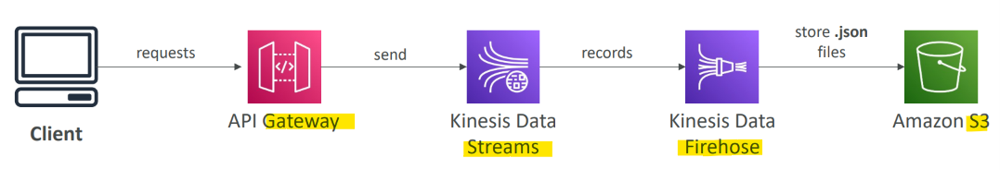

# AIP: API Gateway

[Back](../index.md)

- [AIP: Lambda](#aip-lambda)
  - [Lambda](#lambda)
    - [Server vs serverless](#server-vs-serverless)
  - [integration with AI application](#integration-with-ai-application)
    - [withs Kinesis (popular in exame)](#withs-kinesis-popular-in-exame)
    - [with Bedrock / GenAI](#with-bedrock--genai)

---

## API Gateway

- `AWS Lambda` + `API Gateway`: No infrastructure to manage
- Support for the **WebSocket Protocol**
- Handle **API versioning** (v1, v2…)
- Handle **different environments** (dev, test, prod…)
- Handle **security** (**Authentication** and **Authorization**)
- Create `API keys`, handle request **throttling**
- `Swagger` / `Open API` import to quickly define APIs
- **Transform and validate** requests and responses
- Generate `SDK` and API **specifications**
- **Cache** API responses

---

### Integrations High Level

- **Lambda Function**
  - Invoke `Lambda function`
  - Easy way to expose **`REST API` backed by `AWS Lambda`**
- **HTTP**
  - Expose **HTTP endpoints** in the backend
  - Example: internal HTTP API on premise, Application Load Balancer…
  - Why?
    - Add **rate limiting**, **caching**, **user authentications**, **API keys**, etc…
- **AWS Service**
  - **Expose any AWS API** through the API Gateway
  - Example: start an AWS Step Function workflow, post a message to SQS
  - Why?
    - Add **authentication**, deploy **publicly**, **rate control…**

---

- example

---

### Endpoint Types

- **Edge-Optimized**:
  - default
  - For **global clients**
  - Requests are **routed** through the `CloudFront Edge` locations (improves **latency**)
  - The API Gateway still lives **in only one region**
- **Regional**:
  - For clients within the **same region**
  - Could manually **combine with** `CloudFront` (more control over the **caching strategies** and the **distribution**)
- **Private**:
  - Can only be accessed from your `VPC` using an `interface VPC endpoint (ENI)`
  - Use a **resource policy** to define **access**

---

### Security

- **User Authentication through**
  - `IAM Roles` (useful for **internal** applications)
  - `Cognito` (identity for **external** users – example mobile users)
  - `Custom Authorizer` (your **own logic**)
- `Custom Domain Name HTTPS` **security** through integration with `AWS Certificate Manager (ACM)`
  - If using `Edge-Optimized` endpoint, then the certificate must** be** in `useast-1`
  - If using `Regional` endpoint, the certificate must be in the API Gateway region
  - Must setup `CNAME` or `A-alias` record in `Route 53`

---

## with GenAI

- Use as a **front** for feedback collection
- Use as a **front** for your models
- API Gateway `usage plans`
  - Base on your **model capacity** and client requirements
  - Throttling (~10-50 requests per second)
  - Burst capacity (~2-3X)
- Response **filtering**
- **Retry strategies** when models time out
- Use for **token limit management**
  - Request **validator** + **JSON schema definition** can enforce constraints
- Implement **routing logic** with request **transformations**
- **Validate** required fields
