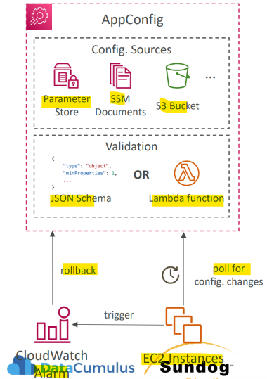

# AIP: AppConfig

[Back](../index.md)

- [AIP: AppConfig](#aip-appconfig)
  - [AppConfig](#appconfig)
  - [GenAI](#genai)

---

## AppConfig

- Configure, validate, and deploy dynamic **configurations**
- **Deploy** dynamic **configuration changes** to your applications **independently of any code deployments**
- You **don’t need to restart** the application
- Feature flags, application tuning, allow/block listing…
- Use with apps on `EC2` instances, `Lambda`, `ECS`, `EKS`…
- **Gradually deploy** the configuration changes and **rollback** if issues occur
- **Validate** configuration changes before deployment using:
  - **JSON Schema** (syntactic check) or
  - **Lambda Function** – run code to perform validation (semantic check)

---

## GenAI

- This is a possible solution for **dynamic FM selection** **(common for examt)**
- **No code changes** required to switch models
  - Use feature flags and configuration profiles
- **Configuration** may be stored in `S3`
  - `AppConfig` is **integrated** with `S3`
- Can be used as a tool for **rolling out** new models, `A/B testing`, `rollbacks`
  - Of course `SageMaker` does all this too.
  - `Bedrock Evaluations` and `CloudWatch Evidently` can also manage `A/B tests`
