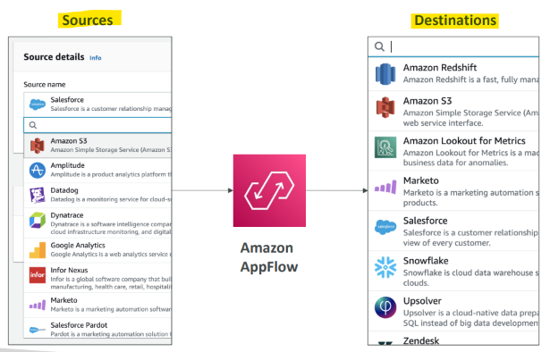

# AIP: AppFlow

[Back](../index.md)

- [AIP: AppFlow](#aip-appflow)
  - [AppFlow](#appflow)

---

## AppFlow

- `Amazon AppFlow`
  - a fully managed, **no-code integration service** that lets you **securely transfer data** between **Software-as-a-Service (SaaS) applications** and **AWS services**.

- Fully managed integration service that enables you to **securely transfer data** between `Software-as-a-Service (SaaS)` applications and `AWS`
- **Sources**:
  - Salesforce, SAP, Zendesk, Slack, and ServiceNow
- **Destinations**:
  - AWS services like Amazon S3, Amazon Redshift or non-AWS such as SnowFlake and Salesforce
- **Frequency**:
  - on a **schedule**,
  - in response to **events**,
  - or **on demand**
- Data transformation capabilities like **filtering** and **validation**
- **Encrypted** over the public internet or privately over `AWS PrivateLink`
- Don’t spend time writing the integrations and leverage APIs immediately

