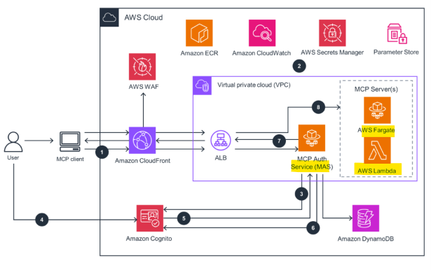

# AWS: Model Context Protocol (MCP)

[Back](../index.md)

- [AWS: Model Context Protocol (MCP)](#aws-model-context-protocol-mcp)
  - [Deploying your Own MCP Server](#deploying-your-own-mcp-server)

---

## Deploying your Own MCP Server

- For stateless, lightweight access:
  - `AWS Lambda`s
- For complex tools:
- `Amazon ECS`
  - Or `Fargate`
- `API Gateway`
  - Can also **expose** MCP endpoints
- Use **MCP client libraries**
  - Abstract away the complexities of the protocol, don’t re-invent the wheel!

- But it’s different from what the exam guide and SkillBuilder talk about :/
- You can also **deploy** `MCP servers` with `AgentCore`

- AWS’s official MCP architecture

