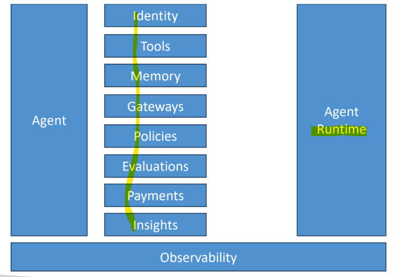
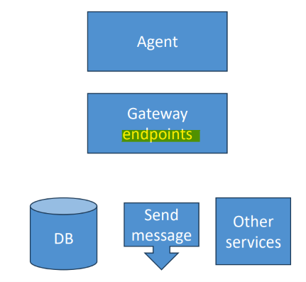
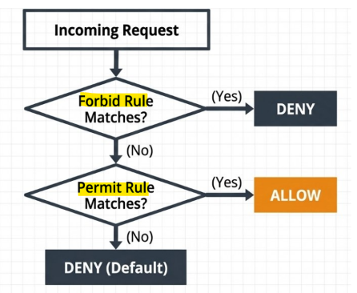
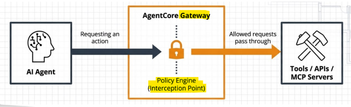

# Amazon Bedrock: AgentCore

[Back](../index.md)

- [Amazon Bedrock: AgentCore](#amazon-bedrock-agentcore)
  - [AgentCore](#agentcore)
    - [Capabilities](#capabilities)
  - [Runtime](#runtime)
    - [Built-In Tools](#built-in-tools)
    - [Importing Bedrock Agents](#importing-bedrock-agents)
  - [Memory](#memory)
  - [Gateway](#gateway)
  - [Policy](#policy)
    - [Policy Enforcement](#policy-enforcement)
  - [Identity](#identity)
  - [Evaluations](#evaluations)
    - [Built-In Evaluations (prompt templates)](#built-in-evaluations-prompt-templates)
    - [Custom Evaluators](#custom-evaluators)
  - [Lab: Strands Agent](#lab-strands-agent)

---

## AgentCore

- `Amazon Bedrock AgentCore`:
  - an all-in-one, framework-agnostic **platform** by AWS designed to **build, deploy, secure, and scale** production AI agents.

- Hands **deployment and operation** of `AI agents` at scale
  - No fussing with Docker, ECR, ECS, etc
  - Serverless
- And it works with **ANY agent framework**
  - You aren’t tied to `Bedrock agents`
  - You aren’t even tied to `AWS’s Strands framework`
    - OpenAI Agent SDK, LangGraph / LangChain, CrewAI, Google ADK, whatever
    - (although… Strands does get better support…)
- Includes a `agentcore CLI` to make deployment of agents to AWS super easy
- Includes several **tools and capabilities** you can include in your agents
  - These can be contained in a `harness` **without writing code**
- Integrates with `Bedrock Knowledge Bases`

---

- vs `Amazon Bedrock`
  - `Amazon Bedrock`:
    - Provides **foundational models (LLMs)** and basic prompt-to-model **APIs**.
  - `Amazon Bedrock AgentCore`:
    - Handles the heavy lifting of **production infrastructure**,
      - such as runtime execution, memory, tool integration, and security.

---

### Capabilities

---

## Runtime

- `Agent Runtime`:
  - A **serverless environment** with **session isolation** and microVM **sandboxes** that supports workloads lasting anywhere from a fraction of a second **up to 8 hours**.

- `Serverless` endpoints
- **Deploy** your agent to `ECR`, enhanced with AgentCore capabilities
  - `Agentcore CLI` manages it all for you, using `CodeBuild`
  - But you can build your own `Docker containers` if you want
- Can have **multiple endpoints**
- `Observability dashboard` lets you **track** usage and performance
  - Through “GenAI Observability” feature in `CloudWatch`

---

### Built-In Tools

- **Browser Tool**
  - Allows control of **browser to interact with the web**

- **Code Interpreter**
  - Allow to run code in an isolated container
    - Python, JavaScript, TypeScript

---

### Importing Bedrock Agents

- Bedrock has its own system for endpoints…
- But `Bedrock Agents` is **deprecated** for new customers.
  - AWS recommends **migration** to `AgentCore`
- Building agents in Bedrock is super easy
- Importing is just a matter of running `agentcore import-agent`
  - Specify your agent-id, agent-alias-id, region
  - This **generates Strands code** (or LangChain / LangGraph) in an output directory
  - From there you can test or deploy it like any other AgentCore agent

---

## Memory

- `Agent Memory`:
  - Manages both `short-term` (current conversation) and `long-term` (cross-session facts, user preferences, and episodic experiences) context.

---

## Gateway

- `Gateway`:
  - **Connects agents to external** tools, APIs, and `Model Context Protocol (MCP)` servers with built-in access controls.

- Addresses the problem of using external tools at scale
- **Convert** into **MCP tools**
  - APIs, Lambda functions, or other services
  - **Targets** can be **OpenAPI (REST), Smithy models (that’s an AWS thing), or Lambda**
- Agents can then **access** them through `Gateway endpoints`
  - Manages OAuth security / credentials
- **Semantic tool** selection

---

## Policy

- `Policy`:
  - Uses **plain-English rules** converted to Cedar to **intercept unauthorized** tool calls

- **Integrates** with `AgentCore Gateways`
- **Intercepts** tool calls, **evaluates** against your defined `policies`
- Defined in the `Cedar` language
  - You can also construct policies using NLP or via a form
- Very **fine-grained control**
  - **who** can do **what** under **what conditions**
- Evaluated outside of the agent’s code

### Policy Enforcement

- **Deny by default**
  - All actions **denied** unless explicitly permitted
- **Contextual** validation
  - Validate full context, OAuth subclaims, specific tool arguments
- **Dual** modes
  - `Enforce mode` to **actively block** actions
  - `Log-only mode` to **test and validate** policies

---

## Identity

- `Identity`:
  - Handles inbound **user authentication (OAuth)** and **outbound** agent credentials/permissions via IAM and token vaults.

- This is about your **agent’s identity / identities**
  - This is different from OAuth identity for users and connecting to services we talked about earlier
- Secure **access to external tools** and AWS **services**
- **Central repository** for all of your **agent identities**
  - Similar to a Cognito user pool
- Secure credential storage
- OAuth 2.0 support
  - Built-in support for Google, GitHub, Slack, Salesforce, Atlassian
- There is a lot of depth to this, but you probably don’t need it right away
  - Refer to https://docs.aws.amazon.com/bedrockagentcore/latest/devguide/identity.html

---

## Evaluations

- Assess how well your agent:
  - Performs **task**
  - **Handles** edge cases
  - Maintains **consistency**
- **Integrates** with:
  - `Strands`
  - `LangGraph`
  - `OpenTelemetry`
  - `OpenInference`
- **Visualize** results in `CloudWatch`
  - `AgentCore Observability Insights`
  - The usual `CloudWatch alerts` / `alarms`
- **Cross-region** inference
  - Automatically **selects optimal region** for processing
  - **Data remains** resident to where the request **originated**
  - But may be transmitted and processed – **encrypted** – to other regions

---

### Built-In Evaluations (prompt templates)

- Correctness (is it **factually correct**)
- Helpfulness (from the **user’s** standpoint)
- Conciseness
- Instruction following
- Faithfulness (is response supported by context/sources)
- Response relevance (to user query)
- Coherence (logical structure)
- Refusal (is it evasive)
- Goal success rate
- Tool selection and parameter accuracy
- Harmfulness, Stereotyping
- Evaluation may be limited by filters and sampling rate you specify

---

### Custom Evaluators

- **Specify a model** to use as a judge
  - And configure it
- And define it with a **prompt**
  - Maybe start with a built-in one
- Define **scales**
  - Maps ranges of results to labels
- Define **evaluation level**
  - Session, trace, tool call

---

## Lab: Strands Agent

- **Prerequisite**
  - Git
  - Python UV
  - Nodejs
  - Bedrock api key
    - set environment variable `AWS_BEARER_TOKEN_BEDROCK`

- Skip
- hands-on project idea(not required for exam)
  - deploy with agentcore cli
  - deploy with terraform
  - integrate with cicd
  - multiple tenant