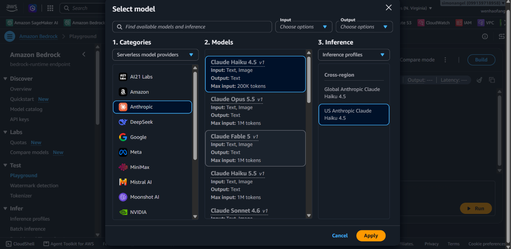
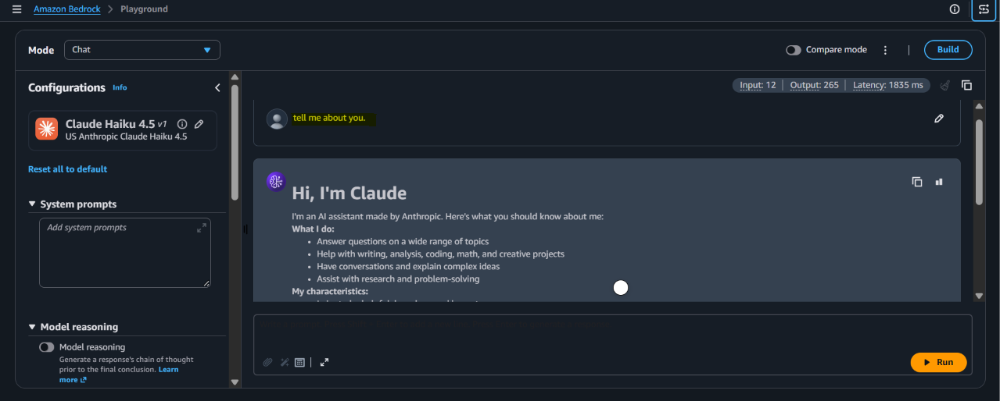
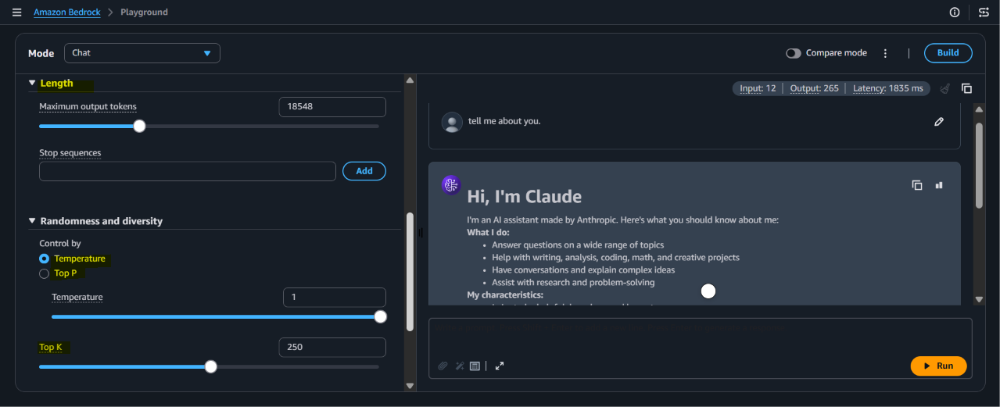
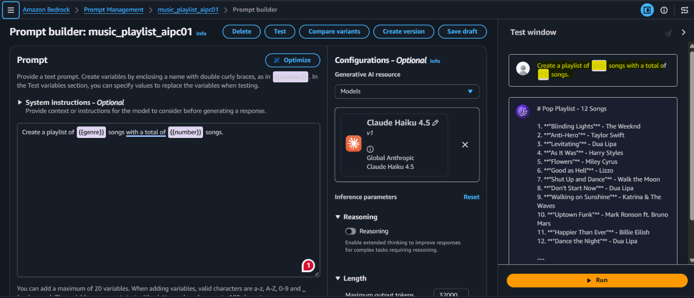
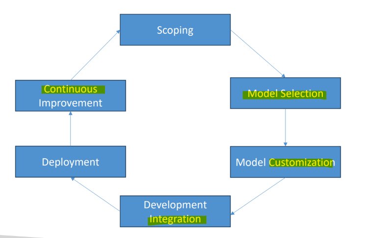

# AIP: Amazon Bedrock

[Back](../index.md)

- [AIP: Amazon Bedrock](#aip-amazon-bedrock)
  - [Bedrock](#bedrock)
    - [Bedrock IAM permissions](#bedrock-iam-permissions)
  - [Lab: Bedrock - Playground](#lab-bedrock---playground)
  - [Converse API](#converse-api)
  - [Fine-tuning in Bedrock: “Custom Models”](#fine-tuning-in-bedrock-custom-models)
  - [Prompt Management](#prompt-management)
    - [Prompt Flows](#prompt-flows)
    - [Bedrock Flows with Prompts](#bedrock-flows-with-prompts)
  - [Lab: Prompt Management](#lab-prompt-management)
  - [Structured Data Responses](#structured-data-responses)
  - [Enterprise Integration](#enterprise-integration)
  - [AWS Well-Architected Generative AI Lens](#aws-well-architected-generative-ai-lens)
  - [`Re-ranker Models` in Amazon Bedrock](#re-ranker-models-in-amazon-bedrock)

---

## Bedrock

- Foundation Models
  - GPT-n (OpenAI)
  - Claude (Anthropic)
  - DALL-E (OpenAI, Microsoft)
  - LLaMa (Meta)
  - DeepSeek
  - Nova

- `Bedrock`
  - a fully managed service to build and scale **generative artificial intelligence applications** using foundation models through a single, unified API.
  - An API for generative AI Foundation Models
    - Invoke chat, text, or image models
    - Pre-built, your own fine-tuned models, or your own models
    - Third-party models bill you through AWS via their own pricing
    - Support for RAG (Retrieval-Augmented Generation)
    - Support for LLM agents
  - Serverless
  - Can integrate with `SageMaker Canvas`

- API Endpoints
  - `bedrock`:
    - Manage, deploy, train **models**
  - `bedrock-runtime`:
    - Perform **inference** (execute prompts, generate embeddings) against these models
    - Converse, ConverseStream, InvokeModel, InvokeModelWithResponseStream
  - `bedrock-agent`:
    - Manage, deploy, train LLM **agents** and **knowledge bases**
  - `bedrock-agent-runtime`:
    - Perform **inference** against agents and knowledge bases
    - InvokeAgent, Retrieve, RetrieveAndGenerate

- Converse API
  - Unified API for models that **support smessages**
  - Specify the **prompt** in the messages field (or an ARN to prompt management)
  - Specify a **modelId**
  - Optionally:
    - Model-specific fields
    - Guardrails
    - Config (max tokens, temperature…)
    - Prompt variables
    - Tools (for agentic AI stuff)

---

### Bedrock IAM permissions

- Must use with an IAM user **(not root)**
- User **must have** relevant Bedrock permissions
  - `AmazonBedrockFullAccess`
  - `AmazonBedrockReadOnly`

- Model Access
  - Amazon is **phasing out the need to request** access to specific models
  - Be sure to check pricing
    - `aws.amazon.com/bedrock/pricing`

---

## Lab: Bedrock - Playground







---

## Converse API

- parameters
  - required: A specific prompt
  - agentic AI:
    - `toolConfig`: set of tools
    - `guardrail`
- ***

## Fine-tuning in Bedrock: “Custom Models”

- **Fine-tuning**
  - base model: Titan, Cohere, and Meta models
  - This can get expensive
  - Your resulting “custom model” may then be used like any other.

- **Text models**:
  - provide **labeled** training pairs of prompts and completions
    - Can be questions and answers
    - Upload training data into S3

    ```json
    {
        "prompt": "What is the meaning of life?",
        "completion": "The meaning of life is 42."
    }
    {
        "prompt": "Who was the best Dr. Who?",
        "completion": "Matt Smith in Series 5 was the best, and anyone who says otherwise is wrong."
    }
    {
        "prompt": "Is Dr. Who better than Star Trek?",
        "completion": "Blasphemer! Star Trek changed the world like no other science fiction has."
    }
    ```

- **Image models**: provide pairs of image S3 paths to image descriptions (prompts)
  - Used for text-to-image or image-toembedding models

- **Best practices**:
  - Use a `VPC` and `PrivateLink` for sensitive training data

---

## Prompt Management

- **Reusable prompts** may be stored
  - Allows **sharing** of specialized prompts **across applications**
- They may be **versioned**
- Prompts may include **variables – placeholders** for some value
  - Enclose them in **double curly braces**
    - e.g., Make me a music playlist for `{{genre}}` music with `{{number}}` songs
  - You can image using this to pass in structured user input to an application.
- **Prompt Variants** can be used for different models, inference configurations, or whatever
- The **Prompt Builder tool** in the Bedrock console lets you play with it
- You may associate Tools and **Caching** with a prompt
- After testing, deployed prompts may be used within a **Flow**
- Quick demo…

---

### Prompt Flows

- Some docs still refer to `Prompt Flows`, which was absorbed by the larger `Flows` feature
- This provides a **mechanism** for **chaining prompts and models together** (among other things)
- A `Flow` consists of **Nodes** and **Connections** between them
- Connections may be **conditional**
- Flows may be generated visually with `Flow Builder`
  - Or defined via **JSON** through the API
- This is touching on `Agentic AI` stuff, but it doesn’t have to be that complicated.

---

### Bedrock Flows with Prompts

- **Stored prompts** may be used as flow components
- You could **chain** them together to do more complicated things using **conditions**
- `Flows` can enforce **pre and post-processing** on the inputs and outputs

---

## Lab: Prompt Management

- Amazon Bedrock > Prompt Management
  - Create prompt, named "music_playlist_aipc01"
  - Prompt

  ```txt
  Create a playlist of {{genre}} songs with a total of {{number}} songs.
  ```

  - select model
  - Test variables (2)
    - genre: pop
    - number: 12
  - Test



- save & create version

---

## Structured Data Responses

- One approach is to just specify that in the prompt.
  - It helps to provide specific, numbered instructions that references a **provided schema**, and an **example** output.

- Another way is through Tool Use in Bedrock’s `Converse API`.
  - **Modern** FMs **all** have ways to connect to **external Tools** (agentic AI) and **pass structured data** back and forth.
  - So you can just make it look like you want to call a tool that expects a given schema.
- In practice, this doesn’t actually work any better or worse than just putting it in the prompt
- Under the hood, it may just be doing that anyhow!
- The point that’s important for the exam is that you can get structured JSON output from a prompt.
- This might be referred to as a `response format template`

---

## Enterprise Integration

- `Knowledge Bases` are the **integration point for internal data / document management systems**
  - S3, SharePoint, Atlassian Confluence, etc.
  - Bedrock will integrate this data into vector stores.
- **Cross-account access**
  - This comes up in every exam.
  - Specific scenario:
    - `Bedrock` models and `OpenSearch` are in different accounts
    - `OpenSearch` has a remote-inference connector that supports **semantic search across accounts**.
  - still need appropriate **IAM roles**
    - The **Bedrock account** needs a role to **allow** `InvokeModel` access from the **OpenSearch account**
- **Event-Driven architecture**
  - Enables loose **coupling** when integrating with downstream systems
    - SQS, Kafka, or some other pub/sub system

---

## AWS Well-Architected Generative AI Lens

- An **overview** of GenAI and best practices
- Aligns GenAI to the “six pillars” of the WellArchitected Framework
  - Operational Excellence;
  - Security;
  - Reliability;
  - Performance Efficiency;
  - Cost Optimization;
  - Sustainability
- ref: https://docs.aws.amazon.com/wellarchitected/latest/generative-ai-lens/generative-ai-lens.html

- The Generative AI Lifecycle:



---

## `Re-ranker Models` in Amazon Bedrock

- Attempts to **improve relevance of retrieved results** for `RAG` from your `KB`
- **Calculates relevance** of chunks to the query, orders results accordingly
- methods:
  - the **Rerank operation in the API** you can use to rank whatever documents you want relative to a query
  - can **specify** a reranker model when hitting your `Knowledge Base`

- Currently availabl models:
  - `Amazon`
  - `Cohere`
- In limited regions

- ref: https://docs.aws.amazon.com/bedrock/latest/userguide/rerank.html
