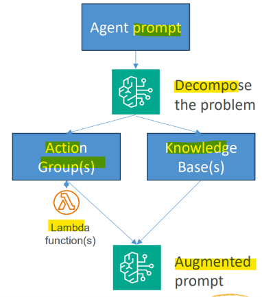

# Amazon Bedrock: Agents Classic

[Back](../index.md)

- [Amazon Bedrock: Agents Classic](#amazon-bedrock-agents-classic)
  - [Agents Classic](#agents-classic)
    - [Deploy Agents Classic](#deploy-agents-classic)

---

## Agents Classic

- Tools
  - In `Bedrock`, `Action Groups` define a tool
    - A `prompt` informs the `FM` when to use it
      - e.g., “Use this function to determine the current weather in a city”
    - You must **define the parameters** your tool (Lambda function) expects
      - Define **name, description, type**, and if it’s **required** or not
      - The **description** is actually important and will be **used by the LLM** to extract the required info from the user prompt
      - You can also allow the FM to go back and ask the user for missing information it needs for a tool
      - This can be done using **OpenAI-style schemas**, or visually with a table in the Bedrock UI
  - Agents may also have `knowledge bases` associated with them
    - Again, a `prompt` tells the LLM when it should use it
      - e.g., “Use this for answering questions about X”
      - This is “agentic RAG” – RAG is just another tool
  - Optional `Code Interpreter` allows the agent to **write its own code** to answer questions or produce charts.

---

### Deploy Agents Classic

- `Bedrock Agents Classic` is being replaced by `AgentCore` more on that later.
- Create an `alias` for an agent
  - This creates a **deployed snapshot**
- `On-Demand throughput (ODT)`
  - Allows agent to **run at quotas set** at the account level
- `Provisioned throughput (PT)`
  - Allows you to purchase an increased rate and number of **tokens** for your agent
- Your application can use the `InvokeAgent` request using your `alias ID` and an Agents for Amazon Bedrock `Runtime Endpoint`.
