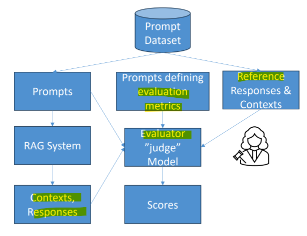

# Amazon Bedrock: Evaluation

[Back](../index.md)

- [Amazon Bedrock: Evaluation](#amazon-bedrock-evaluation)
  - [Bedrock Agents Classic Evaluation](#bedrock-agents-classic-evaluation)
  - [Bedrock Model Evaluations](#bedrock-model-evaluations)
  - [Deployment Validation](#deployment-validation)
  - [Responsible AI](#responsible-ai)
    - [AWS Tools for Responsible AI](#aws-tools-for-responsible-ai)

---

## Bedrock Agents Classic Evaluation

- Every `Agent` **response includes a `trace`**
  - Shows its **“reasoning” process**
  - What `knowledge bases` did it hit, what did it get back
  - How did it use `action groups`
  - **Error** details
- Different trace **types**:
  - **PreProcessing**:
    - categorizing user **input**
  - **Orchestration**:
    - Calling `action groups` and `knowledge bases`
  - **PostProcessing**:
    - Collect **final response**
  - **CustomOrchestration**:
    - Determining **order of actions**
  - **RoutingClassifier**:
    - How it **classified and routed** the request
  - **Failure**:
    - Why a step **failed**
  - **Guardrail**:
    - What your **guardrails** did

- example trace json:

```json
{
  "orchestrationTrace": {
    "observation": {
      "actionGroupInvocationOutput": {
        "metadata": {
          "clientRequestId": "75f5e9fc-6981-4887-a793-77bbd3bd83af",
          "endTime": "2025-06-19T01:56:04.191408Z",
          "startTime": "2025-06-19T01:56:03.929317Z",
          "totalTimeMs": 262
        },
        "text": "The function get_time was called successfully. The current time is 01:56:04"
      },
      "traceId": "1776395b-435a-4c3a-b66c-4ab947f9dc6c0",
      "type": "ACTION_GROUP"
    }
  }
}
```

---

## Bedrock Model Evaluations

- **Automatic** model evaluations
  - Tons of built-in task types, datasets, and metrics (seen here)
  - Text generation, summarization, Q&A, classification
- **Human**-based
  - **Humans compare** two models
    - Given your prompt dataset
  - Set up a work team in Cognito, SageMaker Ground Truth, or Amazon Augmented AI

- **LLM as a judge**
  - **Evaluator model** and **generator model**
  - You provide a prompt dataset
  - Many metrics available – we talked about this before
- **RAG evaluation jobs**
  - **Retrieve only** – measures **retrieval** from your RAG source
    - Relevance and coverage
  - **Retrieve and generate** – Measures the **response** as well
    - Correctness, completeness, helpfulness, logical coherence, etc.
  - Provide a **prompt dataset** in `S3` in JSON line format
  - You can add your own metrics (based on prompts for the judge model)



---

## Deployment Validation

- **Synthetic user workflows**
  - `Unit testing` often doesn’t good enough, because GenAI is **nondeterministic**
  - **Simulate** end to end usage of your application
    - **Before and after deployments**
  - Some useful tools
    - `Cloudwatch synthetic monitoring` (canaries,)
    - `Step Functions`,
    - `EventBridge`,
    - `Lambda`
  - Store results in `S3` / `Athena`, **analyze** in `QuickSight`
- **AI-Specific output validation**
  - Measure **hallucination rate**, **semantic drift**, **faithfulness**, **compliance**, etc.
  - `Bedrock Model Evaluations` does this
  - You could roll your own with `Lambda` + `Step Functions`
- **Checking response consistency**
  - Best you can do is make sure **style is consistent**, answers are **similar** for a test prompt dataset
  - Test that **variability** is within an **accepted range**

---

## Responsible AI

- `Responsible AI`
  - a set of **principles, practices, and governance frameworks** used to **build, deploy, and oversee** artificial intelligence safely, ethically, and legally.
  - aims to **maximize** AI's **benefits** while **reducing** harm, bias, and risk across the entire AI lifecycle.

- Core Dimensions
  - **Fairness**: Minimizing bias
  - **Explainability**
  - **Privacy** and **Security**
  - **Safety**
  - **Controllability**
  - **Veracity** and **Robustness**
  - **Governance**
  - **Transparency**

---

### AWS Tools for Responsible AI

- `Amazon Bedrock`
  - **Model evaluation** tools
- `SageMaker Clarify`
  - **Bias** detection
  - **Model evaluation**
  - **Explainability**
- `SageMaker Model Monitor`
  - Get **alerts** for **inaccurate responses**
- `Amazon Augmented AI`
  - Insert **humans in the loop** to help correct results
- `SageMaker ML Governance`
  - `SageMaker Role Manager`
  - Model
  - Model Dashboard
