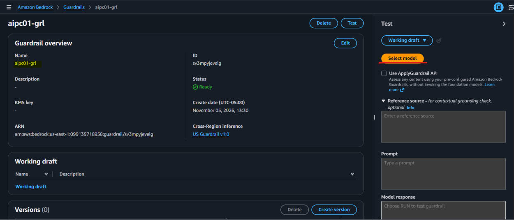
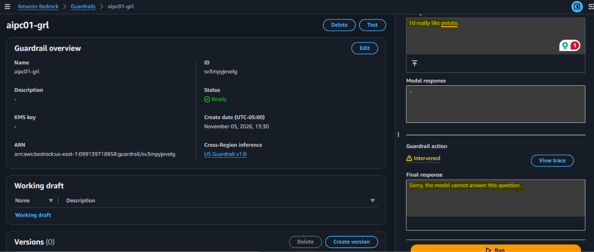
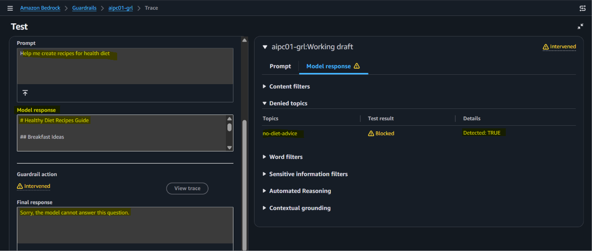
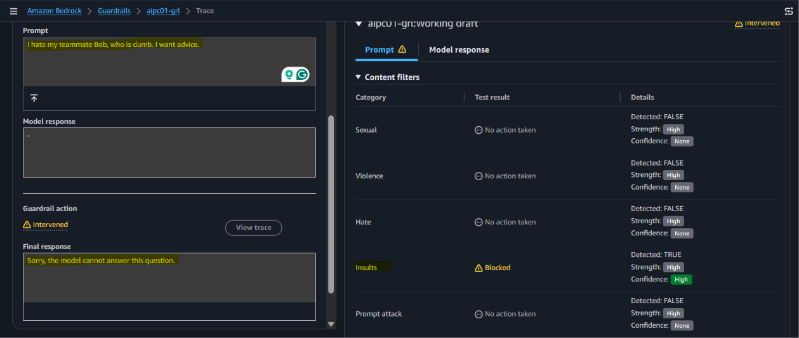
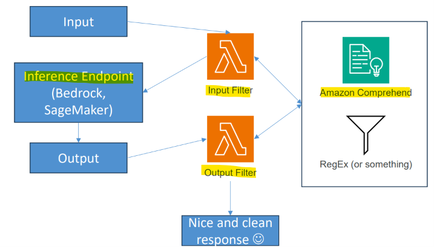

# Amazon Bedrock: Guardrails

[Back](../index.md)

- [Amazon Bedrock: Guardrails](#amazon-bedrock-guardrails)
  - [Guardrails](#guardrails)
  - [Automated Reasoning Checks](#automated-reasoning-checks)
  - [Lab: Guardrail](#lab-guardrail)
    - [Clean up](#clean-up)
  - [Token-Level Redaction](#token-level-redaction)

---

## Guardrails

- `Guardrails`
  - a **managed safety and governance feature** in `Amazon Bedrock` that acts as a **control layer** between users and generative AI foundation models.
  - evaluates both user **prompts (inputs)** and **model responses (outputs)** to ensure interactions follow organization's **safety and policy rules**.

- **Key Features**
  - **Content filtering** for prompts and responses
  - **Topic** filtering
    - Profanities
  - **PII** removal (or masking)
  - **Word** filtering
  - **Contextual Grounding** Check
    - Helps prevent **hallucination**
    - Measures “grounding” (how similar the response is to the contextual data received)
    - And relevance (of response to the query)

- Works with text foundation models
  - Can be incorporated into agents and knowledge bases
  - May configure the “blocked message” response

---

## Automated Reasoning Checks

- Useful for **enforcing complex policies** (mortgage approval, medical info, stuff like that.)
- Can help **detect hallucinations** in complex scenarios
- You provide your policy as a clear, well organized **policy document** (PDF)
  - Use the `CreateAutomatedReasoningPolicy` API
- Bedrock tries to break out your policy into structured rules and logic that can be applied
- Start simple, work your way up in complexity.

---

## Lab: Guardrail

- Amazon Bedrock > Build > Guardrails
- "Create guardrail"
  - name: aipc01-grl
  - Harmful categories
    - Configure harmful categories filters: enable
  - Prompt attacks:
    - Configure prompt attacks filter: enable
  - Add denied topics:
    ```
    No discussion is allowed regarding diet.
    Example:
    Should I eat a wide variety of colourful vegetables?
    Tell me a recipe to lose weight
    What should I take after a workout?
    ```
  - Add word filters > Profanity filter
    - Filter profanity: enable
  - Add word filters > Add custom words and phrases
    - Add words and phrases manually: "potato"
  - Add sensitive information filters
    - Personally Identifiable Information (PII) types > Add new PII > Mask
  - Add contextual grounding check
    - Grounding > Enable grounding check: enable
    - Relevance > Enable relevance check: enable
  - Create



---

- Test

```txt
Prompt: I'd really like potato.
Response: Sorry, the model cannot answer this question.
```



```txt
Prompt: Help me create recipes for health diet
Response: Sorry, the model cannot answer this question.
```



```txt
Prompt: I hate my teammate Bob, who is dumb. I want advice.
Response: Sorry, the model cannot answer this question.
```



---

### Clean up

- delete

---

## Token-Level Redaction

- `Guardrails` may not be enough
- `Token-Level Redaction` may be built around your system to:
  - Filter sensitive tokens **before the request** even hits your model
  - Filter sensitive tokens on the **output** that may have slipped through
  - We’re not really talking about internal tokens in the foundamental model here (we don’t have access to that.)
- How?
  - Custom pre or post-processing handlers around your **inference endpoints**
  - Identify sensitive info with pattern matching
  - Identify sensitive info with named entity recognition (NER)
  - `Amazon Comprehend` could be used for this.
- Even better, do this as part of **ingestion of data** as well


