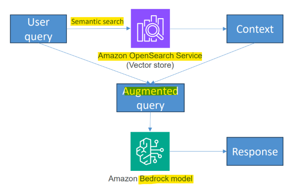
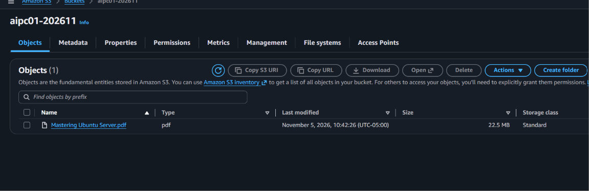
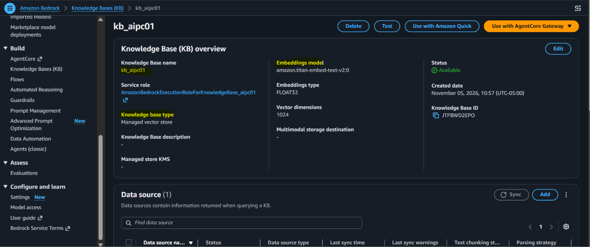
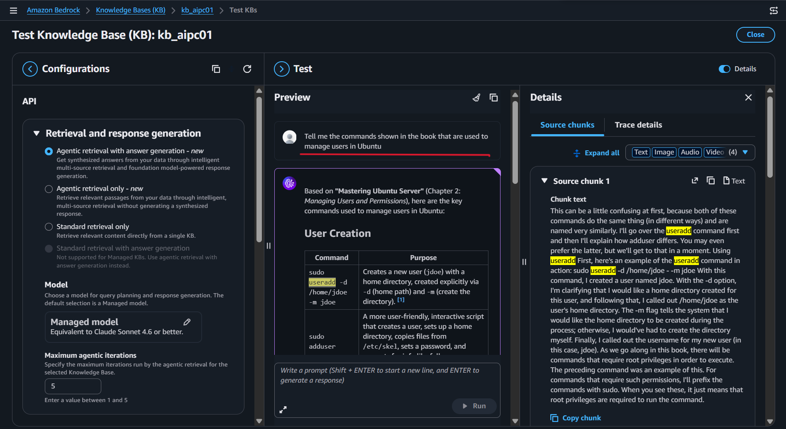
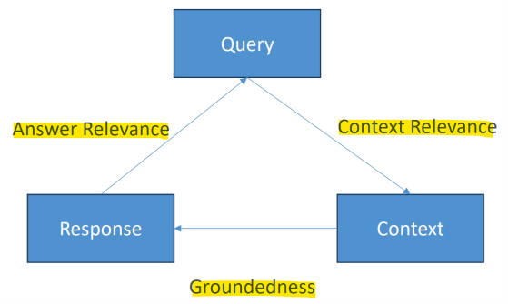

# Amazon Bedrock: Knowledge Bases

[Back](../index.md)

- [Amazon Bedrock: Knowledge Bases](#amazon-bedrock-knowledge-bases)
  - [Knowledge Bases](#knowledge-bases)
  - [Lab: KB](#lab-kb)
    - [Create bucket](#create-bucket)
    - [Create KB](#create-kb)
    - [Clean up](#clean-up)
  - [Chunking in KB](#chunking-in-kb)
    - [Standard Chunking](#standard-chunking)
    - [Hierarchical Chunking](#hierarchical-chunking)
    - [Semantic Chunking](#semantic-chunking)
  - [Practice: Optimizing Embeddings](#practice-optimizing-embeddings)
    - [Vector sizes](#vector-sizes)
    - [Metadata](#metadata)
    - [Keeping KB Up to Date](#keeping-kb-up-to-date)
  - [Evaluation](#evaluation)
  - [Multimodal Models and Pipelines](#multimodal-models-and-pipelines)

---

## Knowledge Bases

- `Knowledge Bases`
  - a feature in Bedrock that **connects data** to foundation models **using RAG**.
  - connects and coordinates components:
    - `S3`: Stores original documents.
    - `Embedding model`: Converts chunks and questions into vectors.
    - `Vector store`: Stores embeddings and finds similar chunks.
    - `Generation model`: Writes the answer using retrieved information.
- Common use cases
  - build a chatbot that answers questions **using company policies stored in S3**.

- **Prepare:** S3 documents → split into chunks → create **embeddings** → **vector store**
  - can **upload** documents or structured data (via S3, maybe with a JSON schema) into Bedrock `Knowledge Bases`
    - Other sources: web crawler, Confluence, Salesforce, SharePoint
  - Must use an `embedding model`
    - obtained model **access**
    - e.g., Cohere or Amazon Titan
    - can control the **vector dimension**
  - vector store
    - For **development**, a **serverless** `OpenSearch` instance may be used **by default**
    - can be `MemoryDB`, `Aurora`, `MongoDB Atlas`, `Pinecone`, `Redis Enterprise Cloud`
    - can control the `chunking`: How many tokens are represented by each vector

- **Inference:** User question → embed question → **retrieve** relevant chunks → send question + chunks to LLM → answer with citations
  - key API calls:
    - `Retrieve`: returns relevant **source chunks**; your application controls the generation step.
    - `RetrieveAndGenerate`: **retrieves** information and **generates** an answer with source citations.

---

## Lab: KB

### Create bucket

- create a new bucket named `aipc01-202611`
- upload book ubuntu

---

### Create KB

- Amazon Bedrock > Build > Knowledge Bases (KB)
- "Create Managed KB" > "Managed KB"
  - name: kb_aipc01
  - Embeddings model: Managed embeddings model
  - IAM role: `*_aipc01`
  - Data source: s3
    - named kb-data-source_aipc01
    - s3://aipc01-202611/Mastering Ubuntu Server.pdf
  - Content parsing and chunking:
    - Parsing strategy: Managed parser
    - Text chunking strategy: Default chunking
- Confirm

- Confirm in OpenSearch

- Test

---

### Clean up

- delete

---

## Chunking in KB

### Standard Chunking

- **Fixed Size**
  - specify tokens per chunk and overlap percentage
- **Default**
  - **300 tokens** per chunk, while honoring **sentence boundaries** (complete sentences preserved within each chunk)
- **No chunking**
  - Every document is a chunk
  - user pre-process the data to chunk it

### Hierarchical Chunking

- **Nested** parent/child chunks
- Initial search hits the **child chunks**
  - But then **replaces** them with **parent chunks** to **get more context** when appropriate
- The idea is to get **better precision** in retrieval from the smaller embeddings
  - But then **reclaim comprehensiveness** from the **parents**

### Semantic Chunking

- Use a **foundation model** to break up chunks **based on semantic content** and not just things like sentences or a fixed chunk size
- specify:
  - **Maximum** tokens (while honoring **sentence boundaries**)
  - **Buffer** size
    - Number of **surrounding sentences** per sentence to consider when embeddings
    - i.e., buffer size of 1 results in 3 sentences
    - Too large = introducing noise; too small = missing important context (but more precise)
  - Breakpoint **percentile threshold**
    - How “semantically similar” a chunk must be
    - Higher = more distinguishable chunks, less of them, larger chunks.
- This **costs money**; you’re **charged** for the underlying FM used for this

---

## Practice: Optimizing Embeddings

### Vector sizes

- **Smaller** vector sizes are a **good** way to **reduce cost**
  - **vector size** here, **not** chunk size
  - Smaller vectors = **fewer dimensions per chunk** = less cost
  - However there is a **tradeoff** with your retrieval **performance**
- `Amazon Titan` has a default of **1024+ dimensions**
  - This might be more than you need!
  - Balance dimensionality with **domain fit**
    - Are the semantic concepts you are searching for really that complex?

---

- **Sparse vs. Dense Embeddings**

- `Sparse` = large vectors that are mostly empty
  - e.g, One-hot encoding
- `Dense` = **smaller** vectors that contain **more semantic** information
  - This is what you generally use
- There is a **tradeoff**
  - **Sparse vectors** give greater **similarity factors**
  - **Dense vectors** are more **efficient** (in memory, and in general)
  - Classical AI systems have ways to **compress sparse vectors**
- `similarity factor`
  - the measure of **how close two vectors are**
  - A common one is `cosine similarity`
  - Remember your trig? Cosine is related to the angle between two vectors.
  - And it has a nice smoothness to it

---

### Metadata

- Your vector DB can store more than just vectors and the raw text of the chunk
- `Bedrock Knowledge Bases` can treat certain columns as **content vs. metadata**
- Pass in a `metadata.json` file to specify what’s what
- This makes sure you **aren’t chunking up metadata** (like creation date) but can still retrieve it
- If you add **metadata tags** for things like topics, what section of the document we’re in, etc… you can use this for better retrieval too.
  - **Relevance scoring** against metadata can be used for **ranking**
- Other examples of metadata
  - Document ID, category, access control, data lineage, additional context

---

### Keeping KB Up to Date

- New or changed content can **trigger a Lambda function**
  - This Lambda function can then **generate new embeddings**
- **Batch**-generate them for greater **efficiency**
- Instead of syncing on every change, maybe you can do so on a **schedule**

---

## Evaluation

- `Bedrock` includes **RAG evaluation jobs**, that can measure:
  - Correctness (accuracy in answering questions)
  - Completeness
  - Helpfulness
  - Logical coherence
  - Faithfulness (How well responses align with the retrieved text)
  - Citation precision and coverage
  - Harmfulness, Stereotyping
  - Refusal (Is it evasive when answering questions?)

- provide a **prompt dataset** for evaluation (in json)
  - This includes both **prompts** and **reference responses**
  - Optionally you can also provide **reference contexts** for the ideal ground truth you expect to be retrieved from your knowledge base
- LLM as a judge!
  - Specific **metrics** are defined within prompts to another model (Llama, Claude, Nova, Mistral)
  - Different models will score in different ways
    - This is all documented; specifics not important for the exam.

---

## Multimodal Models and Pipelines

- `multimodal`
  - mixing different media types
    - Text, images, audio, video, documents, whatever
    - For example, a model could contain accept text, a scanned image of some text, someone saying something, a PDF, etc.
- Requires `specialized encoders` for each type
- Some models available for Bedrock are multimodal
  - Claude, Nova, Titan for example
- `Multimodal embedding models` can conv**ert different media types** into compatible **embedding vectors**.
- To search, hit the **model** for an `embedding vector` for the image / text / video / whatever, and find the **closest match** in the vector DB.

---

- Preparing multi-modal input data
  - For `Titan Multimodal Embeddings G1`, you need to pass in **structured JSON**
- the **data processing pipeline** needs to perform this conversion at some point
  - SageMaker? Glue? We’ll get to that.
