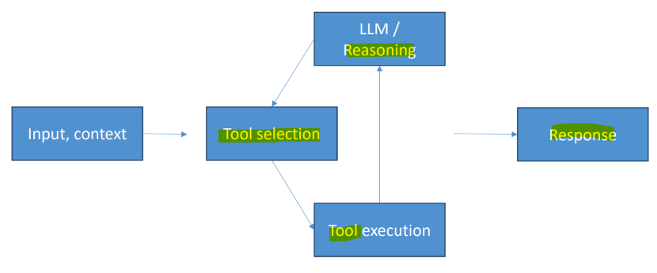
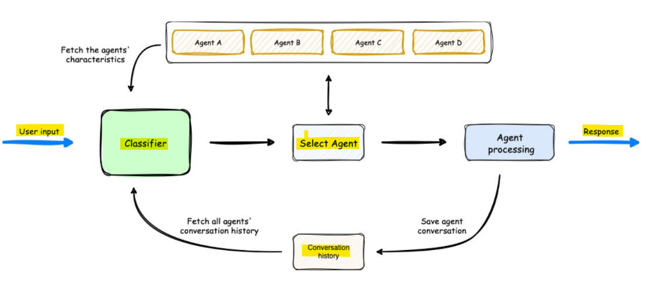

# Amazon Bedrock: Strands Agents

[Back](../index.md)

- [Amazon Bedrock: Strands Agents](#amazon-bedrock-strands-agents)
  - [Strands Agents](#strands-agents)
    - [Strands Agent Loop](#strands-agent-loop)
  - [AWS Agent Squad](#aws-agent-squad)

---

## Strands Agents

- `Strands Agents`
  - an **open-source AI agent SDK** and developer toolkit designed to **build, run, and scale** production `AI agents` using a lightweight, model-driven approach.
  - like `OpenAI Agents SDK`, `CrewAI`, `LangGraph`, `Google ADK`
  - Released by Amazon as open source

- You can create **specialized** agents and **multiagent** systems
  - Complex **task decomposition**
  - **Collaborative** problem solving
- Of course it has tighter **AWS integration**
  - Bedrock models, Lambda, Step Functions, and more
- But it’s not tied to AWS
  - You can use it with `OpenAI` and others if you want to
- **Multimodal** support
  - text, speech, images, video
- `MCP (Model Context Protocol)` support

- Strands Built-in Tools
  - AWS Services / `boto3`
  - RAG and memory in `Bedrock Knowledge Bases`
  - `Mem0` **agent memory** and personalization
  - Run Python **code**
  - **http** (call anything external)
  - Run **shell commands**
  - Manipulate **files**
  - Coordinate **agent swarms**
  - **Speak** (with Amazon Polly)

---

### Strands Agent Loop

- planning → tool usage → response generation

---

## AWS Agent Squad

- `AWS Agent Squad`
  - an open-source framework used to **route** user prompts and **manage conversations** across **multiple** specialized AI agents.

- Intelligent **intent classification**
  - **Routes** queries to the right `agent`
- Python and TypeScript
- **Shares contexts** across agents
- Many **pre-built agents** and **classifiers**
- **Integrates** with `Bedrock Agents`
- Can **extend** `Bedrock Flows`
  - Conversation memory, orchestration
- `Supervisor Agent`
  - **Coordinates** multiple specialized agents (like `Strands`!)
- `Agent Squad` is focused on **routing**; `Strands` on **tool use** in a **single agent loop**

