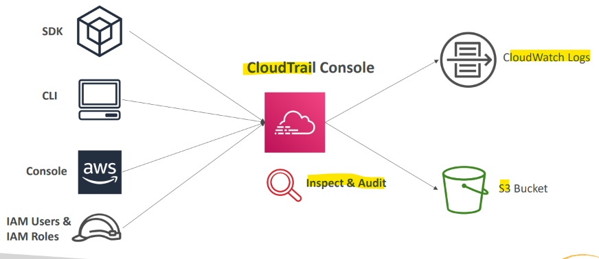
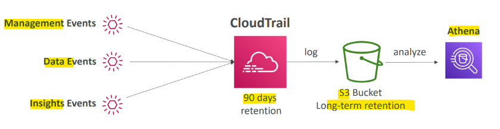

# Amazon CloudTrail

[Back](../index.md)

- [Amazon CloudTrail](#amazon-cloudtrail)
  - [Amazon CloudTrail](#amazon-cloudtrail-1)
  - [Events](#events)
    - [Events Retention](#events-retention)
  - [with GenAI](#with-genai)

---

## Amazon CloudTrail

- `AWS CloudTrail`
  - the service that **records user activity and API calls** across your AWS account to support **auditing, security monitoring, governance, and troubleshooting**.
  - Every event log captures details such as **who** made the request, **what action** occurred, **when** it happened, the source **IP address**, and affected **resources**.

- Provides **governance, compliance and audit** for your AWS Account
- **enabled** by **default**!
- Get an **history of events / API calls** made within your AWS Account by:
  - Console
  - SDK
  - CLI
  - AWS Services
- Can put logs from `CloudTrail` into `CloudWatch Logs` or `S3`
- A trail can be applied to **All Regions** (**default**) or a **single Region**.
- If a resource is deleted in AWS, **investigate `CloudTrail` first**!

---

## Events

- 3 types of events

- `Management Events`:
  - **Operations** that are performed on resources in your AWS account
  - Examples:
    - Configuring security (IAM AttachRolePolicy)
    - Configuring rules for routing data (Amazon EC2 CreateSubnet)
    - Setting up logging (AWS CloudTrail CreateTrail)
  - **By default**, trails are configured to **log management events**.
  - Can **separate** `Read Events` (that **don’t modify** resources) from **Write Events** (that may **modify** resources)
- `Data Events`:
  - By **default**, `data events` are **not logged** (because high volume operations)
  - e.g.,
    - `Amazon S3` **object-level activity** (ex: `GetObject`, `DeleteObject`, `PutObject`): can **separate Read and Write Events**
    - `AWS Lambda` function **execution activity** (the `Invoke` API)

- `CloudTrail Insights Events`:
  - **Enable** `CloudTrail Insights` to **detect unusual activity** in your account:
    - inaccurate resource **provisioning**
    - hitting service **limits**
    - **Bursts** of AWS IAM actions
    - **Gaps** in periodic maintenance activity
  - `CloudTrail Insights` **analyzes normal** management events to create a **baseline**
  - And then continuously **analyzes write events** to **detect unusual** patterns
    - Anomalies **appear** in the **CloudTrail console**
    - Event is **sent** to `Amazon S3`
    - An `EventBridge` event is **generated** (for automation needs)

---

### Events Retention

- Events are **stored for 90 days** in CloudTrail
- To keep events beyond this period, **log** them to `S3` and use `Athena`

---

## with GenAI

- `CloudTrail` can track all API calls to `Amazon Bedrock`
  - **Audit** trails of which **prompt resources** were used
  - **When** and by **who**
- This is often a compliance requirement
  - Yes, this stuff gets logged
