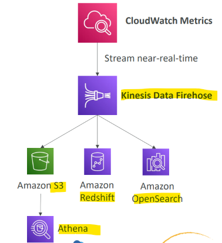
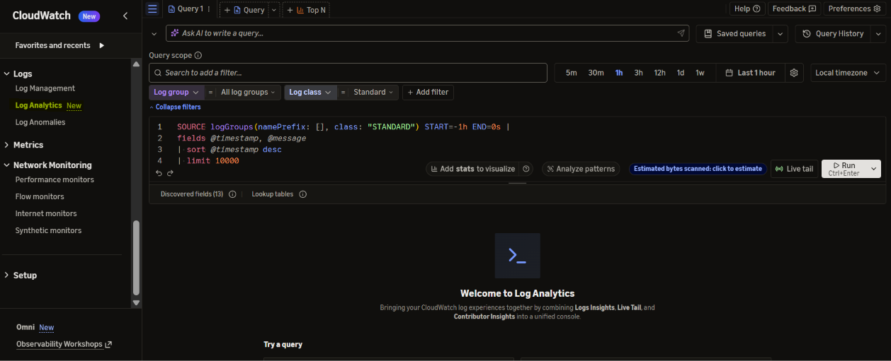
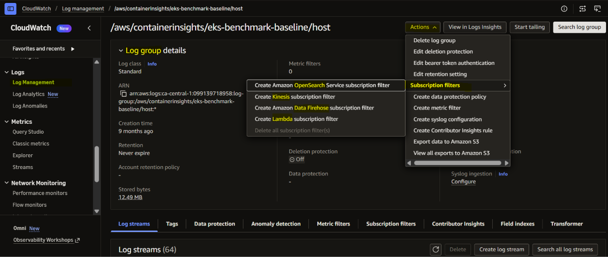
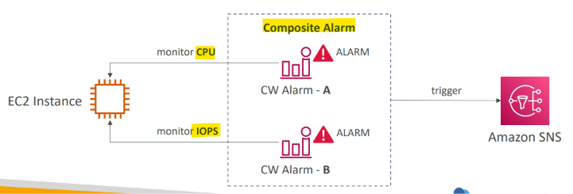
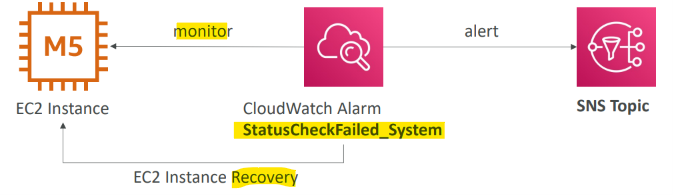

# Amazon CloudWatch

[Back](../index.md)

- [Amazon CloudWatch](#amazon-cloudwatch)
  - [Amazon CloudWatch](#amazon-cloudwatch-1)
  - [Metric](#metric)
    - [Metric Streams](#metric-streams)
  - [Logs](#logs)
    - [`Log Analytics` (formerly `Logs Insights`)](#log-analytics-formerly-logs-insights)
    - [S3 Export](#s3-export)
    - [Logs Subscriptions](#logs-subscriptions)
  - [Alarms](#alarms)
    - [Composite Alarms](#composite-alarms)
    - [Use case: EC2 Instance Recovery](#use-case-ec2-instance-recovery)
  - [Real User Monitoring (RUM)](#real-user-monitoring-rum)
  - [with GenAI](#with-genai)

---

## Amazon CloudWatch

- `Amazon CloudWatch`
  - a fully **managed monitoring and observability** service that tracks cloud resources, applications, and infrastructure.

- **Core Components**
  - `Metrics`:
    - **Numerical values** collected over time (such as EC2 CPU utilization, network traffic, or custom metrics).
    - belong to `namespaces`
      - one namespace per service
    - `Dimension`: an **attribute** of a metric (instance id, environment, etc…).
      - Up to **30** dimensions per metric
    - Can create CloudWatch **Custom** Metrics
  - `Logs`:
    - **Text records that store detailed** application and system events for near-real-time monitoring and **troubleshooting**.
  - **Events / EventBridge**:
    - Streams that track operational changes in AWS resources to trigger automated workflows.

- **Features**
  - **Alarms**:
    - Automated **alerts and notifications** that trigger when a metric or log query crosses a defined **threshold**.
  - **Dashboards**:
    - Customizable visual representations and graphs to monitor resources across multiple regions in a single view via the Using Amazon CloudWatch dashboards guide.
    - Can create `CloudWatch dashboards` of `metrics`
  - **Automated Actions**:
    - Direct integrations with services like `AWS Auto Scaling` or `AWS Lambda` to react to performance changes or scale resources automatically.
  - **Anomaly Detection & AI Observability**:
    - Machine learning-based anomaly detection and agent observability to trace multi-step workflows and model inference.

---

## Metric

### Metric Streams

- **Continually stream** `CloudWatch metrics` to a destination of your choice
  - **near-real-time delivery**
  - **low latency**.
  - `Amazon Kinesis Data Firehose` (and then its destinations)
  - 3rd party service provider: Datadog, Dynatrace, New Relic, Splunk, Sumo Logic…
- Option to **filter metrics** to only stream a subset of them



---

## Logs

- `Log groups`:
  - **arbitrary name**, usually **representing an application**
- `Log stream`:
  - **instances** within application / log files / containers
  - Can define log **expiration policies** (never expire, 1 day to 10 years…)
- `CloudWatch Logs` can **send logs to**:
  - Amazon S3 (exports)
  - Kinesis Data Streams
  - Kinesis Data Firehose
  - AWS Lambda
  - OpenSearch
- Logs are **encrypted** by default
  - Can setup **KMS-based encryption** with your own keys

---

- Log Sources
  - `SDK`, `CloudWatch Logs Agent`, `CloudWatch Unified Agent`
  - `Elastic Beanstalk`: collection of logs from **application**
  - `ECS`: collection from **containers**
  - `AWS Lambda`: collection from **function logs**
  - `VPC Flow Logs`: VPC specific logs
  - `API Gateway`
  - `CloudTrail` based on **filter**
  - `Route53`: Log DNS **queries**

---

### `Log Analytics` (formerly `Logs Insights`)

- **Search and analyze** log data stored in `CloudWatch Logs`
  - Example: find a specific IP inside a log, count occurrences of “ERROR” in your logs…
- Provides a purpose-built **query language**
  - Automatically **discovers fields** from AWS services and JSON log events
  - **Fetch** desired event fields, **filter** based on conditions, calculate **aggregate** statistics, **sort** events, **limit** number of events…
  - Can **save queries** and add them to `CloudWatch Dashboards`
- Can **query** multiple Log Groups in **different AWS accounts**
- It’s a query engine, **not a real-time engine**



---

### S3 Export

- Log data can take up to 12 hours to become available for export
- The API call is `CreateExportTask`
- **Not near-real time or real-time…**
  - real-time use case: use `Logs Subscriptions` instead

---

### Logs Subscriptions

- Get a **real-time log events** from CloudWatch Logs for processing and analysis
  - Send to `Kinesis Data Streams`, `Kinesis Data Firehose`, or `Lambda`
- `Subscription Filter`:
  - **filter** which logs are events delivered to your destination



---

## Alarms

- `Alarms` are used to **trigger notifications** for any **metric**
- Various options (sampling, %, max, min, etc…)
- Alarm **States**:
  - `OK`
  - `INSUFFICIENT_DATA`
  - `ALARM`
- **Period:**
  - **Length of time in seconds** to evaluate the metric
  - High resolution **custom** metrics: 10 sec, 30 sec or multiples of 60 sec

---

- **Targets**
  - Stop, Terminate, Reboot, or Recover an `EC2` Instance
  - Trigger **Auto Scaling Action**
    - `EC2` Auto Scaling group
    - `ECS` Service
  - Send **notification** to `SNS` (from which you can do pretty much anything)
  - `Lambda` action

---

- with `CloudWatch Logs`
  - Alarms can be created based on `CloudWatch Logs Metrics Filters`

- Test
  - To **test** alarms and notifications, set the **alarm state(`set-alarm-state`)** to Alarm using `CLI`
  ```sh
  aws cloudwatch set-alarm-state --alarm-name "myalarm" --statevalue ALARM --state-reason "testing purposes"
  ```

---

### Composite Alarms

- `CloudWatch Alarms` are on a **single metric**
- `Composite Alarms` are monitoring the states of **multiple other alarms**
  - `AND` and `OR` conditions
- Helpful to **reduce “alarm noise”** by creating complex composite alarms



---

### Use case: EC2 Instance Recovery

- Status Check:
  - **Instance status** = check the **EC2 VM**
  - **System status** = check the underlying **hardware**
  - Attached **EBS status** = check attached **EBS volumes**

- **Recovery**: Same Private, Public, Elastic IP, metadata, placement group



---

## Real User Monitoring (RUM)

- Mostly for testing **mobile apps** (iOS or Android)
  - Measures page load times, errors, app launch times, etc.
  - From a **real user session**
- Integrates with **Application Signals**
  - View results in `X-Ray` traces
- Relevant for measuring end to **end performance of your mobile GenAI apps**

---

## with GenAI

- used to
  - Testing prompt **regression**
  - Prompt inputs and model responses
  - Foundational to **monitoring and troubleshooting**
    - `CloudWatch log`
  - Monitor KPIs
    - Prompt effectiveness / response quality
    - Latency
    - Error rates

- Other things to monitor
  - Foundation model **interaction tracing**
  - **Business impact** metrics
  - **Prompt** effectiveness
  - **Hallucination** rates
  - **Anomaly** detection
    - **Token burst** patterns
    - **Response** drift
  - Bedrock model **invocation** logs
  - **Cost** anomaly detection

---
