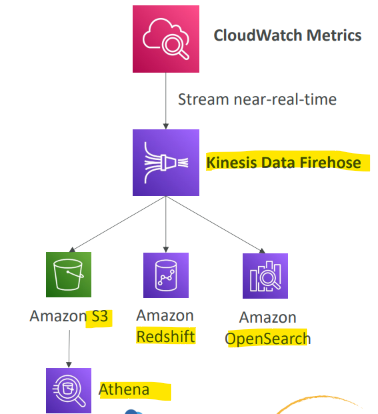

# Amazon CloudWatch

[Back](../index.md)

- [Amazon CloudWatch](#amazon-cloudwatch)
  - [Amazon CloudWatch](#amazon-cloudwatch-1)
  - [Metric Streams](#metric-streams)

---

## Amazon CloudWatch

- `Amazon CloudWatch`
  - a fully **managed monitoring and observability** service that tracks cloud resources, applications, and infrastructure.

- **Core Components**
  - `Metrics`:
    - **Numerical values** collected over time (such as EC2 CPU utilization, network traffic, or custom metrics).
    - belong to `namespaces`
      - one namespace per service
    - `Dimension`: an **attribute** of a metric (instance id, environment, etc…).
      - Up to **30** dimensions per metric
    - Can create CloudWatch **Custom** Metrics
  - **Logs**:
    - **Text records that store detailed** application and system events for near-real-time monitoring and **troubleshooting**.
  - **Events / EventBridge**:
    - Streams that track operational changes in AWS resources to trigger automated workflows.

- **Features**
  - **Alarms**:
    - Automated **alerts and notifications** that trigger when a metric or log query crosses a defined **threshold**.
  - **Dashboards**:
    - Customizable visual representations and graphs to monitor resources across multiple regions in a single view via the Using Amazon CloudWatch dashboards guide.
    - Can create `CloudWatch dashboards` of `metrics`
  - **Automated Actions**:
    - Direct integrations with services like `AWS Auto Scaling` or `AWS Lambda` to react to performance changes or scale resources automatically.
  - **Anomaly Detection & AI Observability**:
    - Machine learning-based anomaly detection and agent observability to trace multi-step workflows and model inference.

---

## Metric Streams

- **Continually stream** `CloudWatch metrics` to a destination of your choice
  - **near-real-time delivery**
  - **low latency**.
  - `Amazon Kinesis Data Firehose` (and then its destinations)
  - 3rd party service provider: Datadog, Dynatrace, New Relic, Splunk, Sumo Logic…
- Option to **filter metrics** to only stream a subset of them

