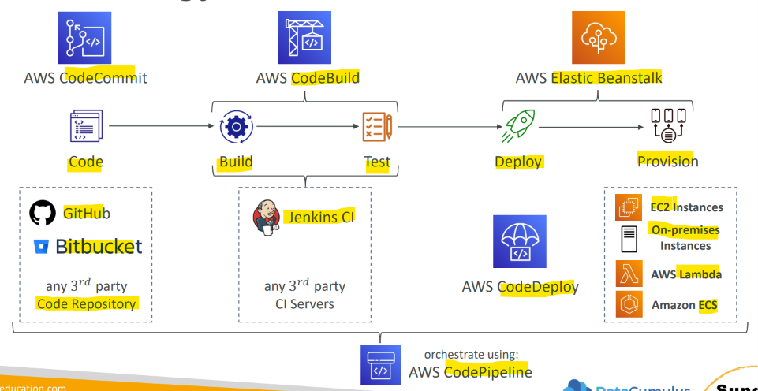
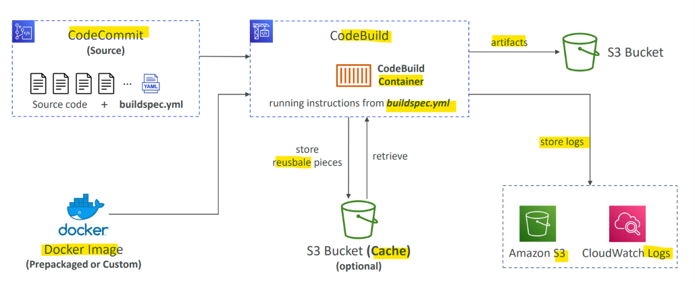
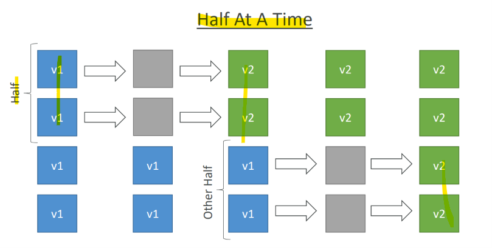
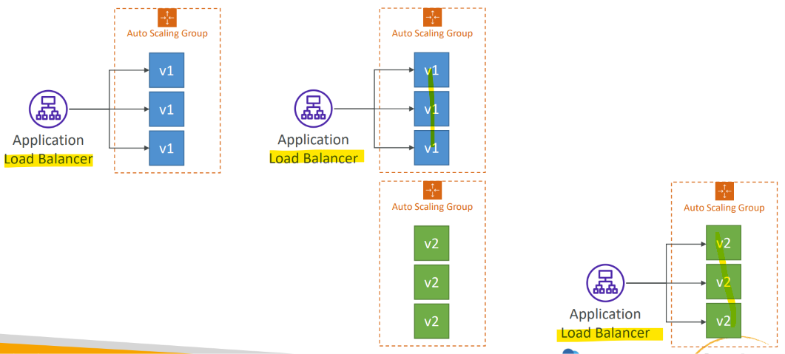
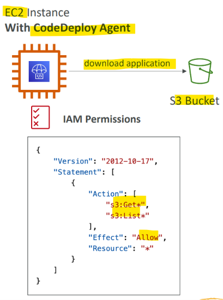
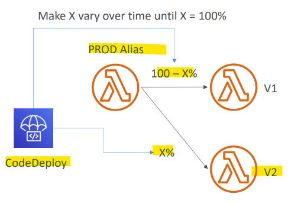
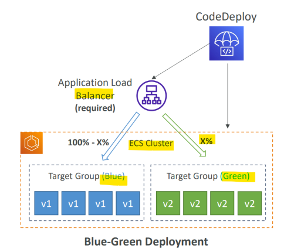

# AIP: CodePipeline

[Back](../index.md)

- [AIP: AppConfig](#aip-appconfig)
  - [AppConfig](#appconfig)

---

## CodePipeline

- Visual Workflow to **orchestrate CICD**
- **Source**: `CodeCommit`, `ECR`, `S3`, `Bitbucket`, `GitHub`
- **Build**: `CodeBuild`, `Jenkins`, `CloudBees`, `TeamCity`
- **Test**: `CodeBuild`, `AWS Device Farm`, 3rd party tools, …
- **Deploy**: `CodeDeploy`, `Elastic Beanstalk`, `CloudFormation`, `ECS`, `S3`, …
- **Invoke**: `Lambda`, `Step Functions`
- Consists of **stages**:
  - Each stage can have **sequential** actions and/or **parallel** actions
  - Example: Build ➔ Test ➔ Deploy ➔ Load Testing ➔ …
  - **Manual approval** can be defined at any stages

---

- `Artifacts`
  - the **packaged**, **immutable outputs** generated during the build and test **process** that move through the **delivery stages**.
    - e.g.,
      - compiled binaries,
      - Docker images,
      - JAR files,
      - or frontend bundles
  - Each pipeline stage can create artifacts
  - Artifacts **stored in an S3 bucket** and passed on to the next stage

---

### Troubleshooting

- For CodePipeline **Pipeline/Action/Stage Execution State** Changes
- Use `CloudWatch Events` (`Amazon EventBridge`).
  - Example:
    - You can **create events** for **failed** pipelines
    - You can **create events** for **cancelled** stages
- If `CodePipeline` **fails** a stage, your pipeline **stops**, and you can **get information** in the console
- If pipeline **can’t perform an action**, make sure the `IAM Service Role` attached does have **enough IAM permissions** (`IAM Policy`)
- AWS `CloudTrail` can be used to **audit** AWS API calls

---

## CodeBuild

- A fully managed `continuous integration (CI)` service
- **Continuous scaling**
  - **no servers** to manage or provision – no build queue
- **Compile** source code, run **tests**, produce software **packages**, …
- Alternative to other build tools
  - e.g., `Jenkins`
- Charged **per minute** for compute resources
  - time it takes to complete the builds
- Leverages `Docker` **under the hood** for reproducible builds
- Use **prepackaged** `Docker images` or create your own **custom Docker image**
- Security:
  - Integration with KMS for **encryption** of build **artifacts**
  - `IAM` for `CodeBuild` **permissions**, and `VPC` for **network security**
  - AWS `CloudTrail` for API calls **logging**

---

- **Source**:
  - `CodeCommit`, `S3`, `Bitbucket`, `GitHub`
- Build instructions:
  - Code file `buildspec.yml`
  - insert **manually** in Console
- **Output logs** can be stored in `Amazon S3` & `CloudWatch Logs`
- Use `CloudWatch Metrics` to monitor build **statistics**
- Use `EventBridge` to detect failed builds and **trigger notifications**
- Use `CloudWatch Alarms` to **notify** if you need **“thresholds”** for failures
- `Build Projects` can be **defined** within `CodePipeline` or `CodeBuild`

- Supported Environments
  - Java
  - Ruby
  - Python
  - Go
  - Node.js
  - Android
  - .NET Core
  - PHP
  - Docker – extend any environment you like

---

### How it Works

---

### buildspec.yml

- `buildspec.yml` file must be **at the root** of your code
- `env`: define **environment variables**
  - `variables`: **plaintext variables**
  - `parameter-store`: variables stored in `SSM Parameter Store`
  - `secrets-manager`: variables stored in `AWS Secrets Manager`
- `phases`: specify **commands to run**:
  - `install`: install **dependencies** you may need for your build
  - `pre_build`: **final commands** to execute **before build**
  - `Build`: actual **build commands**
  - `post_build`: **finishing** touches (e.g., zip output)
- `artifacts`: what to **upload** to S3 (encrypted with KMS)
- `cache`: files to **cache** (usually dependencies) to S3 for future build speedup

---

## CodeDeploy

- **Deployment service** that automates application deployment
- Deploy new applications versions to `EC2` Instances, **On-premises** servers, `Lambda` functions, `ECS` Services
- **Automated** `Rollback` capability in case of failed deployments, or **trigger** `CloudWatch Alarm`
- **Gradual deployment** control
- A file named `appspec.yml `defines how the deployment happens

---

### EC2/On-premises Platform

- Can deploy to `EC2` Instances & **on-premises servers**
- Perform `in-place deployments(就地部署)` or `blue/green deployments`
- Must run the `CodeDeploy Agent` on the target instances
- Define deployment speed
  - `AllAtOnce`: most **downtime**
  - `HalfAtATime`: reduced **capacity by 50%**
  - `OneAtATime`: **slowest**, lowest **availability** impact
  - `Custom`: define **your %**

- Blue-Green Deployment

---

#### CodeDeploy Agent

- The `CodeDeploy Agent` must be running on the **EC2 instances** as a pre-requisites
- It can be **installed and updated automatically** if you’re using `Systems Manager`
- The `EC2` Instances must have sufficient **permissions to access** Amazon `S3` to get deployment bundles

---

### Lambda Platform

- `CodeDeploy` can help you **automate traffic shift** for `Lambda aliases`
- **Feature** is integrated within the `SAM` framework
- `Linear`:
  - grow traffic **every N minutes** until 100%
  - `LambdaLinear10PercentEvery3Minutes`
  - `LambdaLinear10PercentEvery10Minutes`
- `Canary`:
  - try **X percent** then 100%
  - `LambdaCanary10Percent5Minutes`
  - `LambdaCanary10Percent30Minutes`
- `AllAtOnce`:
  - immediate

---

### ECS Platform

- `CodeDeploy` can help you **automate** the deployment of a **new** ECS `Task Definition`
- **Only** `Blue/Green Deployments`
- `Linear`:
  - grow **traffic** **every N minutes** until 100%
  - `ECSLinear10PercentEvery3Minutes`
  - `ECSLinear10PercentEvery10Minutes`
- `Canary`:
  - try **X percent** then 100%
  - `ECSCanary10Percent5Minutes`
  - `ECSCanary10Percent30Minutes`
- `AllAtOnce`:
  - immediate

