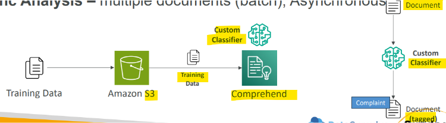
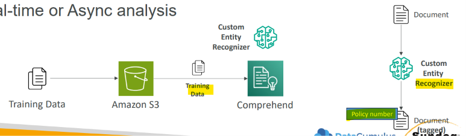
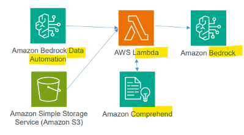

# Amazon Comprehend

[Back](../index.md)

- [Amazon Comprehend](#amazon-comprehend)
  - [Amazon Comprehend](#amazon-comprehend-1)
  - [Custom Classification](#custom-classification)
  - [Named Entity Recognition (NER)](#named-entity-recognition-ner)
  - [Integration: Using `Comprehend` and `Lambda` for Data Quality](#integration-using-comprehend-and-lambda-for-data-quality)
  - [Comprehend Medical](#comprehend-medical)

---

## Amazon Comprehend

- `Amazon Comprehend`
  - a fully managed artificial intelligence and **`natural language processing(NLP)` service** provided by Amazon Web Services (AWS) that **extracts** hidden **insights, structure**, and meaning from **text data**.
  - Fully managed and **serverless** service

- **Capabilities**
  - **Entity Recognition**:
    - Detects names, places, brands, dates, and custom-defined **entities** within text.
  - **Sentiment Analysis**:
    - Determines whether the **tone** of a piece of text is positive, negative, neutral, or mixed.
  - **`PII` Detection & Redaction:**
    - Automatically **identifies and redacts** sensitive Personally Identifiable Information (such as bank details, social security numbers, or addresses).
  - **Keyphrase Extraction**:
    - Pulls out main **talking points** and **key phrases** from documents.
  - **Language Detection**:
    - Identifies the primary language of the input text.
  - **Syntax Analysis**:
    - Breaks down text by **parts of speech** (nouns, verbs, adjectives).
    - Automatically **organizes** a collection of text files **by topic**

- Sample use cases:
  - analyze customer interactions (emails) to find what leads to a **positive or negative** experience
  - Create and groups articles by **topics** that Comprehend will uncover

---

## Custom Classification

- **Organize** documents **into categories (classes)** that you define
  - e.g., categorize customer emails so that you can provide guidance based on the type of the customer request
- Supports different **document types** (text, PDF, Word, images...)
- **Real-time Analysis**: single document, synchronous
- **Async Analysis**: multiple documents (batch), Asynchronous

---

## Named Entity Recognition (NER)

- `Named Entity Recognition (NER)`
  - **Extracts** predefined, general-purpose entities like people, places, organizations, dates, and other standard categories, from text
- **Analyze** text for **specific terms and noun-based phrases**
  - e.g., **Extract** terms like policy numbers, or phrases that imply a customer escalation, anything specific to your business
- **Train the model** with **custom data** such as a list of the entities and documents that contain them
- Support:
  - **Real-time** analysis
  - **Async** analysis

---

## Integration: Using `Comprehend` and `Lambda` for Data Quality

- A `Lambda` function can **call** `Amazon Comprehend` before data hits `Bedrock` to…
  - Redact `PII`
  - **Extract** entities
  - Detect **language**
  - **Classify** the data
- Example applications
  - **Clean up transcripts** before going into a `Knowledge Base`
  - **Pre-screen** user-generated **content** before feeding it to an `agent`

---

## Comprehend Medical

- A **HIPAA-certified version** of Comprehend **for medical use**
- **Pre-trained** for **extracting health data** as entities
  - prescriptions,
  - procedures,
  - diagnoses,
  - `protected health information (PHI)`
- Separate API for PHI
  - `DetectPHI` instead of `DetectEntities`
- Can **search** for specific medical ontologies
- **Individual** documents or **batch** in `S3`
- Integrates with `VPC Endpoints` / `PrivateLink` for security
- Could potentially be used in a **postprocessing** scenario to **detect PHI**
