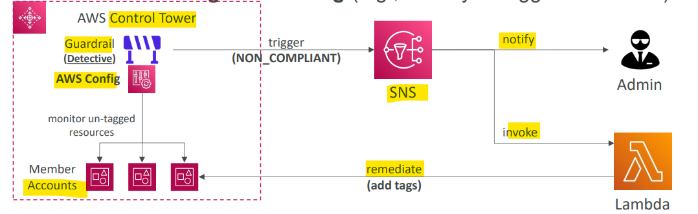

# Security: Control Tower

[Back](../index.md)

- [Security: Control Tower](#security-control-tower)
  - [Control Tower](#control-tower)
    - [Guardrails](#guardrails)

---

## Control Tower

- `Control Tower`
  - **sets up and governs a secure, compliant multi-account AWS environment** using best practices.
  - **automates account creation** and **enforces ongoing compliance rules** across your organization.

- Easy way to **set up and govern a secure and compliant multi-account AWS environment** based on **best practices**
- `AWS Control Tower` uses `AWS Organizations` to create accounts

- Benefits:
  - **Automate** the set up of your environment in a few clicks
  - Automate **ongoing policy management** using `guardrails`
  - **Detect policy violations** and **remediate** them
  - **Monitor compliance** through an interactive dashboard

---

### Guardrails

- Provides **ongoing governance** for your Control Tower environment (AWS Accounts)

- 2 types
  - `Preventive Guardrail`
    - using `Service Control Policies (SCPs)`
    - e.g., Restrict Regions across all your accounts
  - `Detective Guardrail`
    - using `AWS Config`
    - e.g., identify untagged resources
      
