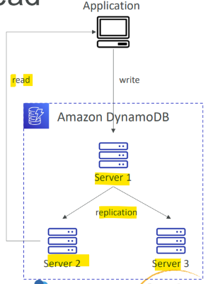
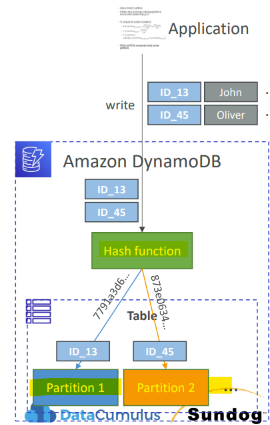
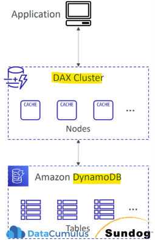
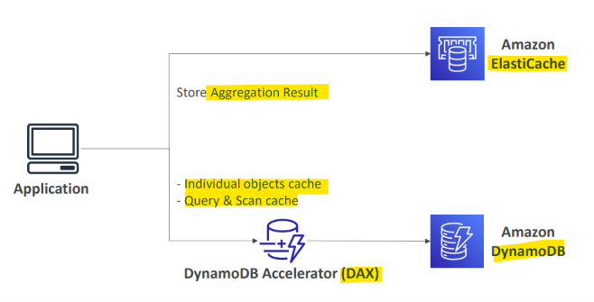
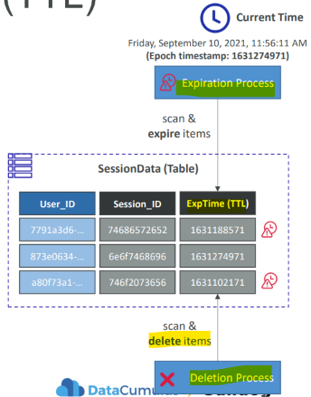
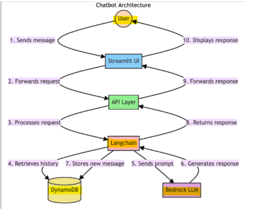
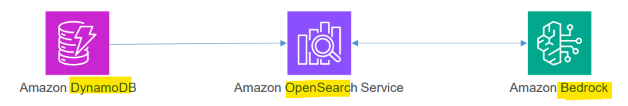

# AIP: DynamoDB

[Back](../index.md)

- [AIP: DynamoDB](#aip-dynamodb)
  - [SQL vs NoSQL](#sql-vs-nosql)
    - [Traditional Architecture](#traditional-architecture)
    - [NoSQL databases](#nosql-databases)
  - [DynamoDB](#dynamodb)
    - [Key Components](#key-components)
    - [Primary Keys](#primary-keys)
  - [Read/Write Capacity Modes](#readwrite-capacity-modes)
    - [Capacity Modes – Provisioned](#capacity-modes--provisioned)
      - [`Write Capacity Units`](#write-capacity-units)
      - [Strongly Consistent Read vs. Eventually Consistent Read](#strongly-consistent-read-vs-eventually-consistent-read)
      - [`Read Capacity Units (RCU)`](#read-capacity-units-rcu)
      - [Partitions Internal](#partitions-internal)
      - [Throttling](#throttling)
    - [Capacity Modes - On-Demand](#capacity-modes---on-demand)
  - [DynamoDB APIs](#dynamodb-apis)
    - [Writing Data](#writing-data)
    - [Reading Data](#reading-data)
    - [Deleting Data](#deleting-data)
    - [Batching](#batching)
  - [PartiQL](#partiql)
  - [DynamoDB Accelerator (DAX)](#dynamodb-accelerator-dax)
    - [Accelerator (DAX) vs. ElastiCache](#accelerator-dax-vs-elasticache)
  - [Time To Live (TTL)](#time-to-live-ttl)
  - [As Vector Store](#as-vector-store)
    - [`Vector Indexes`](#vector-indexes)
    - [Limitations, and Why DynamoDB?](#limitations-and-why-dynamodb)
    - [With `OpenSearch`](#with-opensearch)

---

## SQL vs NoSQL

### Traditional Architecture


- Traditional applications leverage `RDBMS databases`
- These databases have the `SQL query language`
- Strong requirements about how the data should be modeled: **Schema**
- Ability to do **query** joins, aggregations, complex computations
- **Vertical scaling** (getting a more powerful CPU / RAM / IO)
- **Horizontal scaling** (increasing reading capability by adding EC2 / RDS Read Replicas)

---

### NoSQL databases

- NoSQL databases are **non-relational databases** and are **distributed**
- NoSQL databases include `MongoDB`, `DynamoDB`, …
- NoSQL databases do **not support query joins** (or just limited support)
- All the data that is needed for a query is present **in one row**
- NoSQL databases **don’t perform aggregations**
  - such as “SUM”, “AVG”, …
- NoSQL databases **scale horizontally**
- There’s no “right or wrong” for NoSQL vs SQL, they just require to model the data differently and think about user queries differently

---

## DynamoDB

- `Amazon DynamoDB`
  - a fully managed, **serverless NoSQL database** service provided by Amazon Web Services (AWS) designed to deliver consistent single-digit millisecond **performance at any scale**.

### Key Components

- `Tables`:
  - `DynamoDB` is made of `Tables`
  - **Collections** of data items.
- `Items`:
  - **Individual records** within a table
  - similar to a **row** in a relational database
  - made up of `attributes`.
  - **Maximum size** of an item is `400KB`

- `Primary Keys`:
  - Every `item` **must have** a `primary key`
    - must be decided at **creation time**
  - can be
    - a simple `partition key`
    - a `composite key` consisting of a `partition key` and a `sort key` to organize and query data.
- `Secondary Indexes`:
  - `Global Secondary Indexes (GSIs)` and `Local Secondary Indexes (LSIs)` let you query data using alternative keys beyond the main primary key.

- **Data types** supported are:
  - `Scalar` Types
    - String, Number, Binary, Boolean, Null
  - `Document` Types
    - List, Map
  - `Set` Types
    - String Set, Number Set, Binary Set

- `Global Secondary Index (GSI)`
  - a separate data structure that allows to query table using a **completely different** `partition key` and optional `sort key` than your main table's primary key.
  - e.g., in Orders Table,
    - `Partition Key (PK)` is **OrderId**
    - `Sort Key (SK)` is **OrderDate**
    - issue: to query based on user other than order attributes
      - set `GSI` is **CustomerId**

- `Local Secondary Index (LSI)`
  - allows to query data **using the same** `Partition Key (PK)` as the base table **but a different** `Sort Key (SK)`.
  - e.g., in Songs table,
    - `Partition Key (PK)`: ArtistID
    - `Sort Key (SK)`: SongTitle
    - issue: to query based on artist but sort by year
      - set `LSI ` is **ReleaseYear**

---

### Primary Keys

- Option 1: `Partition Key` (HASH)
  - must be **unique** for each item
  - must be “diverse” so that the data is **distributed**
  - Example: “User_ID” for a users table


---

- Option 2: `Partition Key` + `Sort Key` (HASH + RANGE)
  - The **combination** must be **unique** for each item
  - Data is **grouped** by `partition key`
  - Example: users-games table,
    - “User_ID” for `Partition Key`
    - “Game_ID” for `Sort Key`


---

- **Fully** managed, **highly available** with replication **across multiple AZs**
- **NoSQL** database - not a relational database
- **Scales** to massive workloads, distributed database
- **Millions of requests per seconds**, trillions of row, 100s of TB of storage
- **Fast and consistent** in performance (low latency on retrieval)
- Integrated with `IAM` for **security**, authorization and administration
- Enables event driven programming with `DynamoDB Streams`
- Low **cost** and auto-scaling capabilities
- Table Class:
  - `Standard`
  - `Infrequent Access (IA)`

---

- Exame: pick an attribute for PK
  - always pick the one with **highest cardinality**

---

## Read/Write Capacity Modes

- Control how you manage your **table’s capacity** (read/write throughput)

- `On-Demand Mode (default)`
  - Read/writes **automatically scale up/down** with your workloads
  - **No** capacity **planning** needed
  - **Pay for what you use**, more **expensive** ($$$)

- `Provisioned Mode`
  - You specify the **number of reads/writes per second**
  - You need to **plan** capacity **beforehand**
  - **Pay** for provisioned read & write capacity units

- You can **switch** between different modes **once every 24 hours**

---

### Capacity Modes – Provisioned

- `Table` must have **provisioned** read and write **capacity units**
  - `Read Capacity Units (RCU)`: throughput for reads
  - `Write Capacity Units (WCU)`: throughput for writes
- **Option** to setup **auto-scaling** of throughput to meet demand
- Throughput can be **exceeded temporarily** using `Burst Capacity`
  - If `Burst Capacity` has been **consumed**, you’ll get a `ProvisionedThroughputExceededException`
- It’s then advised to do an **exponential backoff retry**
  - an error-handling strategy that progressively **increases the wait time** between retries after an operation fails.
  - e.g., Subsequent Failures: If it fails again, the wait time doubles (or scales by a multiplier) with each attempt:
    - Attempt 1: Wait 100ms
    - Attempt 2: Wait 200ms
    - ...

---

#### `Write Capacity Units`

- One `Write Capacity Unit (WCU)` represents **one write per second for an item up to 1 KB in size**
  - If the items are larger than 1 KB, more WCUs are consumed

- Example 1:
  - we write 10 items per second, with item size 2 KB
  ```
  10 ∗ (2 𝐾𝐵/1 𝐾𝐵) = 20 𝑊𝐶𝑈𝑠
  ```
- Example 2:
  - we write 6 items per second, with item size 4.5 KB
  ```
  6 ∗ (5 𝐾𝐵/1 𝐾𝐵) = 30 𝑊𝐶𝑈𝑠 (4.5 gets rounded to the upper KB)
  ```
- Example 3: we write 120 items per minute, with item size 2 KB:

  ```
  60 ∗ (2 𝐾𝐵/1 𝐾𝐵) = 4 𝑊𝐶𝑈
  ```

---

#### Strongly Consistent Read vs. Eventually Consistent Read

- `Eventually Consistent Read`
  - **default**
  - If we read just after a write, it’s possible we’ll **get some stale data** because of **replication**

- `Strongly Consistent Read`
  - If we read just after a write, we will get the **correct data**
  - Set `ConsistentRead` parameter to `True` in API calls (`GetItem`, `BatchGetItem`, `Query`, `Scan`)
  - Consumes **twice** the `RCU`



---

#### `Read Capacity Units (RCU)`

- One `Read Capacity Unit (RCU)` represents **one** `Strongly Consistent Read` per second, or **two** `Eventually Consistent Reads` per second, for an item up to **4 KB in size**
  - If the items are **larger than 4 KB**, **more** RCUs are consumed

- Example 1:
  - 10 Strongly Consistent Reads per second, with item size 4 KB

  ```
  10 ∗ 4 𝐾𝐵 / 4 𝐾𝐵 = 10 𝑅𝐶𝑈𝑠
  ```

- Example 2:
  - 16 Eventually Consistent Reads per second, with item size 12 KB

  ```
  16 / 2 ∗ (12 𝐾𝐵 / 4 𝐾𝐵) = 24 𝑅𝐶𝑈𝑠
  ```

- Example 3:
  - 10 Strongly Consistent Reads per second, with item size 6 KB
  ```
  10 ∗ (8 𝐾𝐵 / 4 𝐾𝐵) = = 20 𝑅𝐶𝑈𝑠 (we must round up 6 KB to 8 KB)
  ```

---

#### Partitions Internal

- Data is **stored** in `partitions`
- `Partition Keys` go through a **hashing algorithm** to know to which partition they go to
- To compute the number of partitions:(**not for exam**)
  ```
  # 𝑜𝑓 𝑝𝑎𝑟𝑡𝑖𝑡𝑖𝑜𝑛𝑠 𝑏𝑦 𝑐𝑎𝑝𝑎𝑐𝑖𝑡𝑦 = 𝑅𝐶𝑈𝑠𝑇𝑜𝑡𝑎𝑙 / 3000 + ( 𝑊𝐶𝑈𝑠𝑇𝑜𝑡𝑎𝑙 / 1000 )
  # 𝑜𝑓 𝑝𝑎𝑟𝑡𝑖𝑡𝑖𝑜𝑛𝑠𝑏𝑦 𝑠𝑖𝑧𝑒 = 𝑇𝑜𝑡𝑎𝑙 𝑆𝑖𝑧𝑒 / 10 𝐺𝐵
  # 𝑜𝑓 𝑝𝑎𝑟𝑡𝑖𝑡𝑖𝑜𝑛𝑠 = ceil(max # 𝑜𝑓 𝑝𝑎𝑟𝑡𝑖𝑡𝑖𝑜𝑛𝑠 𝑏𝑦 𝑐𝑎𝑝𝑎𝑐𝑖𝑡𝑦, # 𝑜𝑓 𝑝𝑎𝑟𝑡𝑖𝑡𝑖𝑜𝑛𝑠𝑏𝑦 𝑠𝑖𝑧𝑒 )
  ```
- `WCUs` and `RCUs` are **spread evenly across partitions**



---

#### Throttling

- If we **exceed provisioned** `RCUs` or `WCUs`, we get `ProvisionedThroughputExceededException`
- Reasons:
  - **Hot Keys**:
    - one partition key is being read too many times (e.g., popular item)
  - **Hot Partitions**:
    - **Very large items**, remember `RCU` and `WCU` **depends on size of items**
- Solutions:
  - `Exponential backoff` when exception is encountered (already in SDK)
  - **Distribute** `partition keys` as much as possible
- If `RCU` issue, we can use `DynamoDB Accelerator (DAX)`

---

### Capacity Modes - On-Demand

- Read/writes **automatically scale up/down** with your workloads
  - **No** capacity **planning** needed (WCU / RCU)
  - **Unlimited** WCU & RCU, **no throttle**, more **expensive**
- You’re **charged** for reads/writes that you **use** in terms of RRU and WRU
- `Read Request Units (RRU)`
  - throughput for reads (same as `RCU`)
- `Write Request Units (WRU)`
  - throughput for writes (same as `WCU`)
- **2.5x more expensive** than `provisioned capacity` (use with care)
- Use cases:
  - **unknown** workloads,
  - **unpredictable** application traffic, …

---

## DynamoDB APIs

### Writing Data

- `PutItem`
  - **Creates a new** `item` or **fully replace** an old item (same Primary Key)
  - Consumes `WCUs`
- `UpdateItem`
  - **Edits an existing** `item`’s attributes or **adds** a new item **if it doesn’t exist**
  - Can be used to implement `Atomic Counters`
    - a numeric attribute that’s unconditionally incremented
- **Conditional Writes**
  - Accept a write/update/delete only **if conditions are met**, otherwise **returns an error**
  - Helps with **concurrent access to items**
  - **No performance impact**

---

### Reading Data

- `GetItem`
  - **Read** based on `Primary key`
  - Primary Key can be `HASH` or `HASH+RANGE`
  - `Eventually Consistent Read`: **default**
    - Option to use `Strongly Consistent Reads` (more RCU - might take longer)
  - `ProjectionExpression` can be specified to **retrieve only certain attributes**

---

- **Query**
  - Query returns items based on:
    - `KeyConditionExpression`
      - `Partition Key` value (must be = operator) – **required**
      - `Sort Key` value (=, <, <=, >, >=, Between, Begins with) – **optional**
    - `FilterExpression`
      - **Additional filtering** after the Query operation (before data returned to you)
      - Use only **with non-key attributes** (does not allow HASH or RANGE attributes)
  - Returns:
    - The number of items specified in `Limit`
      - Or up to **1 MB** of data
    - Ability to do **pagination** on the results
    - Can query
      - a `table`,
      - a `Local Secondary Index`,
      - or a `Global Secondary Index`

---

- **Scan**
  - **Scan the entire table** and then **filter** out data (**inefficient**)
  - Returns up to **1 MB** of data – use **pagination** to keep on reading
  - **Consumes** a lot of `RCU`
  - **Limit** impact using Limit or reduce the size of the result and pause
  - For faster **performance**, use `Parallel Scan`
    - **Multiple workers** scan multiple data segments at the same time
    - Increases the **throughput** and **RCU consumed**
    - Limit the impact of parallel scans just like you would for Scans
- Can use `ProjectionExpression` & `FilterExpression` (no changes to RCU)

---

### Deleting Data

- `DeleteItem`
  - Delete an **individual item**
  - Ability to perform a **conditional** delete
- `DeleteTable`
  - Delete a **whole table** and **all its items**
  - Much **quicker** deletion than calling `DeleteItem` on all items

---

### Batching

- Allows you to save in latency by **reducing the number of API calls**
- Operations are done in **parallel** for better efficiency
- Part of a batch can **fail**; in which case we need to **try again** for the failed items

---

- `BatchWriteItem`
  - Up to **25** `PutItem` and/or DeleteItem in one call
  - Up to **16 MB** of data written, up to **400 KB** of data per item
  - **Can’t update** items (use `UpdateItem`)
  - `UnprocessedItems` for **failed** write operations
    - `exponential backoff`
    - add `WCU`

---

- `BatchGetItem`
  - Return items from **one or more tables**
  - Up to **100 items**, up to **16 MB** of data
  - Items are retrieved in **parallel** to minimize latency
  - `UnprocessedKeys` for **failed** read operations
    - `exponential backoff`
    - add `RCU`

---

## PartiQL

- **SQL-compatible query language** for `DynamoDB`
- Allows you to select, insert, update, and delete data in DynamoDB **using SQL**
- Run queries across multiple DynamoDB tables
- Run PartiQL queries from:
  - AWS Management Console
  - NoSQL Workbench for DynamoDB
  - DynamoDB APIs
  - AWS CLI
  - AWS SDK

- example:

```sql
SELECT OrderID, Total
FROM Orders
WHERE OrderID IN [1, 2, 3]
ORDER BY OrderID DESC
```

---

## DynamoDB Accelerator (DAX)

- `Amazon DynamoDB Accelerator (DAX)`
  - a fully managed, **in-memory caching service** built specifically for `Amazon DynamoDB`.
  - Fully-managed, highly available, seamless inmemory cache for DynamoDB

- **Microseconds latency** for cached **reads & queries**
- Doesn’t require application logic modification
  - compatible with existing `DynamoDB APIs`
- Solves the **“Hot Key” problem** (too many reads)
- **5 minutes TTL** for cache (**default**)
- Up to **10 nodes** in the cluster
- **Multi-AZ**
  - **3 nodes minimum** recommended for production
- Secure
  - Encryption at rest with KMS,
  - VPC,
  - IAM,
  - CloudTrail,
  - …



---

### Accelerator (DAX) vs. ElastiCache



- `dax`: cache for 1. Individual objects cache, 2. Query & Scan cache
- `elasticCache`: Store Aggregation Result

---

## Time To Live (TTL)

- **Automatically delete** items after an **expiry timestamp**
- **Doesn’t consume** any `WCUs` (i.e., no extra cost)
- The TTL attribute must be a **`Number` data type** with **`Unix Epoch timestamp` value**
- Expired items **deleted within 48 hours of expiration**
- Expired items that haven’t been deleted **could appears** in reads/queries/scans
  - if you don’t want them, **filter** them out
- Expired items are **deleted** from both `LSIs` and `GSIs`
- A delete operation for each expired item enters the `DynamoDB Streams` (can help **recover** expired items)
- Use cases:
  - reduce stored data by keeping only current items, adhere to regulatory obligations, …



---

## As Vector Store

### `Vector Indexes`

- `Vector indexes` enable **similarity search** on `embeddings` stored right in your table
- It can serve your model with **near real-time data**
- It can also serve as a **fast way to store and retrieve chat histories**
- **Long term memory** for your AI agents
- This is important for context awareness in a chatbot



---

- **Similarity search** on embeddings stored alongside your **operational data**
- New `SearchVectors` API: `approximate nearest neighbor (ANN)`
- **No separate** `vector DB`, **no sync pipeline**
- Distance functions:
  - `COSINE`, safe **default** for **text embeddings**
  - `EUCLIDEAN`,
  - `DOT_PRODUCT`
- Optional `partition key` and **inline filters** to scope and scale searches
- Projections work like `global secondary indexes`:
  - only projected attributes are returned
- Works with `Streams`, `TTL`, `global tables`, `pointin-time recovery`
- Use cases:
  - RAG,
  - semantic search,
  - agent memory,
  - recommendations

---

### Limitations, and Why DynamoDB?

- **Limitations**
  - **On-demand capacity mode** only;
  - results are **approximate (ANN)**;
  - vectors stored as **32-bit floats**
  - **Read only** via `SearchVectors` API:
    - no Query, Scan, PartiQL, DAX, or fine-grained access control
  - **16 MB response limit** with no pagination;
    - inline **filters** are equality-only
  - Distance function and projection are **locked in at index creation**
  - Pricing: index writes and searches are **billed per byte** (1 KB minimum) – on top of normal table charges
- Why choose it over other vector stores?
  - Your **operational data** (and chat history!) is **already in** `DynamoDB`
    - **no replication pipeline** to a separate vector DB
  - **Serverless**, low-latency:
    - agent memory and semantic recall in one table
  - `S3 Vectors`: **cheaper** for massive, rarely-queried vector sets – but **higher latency**
  - `OpenSearch`: **richer** search (hybrid, full-text, exact k-NN) – but more to **manage and pay for**

---

### With `OpenSearch`

- **Zero-ETL integration** with `OpenSearch`
- You can create a **pipeline** from `DynamoDB` to `OpenSearch`
  - And then use `OpenSearch` as your `vector store` for `Bedrock`
- This is a way to incorporate DynamoDB data into your `knowledge bases`



---
