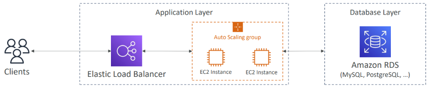
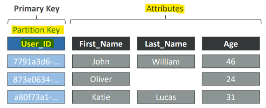
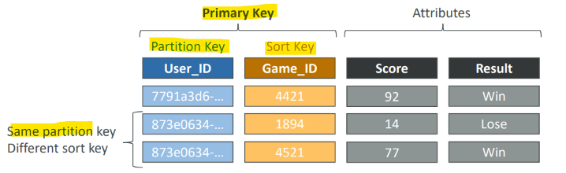

# AIP: DynamoDB

[Back](../index.md)

- [AIP: DynamoDB](#aip-dynamodb)
  - [SQL vs NoSQL](#sql-vs-nosql)
    - [Traditional Architecture](#traditional-architecture)
    - [NoSQL databases](#nosql-databases)
  - [DynamoDB](#dynamodb)
    - [Key Components](#key-components)
    - [Primary Keys](#primary-keys)

---

## SQL vs NoSQL

### Traditional Architecture

- Traditional applications leverage `RDBMS databases`
- These databases have the `SQL query language`
- Strong requirements about how the data should be modeled: **Schema**
- Ability to do **query** joins, aggregations, complex computations
- **Vertical scaling** (getting a more powerful CPU / RAM / IO)
- **Horizontal scaling** (increasing reading capability by adding EC2 / RDS Read Replicas)

---

### NoSQL databases

- NoSQL databases are **non-relational databases** and are **distributed**
- NoSQL databases include `MongoDB`, `DynamoDB`, …
- NoSQL databases do **not support query joins** (or just limited support)
- All the data that is needed for a query is present **in one row**
- NoSQL databases **don’t perform aggregations**
  - such as “SUM”, “AVG”, …
- NoSQL databases **scale horizontally**
- There’s no “right or wrong” for NoSQL vs SQL, they just require to model the data differently and think about user queries differently

---

## DynamoDB

- `Amazon DynamoDB`
  - a fully managed, **serverless NoSQL database** service provided by Amazon Web Services (AWS) designed to deliver consistent single-digit millisecond **performance at any scale**.

### Key Components

- `Tables`:
  - `DynamoDB` is made of `Tables`
  - **Collections** of data items.
- `Items`:
  - **Individual records** within a table
  - similar to a **row** in a relational database
  - made up of `attributes`.
  - **Maximum size** of an item is `400KB`

- `Primary Keys`:
  - Every `item` **must have** a `primary key`
    - must be decided at **creation time**
  - can be
    - a simple `partition key`
    - a `composite key` consisting of a `partition key` and a `sort key` to organize and query data.
- `Secondary Indexes`:
  - `Global Secondary Indexes (GSIs)` and `Local Secondary Indexes (LSIs)` let you query data using alternative keys beyond the main primary key.

- **Data types** supported are:
  - `Scalar` Types
    - String, Number, Binary, Boolean, Null
  - `Document` Types
    - List, Map
  - `Set` Types
    - String Set, Number Set, Binary Set

---

### Primary Keys

- Option 1: `Partition Key` (HASH)
  - must be **unique** for each item
  - must be “diverse” so that the data is **distributed**
  - Example: “User_ID” for a users table

---

- Option 2: `Partition Key` + `Sort Key` (HASH + RANGE)
  - The **combination** must be **unique** for each item
  - Data is **grouped** by `partition key`
  - Example: users-games table,
    - “User_ID” for `Partition Key`
    - “Game_ID” for `Sort Key`

---

- **Fully** managed, **highly available** with replication **across multiple AZs**
- **NoSQL** database - not a relational database
- **Scales** to massive workloads, distributed database
- **Millions of requests per seconds**, trillions of row, 100s of TB of storage
- **Fast and consistent** in performance (low latency on retrieval)
- Integrated with `IAM` for **security**, authorization and administration
- Enables event driven programming with `DynamoDB Streams`
- Low **cost** and auto-scaling capabilities
- Table Class:
  - `Standard`
  - `Infrequent Access (IA)`

---

- Exame: pick an attribute for PK
  - always pick the one with **highest cardinality**
