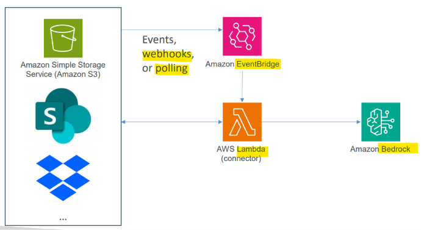
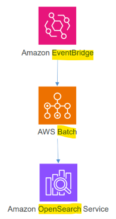

# AIP: EventBridge

[Back](../index.md)

- [AIP: EventBridge](#aip-eventbridge)
  - [EventBridge](#eventbridge)
    - [with Vector Store](#with-vector-store)
    - [Vector Index Maintenance](#vector-index-maintenance)

---

## EventBridge

- `event broker`
  - a piece of **middleware** that **receives** event messages from `publishers (producers)` and routes them to `listeners (subscribers)` in an event-driven architecture.
    - `Senders` and `receivers` do not need to know about each other; the `broker` handles the communication.
    - `Publishers` send events to **a topic or channel**, and the `broker` delivers a copy to every interested `subscriber`.

- `Amazon EventBridge`
  - a **serverless event broker** from Amazon Web Services (AWS) that **connects** application components, SaaS apps, and AWS services **using real-time data and events**.

---

### with Vector Store

- `EventBridge` is used to keep the `vector store` **in sync with new and changed data**
  - **Incremental updates**
  - **Real-time** change detection
  - Automated **synchronization**
  - **Scheduled** refresh pipelines

---

### Vector Index Maintenance

- Drift and fragmentation can become issues over time
- You could use `EventBridge` to schedule a periodic trigger to **rebuild indices**
- That could in turn use `AWS Batch` to queue up a job that
  - Creates **new** `embeddings`
  - Creates a new `vector DB`
  - **Validates** it
  - **Swaps** from the old to the new

