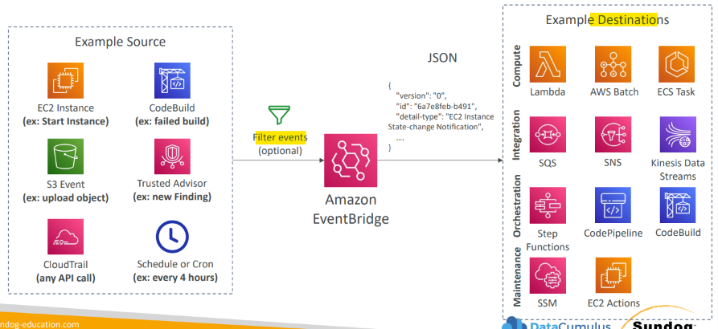
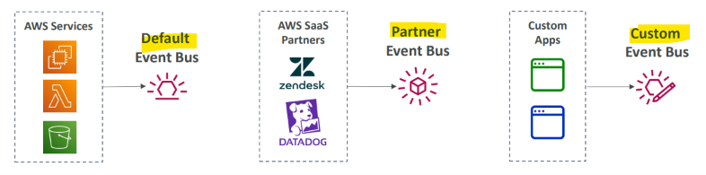
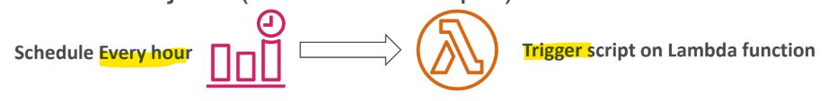
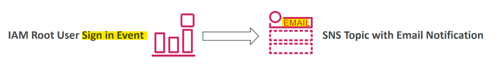
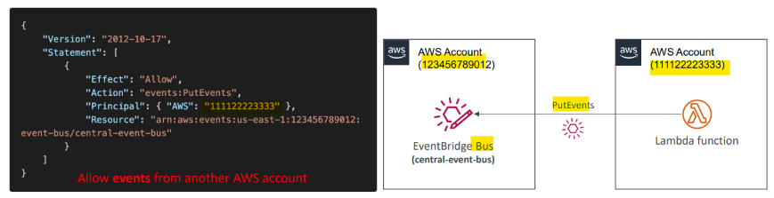
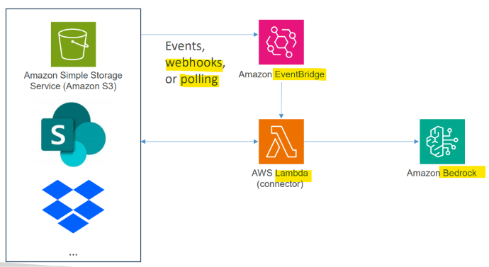
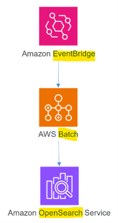

# AIP: EventBridge

[Back](../index.md)

- [AIP: EventBridge](#aip-eventbridge)
  - [EventBridge](#eventbridge)
    - [Core Components](#core-components)
    - [Common use cases](#common-use-cases)
  - [Schema Registry](#schema-registry)
  - [Resource-based Policy](#resource-based-policy)
  - [GenAI](#genai)
    - [with Vector Store](#with-vector-store)
    - [Vector Index Maintenance](#vector-index-maintenance)

---

## EventBridge

- `event broker`
  - a piece of **middleware** that **receives** event messages from `publishers (producers)` and routes them to `listeners (subscribers)` in an event-driven architecture.
    - `Senders` and `receivers` do not need to know about each other; the `broker` handles the communication.
    - `Publishers` send events to **a topic or channel**, and the `broker` delivers a copy to every interested `subscriber`.

- `Amazon EventBridge`
  - a **serverless event broker** from Amazon Web Services (AWS) that **connects** different application components, AWS services, and third-party SaaS apps by **routing events** between decoupled `producers` and `consumers`.

---

### Core Components

- `Event Buses`:
  - **Central routers** that **receive events** from various sources and **deliver** them to zero or more targets.
  - can use the **default** `AWS bus`, create **custom** application buses, or connect **partner** buses.
- `Rules`:
  - The **decision-makers** that **inspect** incoming events and **match** them using content **filters** to route them to the right targets.
- `Targets`:
  - The **downstream services** that process the events
  - e.g., AWS Lambda functions, Amazon SQS queues, Amazon SNS topics, Step Functions, or API destinations.
- `EventBridge Pipes`:
  - **Point-to-point integrations** that receive events **from a single source**, apply optional filtering, transformation, and enrichment, and send them **to a single target** without needing custom compute code.
- `EventBridge Scheduler`:
  - A **serverless scheduler** used to create and run millions of **time-based tasks** using `cron` or **rate expressions**.

---

- **EventBridge Ruless**

  

- **EventBridge bus**
  - `Event buses` can be **accessed by other AWS accounts** using Resource-based **Policies**
  - You can **archive events (all/filter)** sent to an event bus (indefinitely or set period)
  - Ability to **replay archived events**

  

---

### Common use cases

- **Schedule**: `Cron` jobs (scheduled scripts)
  

- **Event Pattern**: `Event rules` to react to a service doing something
  

- Trigger Lambda functions, send SQS/SNS messages…

---

## Schema Registry

- help `EventBridge` understand the incomming event(data structure)
- EventBridge can **analyze the events** in your bus and infer the schema
- The `Schema Registry` allows you to **generate code** for your application, that will know in advance how **data is structured** in the event bus
- Schema can be **versioned**

---

## Resource-based Policy

- Manage permissions for a specific `Event Bus`
  - Example: allow/deny events from **another AWS account** or **AWS region**
- Use case: set up **a central `AWS account` / `AWS Region`** for `EventBridge`;**aggregate all events** from your `AWS Organization`

---

## GenAI

### with Vector Store

- `EventBridge` is used to keep the `vector store` **in sync with new and changed data**
  - **Incremental updates**
  - **Real-time** change detection
  - Automated **synchronization**
  - **Scheduled** refresh pipelines

---

### Vector Index Maintenance

- Drift and fragmentation can become issues over time
- You could use `EventBridge` to schedule a periodic trigger to **rebuild indices**
- That could in turn use `AWS Batch` to queue up a job that
  - Creates **new** `embeddings`
  - Creates a new `vector DB`
  - **Validates** it
  - **Swaps** from the old to the new

