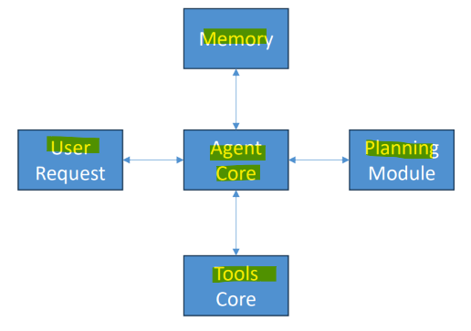

# AIP Fundamental: Agentic AI

[Back](../index.md)

- [AIP Fundamental: Agentic AI](#aip-fundamental-agentic-ai)
  - [Agentic AI](#agentic-ai)
    - [AI agent](#ai-agent)
      - [How AI Agents Work (The ReAct Loop)](#how-ai-agents-work-the-react-loop)
      - [Key Components](#key-components)
    - [Agentic AI](#agentic-ai-1)
      - [Patterns](#patterns)
  - [Memory](#memory)

---

## Agentic AI

### AI agent

- `AI agent`
  - an **autonomous software system** that uses an **artificial intelligence foundation model**, such as a `Large Language Model (LLM)`, to **perceive** its environment, **reason** through a goal, **plan** steps, and **take action** across digital tools or APIs **without requiring human input** at every single stage.

---

#### How AI Agents Work (The ReAct Loop)

- Most modern `AI agents` run on a `Reason and Act (ReAct)` framework, cycling through these **core phases**:
  - `Reasoning`: The LLM **analyzes** the goal, **breaks it down** into sub-tasks, and **decides** what needs to happen next.
  - `Acting`: The agent **calls external tools**, APIs, or code-execution sandboxes (such as searching the web, reading files, or sending an email).
  - `Observing`: It **reads** the output or result of that action.
  - `Iterating/Reflecting`: It **evaluates** whether the goal is met; if not, it **adjusts** its plan and **loops again until the job is done**.

#### Key Components

- **The Brain**: An `LLM` or `foundation model` responsible for **decision-making** and **logic**.
- **Tool Interfaces**: **Connectors** that let the agent interact with software, databases, or the internet (via function-calling or protocols like `Model Context Protocol`).
- **Memory**: **Short-term context windows** for ongoing tasks, plus **long-term memory** (like `vector databases`) to retain past experiences.
- **Orchestration/Harness**: The **software wrapper** that runs the agent loop and maintains **guardrails**.

---

- **Tools**: just functions provided to a tools API.
- `Prompts`: guide the LLM on how to use them.

---

### Agentic AI

- `Agentic AI`
  - the artificial intelligence systems designed to **act autonomously or semi-autonomously** to achieve a specific goal with minimal or no human intervention.

---

#### Patterns

- **Foundational Patterns**
  - `Tool Use (Function Calling)`:
    - Connects the language model to **external** systems, APIs, code interpreters, or databases so it can fetch live data or execute actions.

  - `Planning (Task Decomposition)`
    - A **planner model** breaks a complex goal into a **step-by-step roadmap before** separate **executor workers** carry out each subtask.

  - `ReAct (Reasoning and Acting)`
    - A **single agent** alternates between **thinking** through a problem, **calling** an external tool, and **observing** the result **until** it reaches a final answer.
    - Interleaves thought, tool execution, and observation in a **continuous loop** (`Think → Act → Observe → Repeat`).
  - `Reflection (Self-Correction)`:
    - The model reviews, critiques, and refines its own output autonomously before returning a final answer to the user.
    - A **generator agent** produces an **initial draft**, and a **separate evaluator reviews** it against quality rules in a **feedback loop** until the output passes.

- `Multi-Agent Orchestration`
  - **Multiple specialized agents** divide complex workloads using **sequential** pipelines, **parallel** execution, **hierarchical** supervisors, or **dynamic** routers.

- `Human-in-the-Loop (HITL)`
  - Workflows pause at critical checkpoints to **request human approval,** clarification, or escalation before executing high-stakes actions.

---

## Memory

- `Short-Term Memory (Working Memory)`
  - **Chat history** within a **session / immediate context**
    - Enables conversations
    - Events within sessions
  - **Implementation**:
    - This could be in-memory or in a big distributed cache. e.g., `Elasticache`, `MemoryDB`, even `DynamoDB` is OK
  - **Lifecycle**:
    - Wiped or discarded **once the current task or session ends**.
  - **Limitations**:
    - Bounded by **token limits**;
    - older turns must be **summarized** or truncated when the window fills up, risking **"context rot" or data loss**.

- `Long-Term Memory (Persistent Storage)`
  - Stores **extracted insights**
  - **Summaries** of past sessions
  - **Preferences** (your coding style and favorite tools, for example)
  - **Facts** you gave it in the past
  - “Memory Records” that store structured information derived from agent interactions
  - “Strategies” for user preferences, semantic facts, session summaries
  - **Lifecycle**:
    - Persists indefinitely until explicitly updated, overwritten, or expired.
  - **implementation**:
    - DynamoDB, SQLLite, RDS, Aurora, etc
    - Knowledge Bases
    - Mem0(`Strands` uses this)
