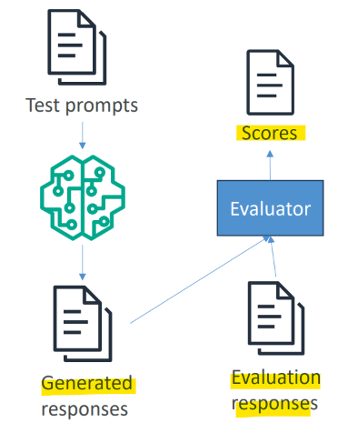
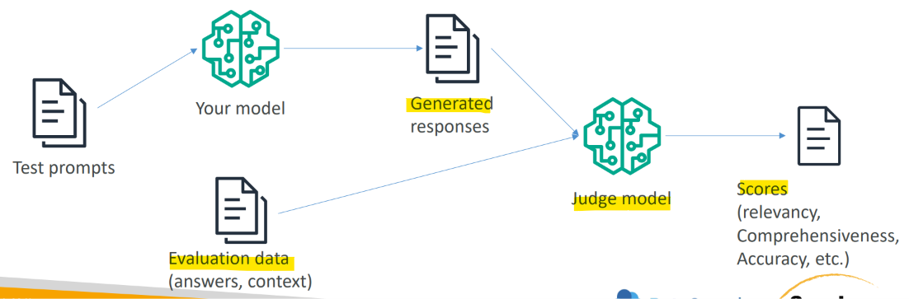
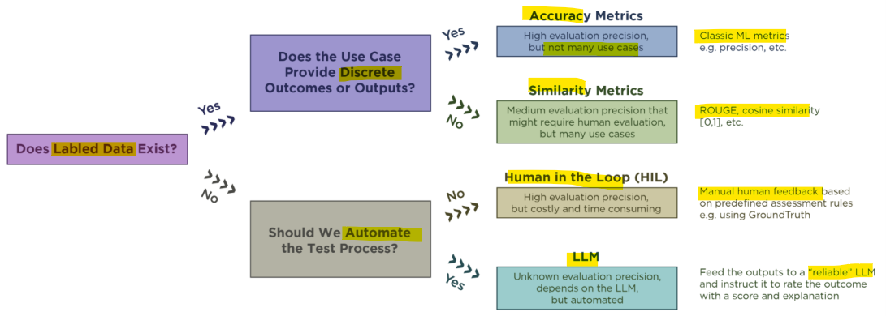

# AIP Fundamental: Evaluation

[Back](../index.md)

- [AIP Fundamental: Evaluation](#aip-fundamental-evaluation)
  - [Foundation model evaluation criteria](#foundation-model-evaluation-criteria)
    - [Human Evaluation](#human-evaluation)
    - [Benchmark Datasets](#benchmark-datasets)
    - [Model as a “judge”](#model-as-a-judge)
    - [Hybrid approaches](#hybrid-approaches)
  - [Metrics](#metrics)
    - [ROUGE](#rouge)
    - [BLEU](#bleu)
    - [BERTscore](#bertscore)
  - [Testing and evaluation: choosing a strategy](#testing-and-evaluation-choosing-a-strategy)

---

## Foundation model evaluation criteria

### Human Evaluation

- The **complex and nondeterministic nature** of generative AI makes it **hard to measure**.
- Humans are often your best source of feedback
  - UX: How does it feel to use this model?
  - **Contextual relevancy** / **sensitivity**
  - **Creativity** & **flexibility**
    - Handling **unexpected** or complex problems

---

### Benchmark Datasets

- Generally a set of **sample questions (prompts) and answers** generated by `Subject Matter Expert(SME)`’s
  - Might test **performance** for a specific **application**
  - Might test **performance** for specific kinds of **problems** (like reasoning ability)
- Can be useful as **initial metrics before getting human feedback**
- Often used for **FM “leaderboards”**
- Things you can **measure**
  - **Accuracy**
    - How close was the generated result to the “ideal” one?
  - **Speed / Efficiency**
    - How quickly was the result generated?
  - **Scalability**
    - How does it hold up to more data? More users? Longer prompts? More context?
  - **Context retrieval**
    - We’re getting there… but if the system retrieves external data, how relevant is that data?
- Limit:
  - Only as good as your `test and evaluation data`… these metrics can be **flawed and incomplete**

---

### Model as a “judge”

- A **“trusted” model** is used to **evaluate responses** from your test prompts
- This **assumes** you have a **“trusted” model** (who watches the watchers?)
- limit
  - If your model and the judge model **share** some of the **same problems**, that could be a problem.
- Use case
  - Perhaps better for **testing “small” language models** designed for efficiency

---

### Hybrid approaches

- Comparing **human** and **benchmarkbased** approaches can **reveal the limitations** of both

---

## Metrics

### ROUGE

- `ROUGE (Recall-Oriented Understudy for Gisting Evaluation)`
  - a set of metrics **from 0 to 1** that **evaluates machine-generated text** by **measuring word and phrase overlap** against **human-written reference texts**.
    - e.g., **Text summarization** or **Machine translation**

- Counts **number of overlapping** “units” between **computer-generated output** and **evaluation groundtruth output**.
  - Words, n-grams, sentence fragments
- `ROUGE-N`
  - **Overlap** on n-grams (how many words at a time are compared)
  - `ROUGE-1`: unigrams (one word,)
  - `ROUGE-2`: bigrams (two words)
- `ROUGE-L`
  - Uses **longest common subsequence** between generated and reference text
  - Good at evaluating **coherence** and **order** of narrative

- example:
  - input: Certified AI Practitioner
  - Output: Certified ML Practitioner
  - ROUGE expect
    - Unigrams: Certified, AI, Practitioner
    - Bigrams: Certified AI, AI Practitioner
  - score
    - ROUGE-1: 2/3
    - ROUGE-2: 0

---

### BLEU

- `BLEU (Bilingual Evaluation Understudy)`
  - an automated metric that **scores machine-generated text**, most commonly **machine translations**, by comparing its word and phrase **overlap** against human reference texts.

- Used for **machine translation**
- Compares **machine translation** to **human translation**
- Measure `PRECISION` of N-grams
  - As opposed to ROUGE, which is **recall**
  - Precision compares to **everything**, recall just to “relevant” results (overlapping results in the case of ROUGE)
  - Checks **how many words** / phrases appear in the reference translation
- Works at the **sentence level**
- **Brevity penalty**
  - Overly short translations are penalized
- **Limited** use in assessing **fluency and grammar**

---

### BERTscore

- `BERTScore`
  - an automatic evaluation metric for text generation that measures **semantic similarity** between a model's output (candidate) and a reference text **using contextual token embeddings and cosine similarity**.
  - Unlike metrics such as BLEU or ROUGE that rely on exact word or n-gram overlap, it **rewards valid paraphrases and synonyms**.

- LLMs rely on **“embeddings”** that store the meaning of a word as a vector
- I am oversimplifying, but that’s the idea.
- `BERTscore` uses these **embedding vectors** to compare the **semantic similarity** between a model’s output and the ideal output
- `BERT` is a **language model** that predated GPT
- Less sensitive to synonyms and paraphrasing that don’t really change the meaning of what’s being generated

---

## Testing and evaluation: choosing a strategy

