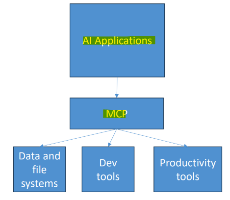

# AIP Fundamental: Model Context Protocol (MCP)

[Back](../index.md)

- [AIP Fundamental: Model Context Protocol (MCP)](#aip-fundamental-model-context-protocol-mcp)
  - [Model Context Protocol (MCP)](#model-context-protocol-mcp)
    - [Core Architectural Components](#core-architectural-components)
    - [vs `RAG`](#vs-rag)

---

## Model Context Protocol (MCP)

- `Model Context Protocol (MCP)`
  - an open-source standard created by Anthropic that standardizes how AI assistants and large language models (LLMs) **connect to external** tools, databases, file systems, and software.
  - **Standardized interface** for agent-tool interactions
  - uses a `client-server` architecture
  - Transport:
    - `stdio` for local
    - `HTTP streaming` for remote
- Access external tools with **consistent interaction patterns**
  - **Standardizes** how apps provide context to LLMs

- Pretty much any `agent SDK` can call external MCP servers (including `Strands`)
- Servers may **expose tools, resources, and prompts**
- Some popular MCP servers:
  - GitHub, Atlassian, PostgreSQL, Slack, Google Maps… even Udemy!

---

### Core Architectural Components

- `MCP Host`:
  - The main **AI application** or environment that **orchestrates workflows and manages user interactions**.
  - e.g., `Claude Desktop`, `VS Code`, or an `IDE`
- `MCP Client`:
  - A component **embedded inside** the `MCP Host` that **maintains** a dedicated, 1:1 **connection** with an `MCP Server`, translating requests and responses.
- `MCP Server`:
  - A lightweight program that **connects to external systems** and exposes capabilities to the client.
  - e.g., databases, APIs, or local files
- `Transport Layer`:
  - The underlying communication mechanism using JSON-RPC 2.0.
  - typically `stdio` for local processes or Streamable HTTP / SSE for remote services

- `Data Layer`:
  - `MCP servers` expose three primary types of primitives to the AI:
    - **Resources**:
      - **Read-only data** or files (such as database schemas, log files, or code repositories) that **provide context to the LLM**.
    - **Tools**:
      - **Executable functions** or actions (such as running a query, sending a message, or calling an API) that the **LLM can dynamically trigger**.
    - **Prompt Templates**:
      - Pre-defined, reusable interaction patterns or user templates that help **standardize workflows.**

---

### vs `RAG`

| Feature        | MCP (Model Context Protocol)                                        | RAG (Retrieval-Augmented Generation)                                    |
| -------------- | ------------------------------------------------------------------- | ----------------------------------------------------------------------- |
| Primary Goal   | Allow models to **take actions** and **interact with live** systems | Provide **referenceable knowledge** so answers are factual and grounded |
| Core Mechanism | Client-server protocol for tool calls and live API execution        | Vector/semantic search + text context injection into prompts            |
| Data Flow      | Bidirectional (reads data and writes/executes actions)              | One-way (retrieves text/data to augment a prompt)                       |
| Main Analogy   | A USB port (a standardized way to plug in tools)                    | A reference library (looking up info to read)                           |
| Key Use Cases  | Booking meetings, updating CRM records, running live code/queries   | Enterprise search, answering policy questions from handbooks            |
