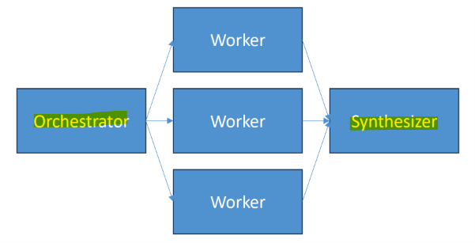
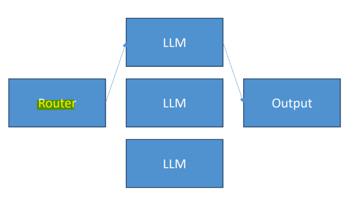
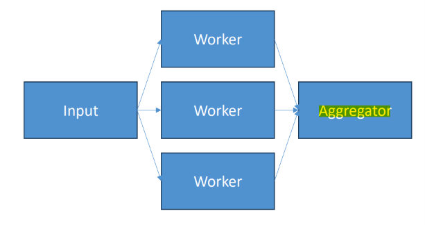
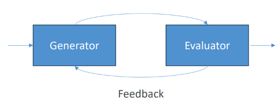

# AIP Fundamental: Multi-agent systems

[Back](../index.md)

- [AIP Fundamental: Multi-agent systems](#aip-fundamental-multi-agent-systems)
  - [Multi-agent systems](#multi-agent-systems)
    - [Single Agent vs. Multi-Agent Systems](#single-agent-vs-multi-agent-systems)
    - [Popular patterns](#popular-patterns)
      - [Orchestrator-Synthesizer](#orchestrator-synthesizer)
      - [Routing](#routing)
      - [Parallelization](#parallelization)
      - [Prompt Chaining](#prompt-chaining)
      - [Evaluator - Optimizer](#evaluator---optimizer)

---

## Multi-agent systems

- `Multi-Agent AI Systems (MAS)`
  - the architectures where **multiple** autonomous, specialized **AI agents collaborate** within a **shared environment** to solve complex tasks that are too difficult or sprawling for a single general-purpose model.

- Key Characteristics
  - **Role Specialization**:
    - Each agent has a distinct **persona**, **system prompt**, access-scoped **tools**, and specialized **knowledge** (e.g., a Researcher agent that web-searches, a Coder agent, and a Judge/Critique agent).
  - **Collaboration & Coordination**:
    - Agents communicate by **passing** messages, **sharing a common whiteboard/memory state**, or executing through **orchestrators and protocols** like Google's Agent-to-Agent (A2A) Protocol.
  - **Parallel & Sequential Execution**:
    - Subtasks can be **fanned out** and run simultaneously (high throughput) or chained sequentially in **pipelines** or **feedback loops**.

---

### Single Agent vs. Multi-Agent Systems

| Feature         | Single AI Agent                                                   | Multi-Agent System (MAS)                                               |
| --------------- | ----------------------------------------------------------------- | ---------------------------------------------------------------------- |
| Best Suited For | Linear, short, self-contained tasks (e.g., rewriting a paragraph) | Complex, multi-step workflows (e.g., full software dev, deep research) |
| Complexity      | Easier to monitor, debug, and control                             | Requires orchestration, conflict resolution, and step caps             |
| Cost & Latency  | Lower (single model invocation)                                   | Higher (multiple model calls and handoffs)                             |
| Quality Control | Relies on one model's internal check                              | Built-in review, critique, and validation agents                       |

---

### Popular patterns

- **Supervisor / Manager-Worker**:
  - A **central manager agent** breaks down the incoming goal, delegates subtasks to sub-agents, and aggregates the final output.
- **Pipeline / Sequential**:
  - Agents hand off work step-by-step (e.g., research → draft → review → edit).
- **Decentralized / Peer-to-Peer**:
  - Autonomous agents negotiate, share neighbor info, or use market-based/contract-net paradigms **without a strict single controller**.
- **Graph-Based** (e.g., LangGraph):
  - Workflows feature non-linear branching, conditional loops, and self-correction checks.

---

#### Orchestrator-Synthesizer

- The `Orchestrator` **breaks down tasks** and delegates them to worker LLMs
- A `Synthesizer` can then **combine** their results

---

#### Routing

- A `router LLM` chooses just one of many specialized **agents** to call in turn
- Use for **complex tasks** where a single classification is needed
  - i.e., how large of a model is needed for the task
  - What kind of customer service query is being received

---

#### Parallelization

- A lot like the orchestrator
- But without complex orchestration
- `Sectioning`: independent **subtasks** run **in parallel**
  - Running multiple **guardrails** at once
  - Running multiple **evaluations** at once
- Voting
  - Do the same thing with **different models** or prompts
  - Let them vote on the right result

---

#### Prompt Chaining

- `Prompt chaining`
  - a **prompt engineering** technique where you break a large, complex task into a **sequence of smaller, connected steps**.
  - Each LLM processes the **output of the previous one**
  - Can add `gates` to keep things on track as you go, or exit early
  - e.g.,
    - Write a document, then translate it to different languages
    - Write an outline, then make slides

- How It Works example:

1. Step 1: You give the AI a single, well-defined **subtask** (e.g., summarize a long article).
2. Step 2: You take that **summary and send** it in the **next prompt** for a new subtask (e.g., extract key themes from the summary).
3. Step 3: You take those **themes and send** them in a **final prompt** (e.g., turn them into a structured outline or email).

- vs `Chain-of-Thought`
  - `Chain-of-Thought`: Asks a **single AI call** to "think step by step" inside one single prompt.

---

#### Evaluator - Optimizer

- One LLM **generates** a response
- Another **evaluates** that response
- If it’s not good enough, provide feedback and try again
- e.g.,
  - Code reviewing code and incorporating those recommendations
  - Complex search that requires multiple rounds

