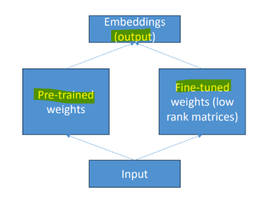

# LLM Fundamental: Training

[Back](../index.md)

- [LLM Fundamental: Training](#llm-fundamental-training)
  - [Training](#training)
    - [Pre-training](#pre-training)
    - [Post-training](#post-training)
    - [Continued pre-training (CPT)](#continued-pre-training-cpt)
    - [Fine-tuning](#fine-tuning)
      - [Low-Rank Adaptation (LoRA)](#low-rank-adaptation-lora)

---

## Training

### Pre-training

- `Pre-training`
  - the foundational **first stage** in training a machine learning or artificial intelligence model, such as a Large Language Model (LLM).

- How Pre-training Works
  - **Massive Unlabeled Data**:
    - The model ingests trillions of words, books, articles, and web pages without human-labeled tags.
  - **Next-Token Prediction**:
    - Its core task is to **repeatedly guess the next** word or token based on the context that came before it.
  - **Pattern & Grammar Learning**:
    - Through this process, the model **implicitly absorbs human language structure**, syntax, logic, and **factual world knowledge**.

- Output:
  - a raw `base model`—a powerful **text-completion engine**

---

### Post-training

- `Post-training`
  - the phase after raw `pre-training` where a `base model` is refined, **tuned, and aligned** to follow instructions, converse naturally, reason through complex tasks, and act safely.

- Main Stages of Post-Training
  - `Supervised Fine-Tuning (SFT)`:
    - The `base model` is trained on curated **input-output example pairs** (such as prompts and ideal assistant responses) to learn instruction-following, formatting, and tone.
  - **Preference Alignment / Reinforcement Learning**:
    - The model generates multiple responses, and human or automated feedback (via methods like RLHF, DPO, or GRPO) rewards preferred outputs while **discouraging harmful, toxic, or low-quality behavior**.
  - **Reasoning and Verification Tuning**:
    - For advanced models, specialized datasets and reinforcement learning steps are added to teach step-by-step logic, math problem-solving, and tool or web-search usage.

- **Techniques**
  - `Supervised Fine-Tuning (SFT)`:
    - Shifts model behavior quickly using high-quality prompt-response datasets.
  - `Direct Preference Optimization (DPO)`:
    - Aligns a model directly from pairs of **preferred vs. rejected responses** without needing a separate reward model.
  - `On-Policy` / `Reinforcement Learning` (PPO, GRPO):
    - Encourages active exploration where the model generates trajectories and updates policies based on reward signals.
  - `Model Distillation`: **Transfers knowledge** from a **large** teacher model into a **smaller**, faster student model.

- output:
  - instruct model (or an aligned model)

---

### Continued pre-training (CPT)

- `Continued pre-training (CPT)`
  - an **extension** of foundation model **pre-training** that adapts an existing model to **new domains, languages, or specialized vocabularies** using raw, **unlabeled** text without full retraining.
- Purpose:
  - feed it text to **familiarize** the model with domain knowledge

- example

```json
{"input": "Spring has sprung."}
{"input": "The grass has riz."}
{"input": "I wonder where the flowers is."}
```

---

### Fine-tuning

- `fine-tuning`
  - the process of **taking a pre-trained** Large Language Model (like Llama or GPT) and training it further on a smaller, specialized dataset.

- `base model`: learns general language and patterns from massive internet data
- `fine-tuning`: adapts it to a specific purpose:
  - **Domain knowledge**: Injecting specialized vocabulary, medical data, legal terminology, or proprietary company information.
  - **Tone and style**: Teaching the model to speak with a specific brand voice, persona, or output format.
  - **Task execution**: Improving performance on structured tasks like code generation, classification, or custom chat responses.

- **Fine-Tuning Methods**
  - `Supervised Fine-Tuning (SFT)`: Training the model using **labeled** input-output example pairs.
  - `Parameter-Efficient Fine-Tuning (PEFT)`:
    - **freeze** most of the model's **original weights** and train only a **tiny fraction of new parameters**
    - benefits: saving massive amounts of compute and GPU memory
    - e.g., `LoRA (Low-Rank Adaptation)` or `QLoRA (Quantized Low-Rank Adaptation)`
  - `Alignment (RLHF / DPO)`:
    - Refining model behavior **using human feedback or preference optimization** to reduce hallucinations and make outputs safer.

- **Common use cases:**
  - Chatbot with a certain personality or style, or with a certain objective (i.e., customer support, writing ads)
  - Training with **data more recent** than what the LLM had
  - Training with **proprietary data** (i.e., your past emails or messages, customer support transcripts)
  - Specific applications (classification, evaluating truth)

- vs `Prompt Engineering`

| Feature        | Prompt Engineering                                 | Fine-Tuning                                          |
| -------------- | -------------------------------------------------- | ---------------------------------------------------- |
| Core Action    | Changes the input (instructions/context)           | Changes the model (weights/parameters)               |
| Setup Time     | Instant (minutes)                                  | Slower (requires dataset prep and training pipeline) |
| Flexibility    | High; changes take effect immediately on next call | Low; requires retraining to modify behavior          |
| Resource Needs | Minimal (just API or local runtime access)         | High (GPU compute, training examples, PEFT tools)    |

---

#### Low-Rank Adaptation (LoRA)

- `Low-Rank Adaptation (LoRA)`:
  - parameter-efficient fine-tuning technique that customizes large machine learning and language models **without modifying or retraining** their original pre-trained weights.

- `Low-rank`:
  - the complexity of the underlying matrices in the model

- **How LoRA Works**
  - **Freezes Base Weights**: Base model remains **unchanged**
  - **Low-Rank Decomposition**: LoRA injects two smaller, low-rank matrices into the model layers.



- At **inference**, these **fine-tuned weights** get **added** into the base model
- benefit:
  - Very **efficient** for storage, training, and inference

---
