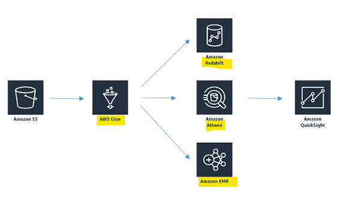

# AWS Glue

[Back](../index.md)

- [AWS Glue](#aws-glue)
  - [AWS Glue](#aws-glue-1)
    - [Glue Crawler / Data Catalog](#glue-crawler--data-catalog)
  - [AWS Glue Studio](#aws-glue-studio)
  - [Data Quality](#data-quality)

---

## AWS Glue

- `AWS Glue`
  - a **serverless data integration and ETL (Extract, Transform, Load) service** that helps discover, prepare, move, and combine data from hundreds of **different sources** for analytics, machine learning, and AI applications without managing any underlying servers.

- **Core Capabilities**
  - `Data Catalog`:
    - A centralized **metadata repository** that stores table definitions, schemas, and data lineage.
    - acts as a **single source of truth** for data landscape on AWS
      - S3 data lakes
      - RDS
      - Redshift
      - DynamoDB
      - Most other SQL databases
  - `Glue crawler`:
    - **Automated tools** that **scan** data stores (like Amazon S3, databases, or data warehouses) to infer schemas and populate the `Data Catalog`.
  - **ETL & Data Pipelines**:
    - Build and run data transformation jobs using Apache Spark, Ray, Python, Scala, or a visual low-code interface called `AWS Glue Studio`.
    - Trigger-driven, on a schedule, or on demand
    - Fully managed
  - **Serverless Architecture**:
    - do not provision or manage virtual machines; AWS Glue automatically **scales** compute resources up or down and bills you only for the seconds your jobs run.

---

### Glue Crawler / Data Catalog

- `Glue crawler` scans data in S3, **creates schema**
- Can run **periodically**
- **Populates** the `Glue Data Catalog`
  - Stores **only table definition**
  - Original data stays in S3
- Once cataloged, you can **treat the unstructured data like it’s structured**
  - Redshift Spectrum
  - Athena
  - EMR
  - Quicksight

---

- S3 Partitions
  - `Glue crawler` will **extract partitions** based on how your S3 data is organized
  - Think up front about how you will be querying your data lake in S3
  - Example:
    - devices send sensor data every hour
    - Do you query primarily by time ranges?
      - If so, organize your buckets as yyyy/mm/dd/device
    - Do you query primarily by device?
      - If so, organize your buckets as device/yyyy/mm/dd

---

## AWS Glue Studio

- `AWS Glue Studio`
  - a **graphical interface** for `AWS Glue` that allows to build, run, and monitor serverless **extract, transform, and load (ETL) data pipelines** **without deep `Apache Spark` coding**.

- **Visual interface** for `ETL workflows`
- Visual **job editor**
  - Create `DAGs` for complex workflows
  - Sources include S3, Kinesis, Kafka, JDBC
  - Transform / sample / join data
  - Target to `S3` or `Glue Data Catalog`
  - Support **partitioning**
- Visual **job dashboard**
  - Overviews, status, run times

---

## Data Quality

- `AWS Glue Data Quality`
  - a **serverless feature** in `AWS Glue` that measures, monitors, and manages the **quality of data** at rest and in transit.

- **Data quality rules** may be created manually or recommended automatically
- **Integrates** into `Glue jobs`
- Uses `Data Quality Definition Language (DQDL)`
- Results can be used to **fail** the job, or just be **reported** to `CloudWatch`

---
