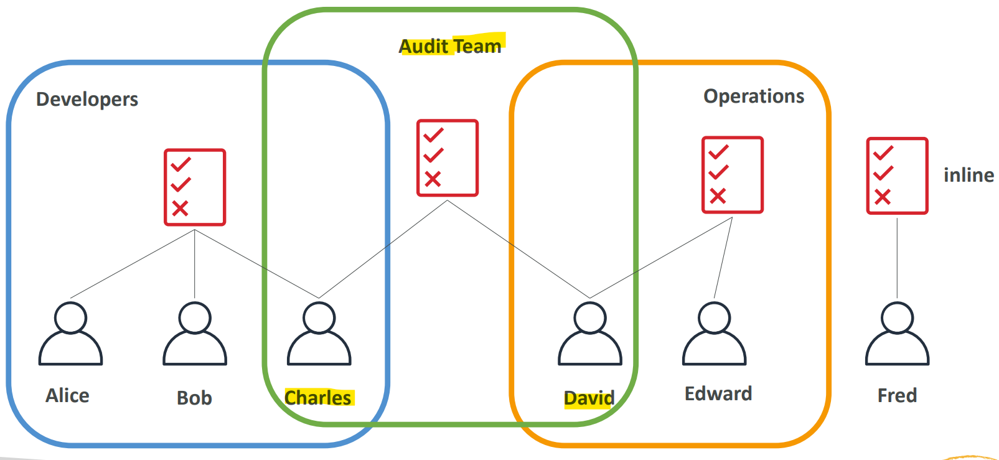
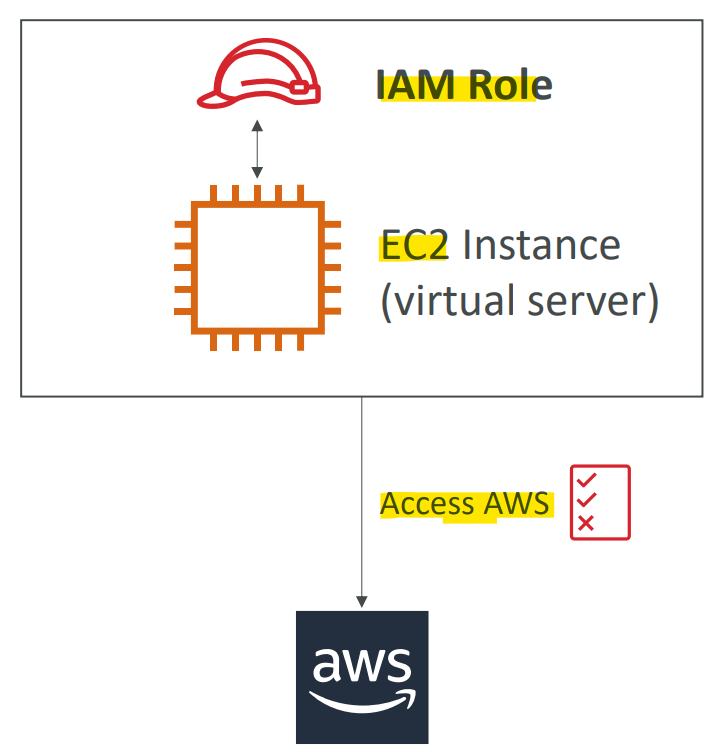
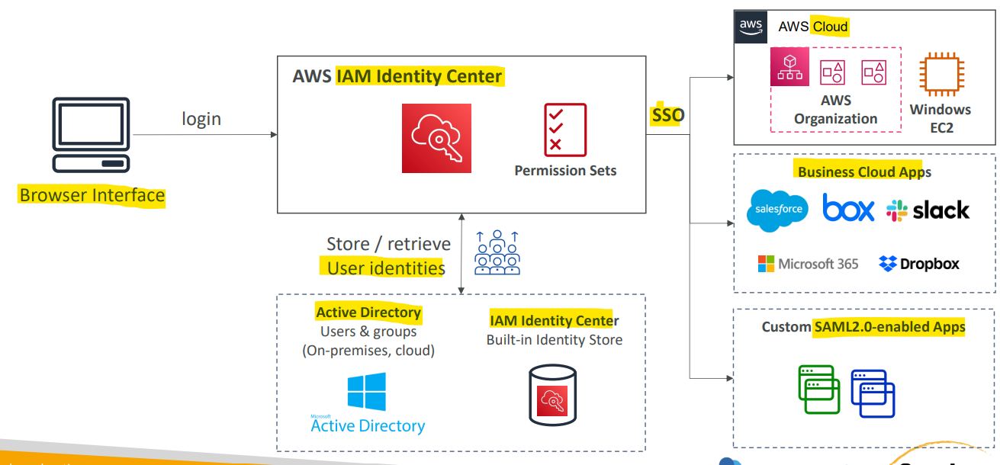
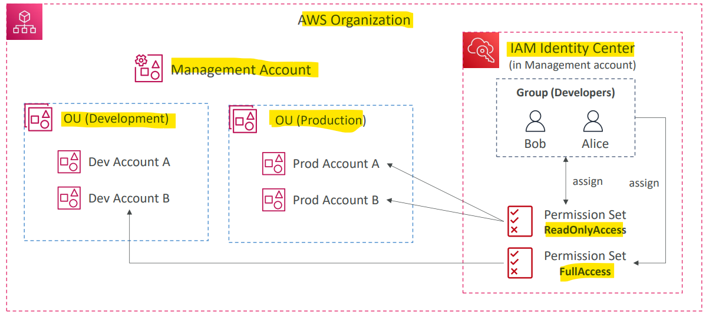
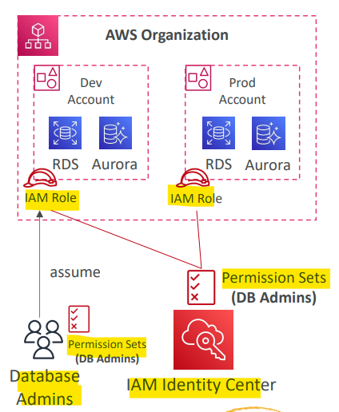

# Security: IAM

[Back](../index.md)

- [Security: IAM](#security-iam)
  - [IAM](#iam)
    - [Common Best Practices](#common-best-practices)
  - [Policy \& Permissions](#policy--permissions)
    - [AssumeRole](#assumerole)
    - [Policy inheritance](#policy-inheritance)
    - [Structure](#structure)
    - [Password Policy](#password-policy)
  - [Multi Factor Authentication - MFA](#multi-factor-authentication---mfa)
    - [MFA devices options in AWS](#mfa-devices-options-in-aws)
  - [IAM Roles](#iam-roles)
    - [Roles for Services](#roles-for-services)
  - [AWS IAM Identity Center](#aws-iam-identity-center)
    - [use case: with AWS Organization](#use-case-with-aws-organization)
    - [Fine-grained Permissions and Assignments](#fine-grained-permissions-and-assignments)

---

## IAM

- `Identity and Access Management (IAM)`
  - a free, **global AWS security service** that controls **who is authenticated and authorized** to access your AWS resources.
  - Global service

---

- **Core Components**

- `Root account`
  - created by **default**, **shouldn’t be used** or shared

- `Users`:
  - **Individual identities** with credentials for **people** or **applications** that need access to AWS.
- `Groups`:
  - **Collections of users** that **share common permissions**, making bulk management easier.
  - only contain `users`, **not other `groups`**
  - `Users` **don’t have to** belong to a `group`
  - `user` can belong to **multiple** `groups`
- `Roles`:
  - **Identities with temporary security credentials** that AWS **services**, **applications**, or external **identities** can **assume**.
- `Policies`:
  - **JSON documents** that define **allowed or denied actions** on specific AWS resources.

---

### Common Best Practices

- **least privilege**:
  - Grant only the **minimum permissions** needed for a task.
- Prefer `roles` over **long-term keys**:
  - Use **temporary credentials** via roles for workloads and cross-account access.
- **Protect the root account**:
  - **Avoid** using the **root user** for daily tasks and enable `multi-factor authentication (MFA)`.
- **Use IAM Identity Center**:
  - Manage workforce access **centrally** across multiple AWS accounts and applications.

---

## Policy & Permissions

- `Users` or `Groups` can be assigned **JSON documents** called `policies`
- These `policies` **define the permissions** of the users
- In AWS you apply the `least privilege principle`: don’t give more permissions than a user needs

- Attach policy vs inline policy
  - **Attach policys**:
    - **links a standalone, reusable policy** (AWS-managed or customer-managed) to **one or more identities**
    - a **many-to-many** relationship
      - can be reused across multiple users, groups, and roles.
  - **Inline policy**:
    - **embedded directly** inside a single IAM user, group, or role.
    - a strict **one-to-one** relationship
      - with a single identity

---

### AssumeRole

- `AssumeRole`:
  - an action in a policy that allows specific **AWS resource** to obtain **temporary security credentials** via `STS` to adopt the permissions of an IAM role.
  - returns a short-lived access key ID, secret access key, and session token.

- Authorization based on the attached policy

```
1. allow to get short-live credential from STS
2. take actions on resources based on the policy
```

- example

```json
{
  "Version": "2012-10-17",
  "Statement": [
    {
      "Effect": "Allow",
      "Action": ["sts:AssumeRole"],
      "Principal": {
        "Service": ["ec2.amazonaws.com"]
      }
    }
  ]
}
```

---

- example:

```json
{
  "Version": "2012-10-17",
  "Statement": [
    {
      "Effect": "Allow",
      "Action": "ec2:Describe*",
      "Resource": "*"
    },
    {
      "Effect": "Allow",
      "Action": "elasticloadbalancing:Describe*",
      "Resource": "*"
    },
    {
      "Effect": "Allow",
      "Action": [
        "cloudwatch:ListMetrics",
        "cloudwatch:GetMetricStatistics",
        "cloudwatch:Describe*"
      ],
      "Resource": "*"
    }
  ]
}
```

---

### Policy inheritance

- **permissions or policy rules** attached to a **higher-level** identity, group, or resource container **automatically pass down to lower-level members or child resources**.



- Charles: policies of both Developers & Audit
- David: policies of both Audit & Operations

---

### Structure

- **what identity(`Principal`) take what action(`Action`) on what resource(`Resource`) with what effect(`Effect`) with what condition(`Condition`)**

- Consists of
- **Version**:
  - policy language **version**, always include `2012-10-17`
- **Id**:
  - optional
  - an **identifier** for the policy
- **Statement**:
  - **required**
  - one or more individual statements

---

- **Statements** consists of
  - **Sid**:
    - optional
    - an **identifier** for the statement
  - **Effect**:
    - whether the statement **allows or denies access**
    - values: `Allow`, `Deny`
  - **Principal**:
    - **account/user/role** to which this policy applied to
  - **Action**:
    - **list of actions** this policy allows or denies
  - **Resource**:
    - **list of resources** to which the actions applied to
  - **Condition**:
    - optional
    - conditions for when this policy is in effect

---

### Password Policy

- **Strong** passwords = higher security for your account
- In AWS, you can setup a password policy:
  - Set a minimum password **length**
  - Require specific **character types**:
    - including **uppercase** letters
    - **lowercase** letters
    - **numbers**
    - **non-alphanumeric** characters
  - Allow all IAM users to **change their own passwords**
  - Require users to **change** their password **after some time** (`password expiration`)
  - **Prevent** password **re-use**

---

## Multi Factor Authentication - MFA

- Users have access to your account and can possibly change configurations or delete resources in your AWS account
- You want to **protect** your `Root Accounts` and `IAM users`
- MFA = **password** you know + **security device** you own
- Main benefit of MFA: if a password is **stolen or hacked**, the account is **not compromised**

---

### MFA devices options in AWS

- Virtual `MFA device`:
  - Google Authenticator
  - Authy

- `Universal 2nd Factor (U2F)` Security Key
  - YubiKey by Yubico (3rd party)

- **Hardware Key Fob** MFA Device
  - Provided by Gemalto (3rd party)

- Hardware Key Fob MFA Device for **AWS GovCloud (US)**
  - Provided by SurePassID (3rd party)

---

## IAM Roles

- `IAM role`
  - an identity that **grants temporary permissions** to **users**, applications, or **services** without using permanent passwords or long-term access keys.
  - entities **"assume" a role** to perform specific tasks and then **lose those temporary credentials** when finished.

- How It Works
  - `Trust policy`:
    - Defines **who or what** is allowed to assume the role (such as an EC2 instance, a user, another account, or an external identity provider).
  - `Permissions policy`:
    - Defines **what actions** the role is allowed or denied to perform on cloud resources.
  - `Temporary credentials`:
    - **Issues short-lived session tokens** (for example, via `AWS STS`) that **expire automatically**, reducing credential leak risks.

- **Common Use Cases**
  - **Cloud services**:
    - Letting compute services (like EC2 or Lambda) **read or write data** (like S3 buckets) **without hardcoding secret keys** in application code.
  - **Cross-account access**:
    - Allowing a user or service in one account to **access resources in another account**.
  - **Federated or temporary elevation:**
    - Letting **external** sign-ins or team members **temporarily take on elevated permissions** for a specific task.

---

### Roles for Services

- Some AWS service will need to **perform actions on your behalf**
- To do so, we will **assign permissions** to AWS services with `IAM Roles`
- Common roles:
  - `EC2` Instance Roles
  - `Lambda Function` Roles
  - Roles for `CloudFormation`



---

## AWS IAM Identity Center

- former `AWS Single Sign-On`

- **One login** (`single sign-on`) for **all your**
  - `AWS accounts` in AWS Organizations
  - **Business cloud applications** (e.g., Salesforce, Box, Microsoft 365, …)
  - `SAML2.0`-enabled applications
  - `EC2 Windows Instances`
- Identity providers
  - Built-in identity store in `IAM Identity Center`
  - 3rd party: `Active Directory (AD)`, OneLogin, Okta…

---

- How it works



---

### use case: with AWS Organization



- Create `Permission Set` in `Identity Center`
  - allow FullAccess to `Dev Accounts` in `OU(Dev)`
- Asign `Permision Set` to `Group`
  - User Bob can access to `Dev Accounts` in `OU(Dev)`

---

### Fine-grained Permissions and Assignments

- **Multi-Account Permissions**
  - **Manage access** across AWS accounts in your `AWS Organization`
  - `Permission Sets`
    - a collection of one or more `IAM Policies` **assigned** to `users` and `groups` to define AWS access



- **Application Assignments**
  - `SSO access` to many `SAML 2.0` business **applications** (Salesforce, Box, Microsoft 365, …)
  - Provide required **URLs**, **certificates**, and **metadata**

- **Attribute-Based Access Control (ABAC)**
  - Fine-grained permissions based on **users’ attributes** stored in `IAM Identity Center Identity Store`
    - Example: cost center, title, locale, …
  - Use case:
    - Define **permissions** once, then modify `AWS access` by **changing the attributes**
