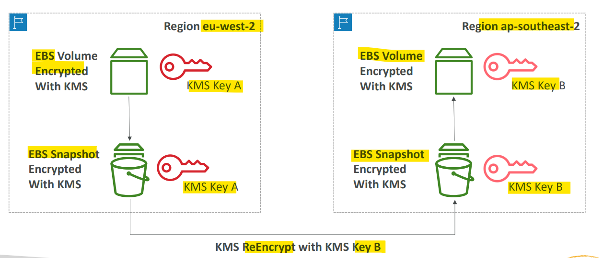

# Security: KMS

[Back](../index.md)

- [Security: KMS](#security-kms)
  - [KMS](#kms)
    - [Keys Types](#keys-types)
    - [keys in KMS](#keys-in-kms)
    - [scope in region](#scope-in-region)

---

## KMS

- `Key Management Service (AWS KMS)`
  - an AWS managed service for creating, controlling, and auditing **cryptographic keys** used to encrypt, decrypt, and digitally sign data.

- Anytime you hear “encryption” for an AWS service, it’s most likely KMS
- AWS **manages encryption keys** for us
- Fully integrated with `IAM` for authorization
- Easy way to control access to your data
- Able to **audit** KMS Key usage using `CloudTrail`
- Seamlessly **integrated** into most AWS services (EBS, S3, RDS, SSM…)
- **Never** ever store your secrets in **plaintext**, especially in your code!
  - `KMS Key Encryption` also available through **API calls** (SDK, CLI)
  - Encrypted secrets can be stored in the code / environment variables

---

### Keys Types

- `KMS Keys` is the new name of `KMS Customer Master Key`
- **`Symmetric` (AES-256 keys)**
  - **Single encryption key** that is used to **Encrypt and Decrypt**
  - **AWS services** that are integrated with KMS use `Symmetric CMKs`
  - You **never get access** to the KMS Key unencrypted (**must call KMS API** to use)

- **`Asymmetric` (RSA & ECC key pairs)**
  - `Public` (**Encrypt**) and `Private Key` (**Decrypt**) pair
  - Used for
    - Encrypt/Decrypt,
    - or Sign/Verify operations
  - The `public key` is **downloadable**, but you **can’t access** the `Private Key` unencrypted
- Use case:
  - encryption outside of AWS by users who can’t call the KMS API

---

### keys in KMS

- Types of KMS Keys:
  - `AWS Owned Keys (free)`:
    - SSE-S3,
    - SSE-SQS,
    - SSE-DDB (default key)
  - `AWS Managed Key`:
    - free (aws/service-name, example: aws/rds or aws/ebs)
  - `Customer managed keys`
    - created in KMS: $1 / month
  - `Customer managed keys imported`:
    - $1 / month
- Pricing:
  - plus pay for API call to KMS ($0.03 / 10000 calls)

- **Automatic Key rotation:**
  - `AWS-managed KMS Key`: **automatic** every **1 year**
  - `Customer-managed KMS Key`:
    - automatic: must be enabled
    - on-demand
  - `Imported KMS Key`:
    - only **manual rotation** possible using alias

---

### scope in region

- example: Copying Snapshots across regions
  - must use key per region

