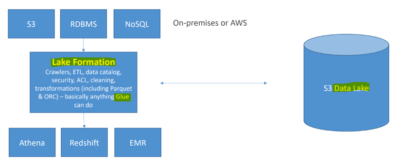

# Lake Formation

[Back](../index.md)

- [Lake Formation](#lake-formation)
  - [Lake Formation](#lake-formation-1)
    - [Building a Data Lake](#building-a-data-lake)
    - [Governed Tables and Security](#governed-tables-and-security)
    - [Data Permissions](#data-permissions)
    - [Data Filters](#data-filters)

---

## Lake Formation

- “Makes it easy to set up a **secure data lake in days**”
- **Loading** data & **monitoring** data flows
- Setting up **partitions**
- **Encryption** & managing keys
- Defining **transformation jobs** & monitoring them
- **Access** control
- **Auditing**
- Built **on top of** `Glue`

---

- **Pricing**
  - **No cost** for Lake Formation itself
  - But **underlying services** incur charges
    - Glue
    - S3
    - EMR
    - Athena
    - Redshift

---

- **Cross-account** Lake Formation **permission**
  - **Recipient** must be set up as a data lake **administrator**
  - Can use `AWS Resource Access Manager` for **accounts external** to your organization
  - **IAM permissions** for cross-account access
- `Lake Formation` does **not support** manifests in `Athena` or `Redshift` queries
- IAM permissions on the `KMS` encryption key are **needed for encrypted data catalogs** in Lake Formation
- IAM permissions needed to create **blueprints** and **workflows**

---

### Building a Data Lake

1. Create an **IAM user** for **Data Analyst**
2. Create `AWS Glue` connection to your **data source(s)**
3. Create `S3` bucket for the lake
4. **Register** the `S3` path in Lake Formation, grant **permissions**
5. **Create database** in Lake Formation for **data catalog**, grant **permissions**
6. Use a **blueprint** for a workflow (ie, Database snapshot)
7. Run the **workflow**
8. Grant **SELECT permissions** to whoever needs to read it (Athena, Redshift Spectrum, etc)

---

### Governed Tables and Security

- Now supports `“Governed Tables”` that support **ACID transactions** across **multiple tables**
  - New type of `S3` table
  - **Can’t change** choice of governed **afterwards**
  - Works with **streaming data** too (`Kinesis`)
  - Can **query** with `Athena`
- **Storage Optimization** with **Automatic Compaction**
- **Granular Access Control** with **Row and CellLevel Security**
  - Both for `governed` and `S3` tables
- Above features incur additional charges based on usage

---

### Data Permissions

- Can tie to **IAM users/roles**, **SAML**, or **external** AWS accounts
- Can use **policy tags** on _databases_, _tables_, or _columns_
- Can select specific **permissions for tables or columns**

---

### Data Filters

- **Column**, **row**, or **cell-level** security
- Apply when granting **SELECT permission** on tables
- “All columns” + **row filter** = **rowlevel security**
- “All rows” + **specific columns** = **column-level security**
- **Specific columns** + **specific rows** = **cell-level security**
- Create filters via the **console** (seen here) or via `CreateDataCellsFilter` API.
