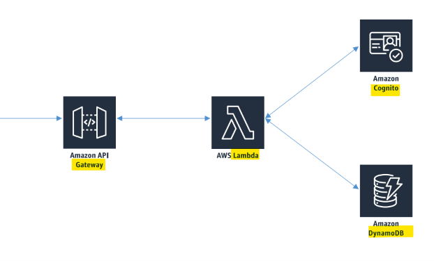
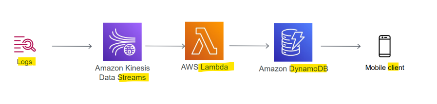
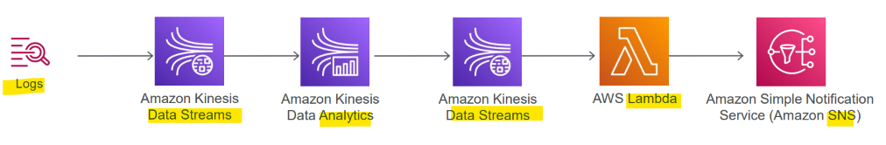
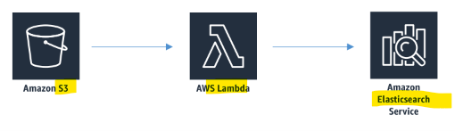
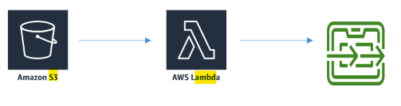
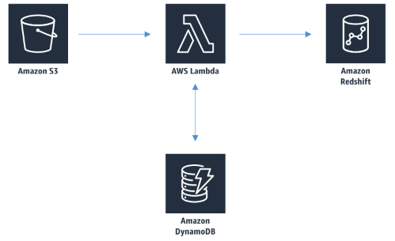
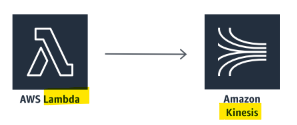

# AIP: Lambda

[Back](../index.md)

- [AIP: Lambda](#aip-lambda)
  - [Lambda](#lambda)
    - [Server vs serverless](#server-vs-serverless)
  - [integration with AI application](#integration-with-ai-application)
    - [withs Kinesis (popular in exame)](#withs-kinesis-popular-in-exame)
    - [with Bedrock / GenAI](#with-bedrock--genai)

---

## Lambda

- A way to **run code snippets** “in the cloud”
- **Serverless**
- **Continuous scaling**
- Often used to **process data** as it’s moved around

- Supported languages
  - Node.js
  - Python
  - Java
  - C#
  - Go
  - Powershell
  - Ruby

- main uses
  - **Real-time** **file** processing
  - **Real-time stream** processing
  - **ETL**
  - **Cron** replacement
  - Process **AWS events**

- example: serverless website

- example: asyncly update log
  - trigger lambda by event in log with kinesis

- example: transaction rate alarm
  - trigger lambda by event streaming with kinesis

---

### Server vs serverless

- Server management
  - **patches**
  - **monitoring**
  - **hardware failures**,
  - etc.
- Servers can be cheap, but **scaling** gets **expensive** really fast
- You **don’t pay for processing time** you don’t use
- Easier to **split up development** between `front-end` and `back-ends`

---

## integration with AI application

- with Opensearch

- Data Pipeline

- with Redshift(data warehouse service)
  - Best practice for **loading data** into `Redshift` is the `COPY` command
  - But, you can use `Lambda` if you need to respond to new data that shows up at any time
  - Can use `DynamoDB` to keep track of what’s been loaded
  - `Lambda` can batch up new data and load them with `COPY`

---

### withs Kinesis (popular in exame)

- **NOTE: `Lambda` is **polling** the data from `Kinesis`, not `Kinesis` pushing.**

- Your `Lambda` code receives an event with a **batch of stream records**
- You specify a **batch size** when setting up the **trigger**
  - e.g, up to 10,000 records
  - Too large a batch size can cause timeouts!
  - Batches may also be split beyond Lambda’s **payload limit (6 MB)**
- Lambda will **retry the batch** until it succeeds or the data expires
  - This can **stall the shard** if you don’t handle errors properly
  - Use **more shards** to ensure processing isn’t totally held up by errors
- `Lambda` **processes shard data synchronously**

---

### with Bedrock / GenAI

- Connecting agents with **tools**
  - Parameter validation, error handling
- On-demand **FM invocation**
  - Without provisioning capacity
- Receiving **webhooks for integrations**
- Handle **JSON events** from `API Gateway`
- Custom **aggregation logic**
  - From **multiple models** (weighted averaging?), or models that **vote**

---
