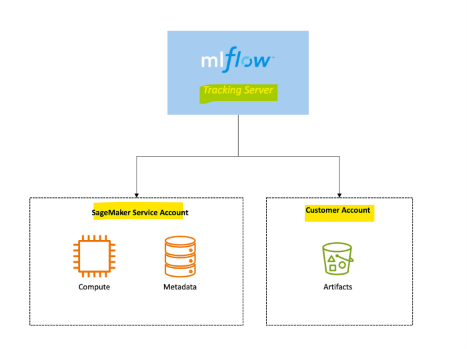

# AIP: MLFlow

[Back](../index.md)

- [AIP: AppConfig](#aip-appconfig)
  - [AppConfig](#appconfig)

---

## MLFlow

- **Open-source platform** for ML / GenAI **workflows**
- Offers **observability**, **evaluations**, **tracking**, **tracing**, **AI gateway**
- **Model management** and deployment
- `MLFlow` is integrated into `Amazon SageMaker AI`
  - Managed service
  - Integrates with **model** development, management, deployment, and **tracking**
  - Integration points:
    - SageMaker **Studio**
    - SageMaker **Model Registry**
    - SageMaker AI **Inference**
    - `IAM`
    - `CloudTrail`
    - `EventBridge`

