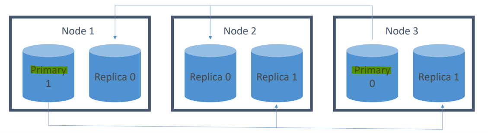
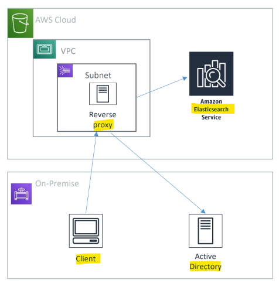
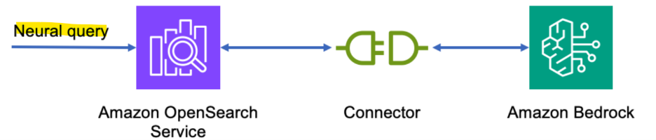

# AIP: Amazon Opensearch

[Back](../index.md)

- [AIP: Amazon Opensearch](#aip-amazon-opensearch)
  - [Opensearch](#opensearch)
    - [Concepts](#concepts)
    - [how it works](#how-it-works)
  - [Amazon Opensearch](#amazon-opensearch)
    - [Implementation options](#implementation-options)
    - [Security](#security)
    - [Anti-patterns - not to use OpenSearch](#anti-patterns---not-to-use-opensearch)
    - [Storage](#storage)
    - [Index State Managements](#index-state-managements)
    - [Cross-cluster replication](#cross-cluster-replication)
    - [Stability](#stability)
    - [performance](#performance)
    - [OpenSearch Serverless](#opensearch-serverless)
  - [OpenSearch as a Vector Store](#opensearch-as-a-vector-store)
    - [Neural Plugin](#neural-plugin)
    - [Vector Engines](#vector-engines)

---

## Opensearch

- `OpenSearch`
  - a distributed, open-source **search and analytics suite** sed for **full-text searching, log analytics, application monitoring, security analytics, and vector search** for AI workloads.
- A fork of `Elasticsearch` and `Kibana`

- Key Features
  - **OpenSearch Engine**:
    - A distributed, **RESTful search and data store** that **indexes** JSON documents and **scores** relevance using algorithms like BM25.
  - **OpenSearch Dashboards**:
    - A user-friendly **visualization interface** (similar to Kibana) used to build charts, graphs, maps, and operational monitoring panels.
  - **Vector Search & AI**:
    - Supports **high-dimensional vector search, k-NN (k-nearest neighbors), and Retrieval-Augmented Generation (RAG) workflows** for machine learning and AI applications.
  - **Data Prepper**:
    - A **server-side data collector** used to filter, enrich, and pipe logs and telemetry data into OpenSearch.

---

### Concepts

- `documents`
  - the things you’re **searching for**.
  - They can be more than text – any structured `JSON` data works.
  - Every document has a **unique ID**, and a **type**.

- `indices`
  - An index powers **search** into all documents within **a collection of types**.
  - They contain `inverted indices` that let you search across everything within them at once.

- `types`
  - A type defines the **schema** and mapping shared by documents that **represent the same sort** of thing.
    - A log entry, an encyclopedia article, etc.

---

### how it works

- shards for horizontal scaling
  - An `index` is split into `shards`
  - `Documents` are **hashed** to a particular `shard`.
  - Each `shard` may be on a different `node` in a cluster.
  - Every `shard` is a **self-contained Lucene index** of its own.

---

- Redundancy

- The application should **round-robin requests amongst nodes**.
- e.g.,
  - This index has two `primary shards` and two `replicas`.
  - **Write requests** are routed to the `primary shard`, then **replicated**
  - **Read requests** are routed to the `primary` or any `replica`

---

## Amazon Opensearch

- `Amazon OpenSearch` (formerly named `ElasticSearch`)
  - a fully managed cloud service on Amazon Web Services (AWS) that allows to easily deploy, secure, and scale **search and analytics workloads**.
  - **can** be serverless

  - A search engine
  - An analysis tool
  - A visualization tool (Dashboards = Kibana)
  - A data pipeline
    - `Kinesis` replaces Beats & LogStash
  - Horizontally scalable

- features:
  - **Scale** up or down without downtime
    - But this isn’t automatic
  - **Pay** for what you use
    - Instance-hours, storage, data transfer
  - **Network isolation**
  - AWS **integration**
    - `S3` buckets (via `Lambda` to `Kinesis`)
    - `Kinesis` Data Streams
    - `DynamoDB` Streams
    - `CloudWatch` / `CloudTrail`
  - Zone awareness

- Common use cases:
  - Full-text **search**
  - **Log** analytics
  - Application **monitoring**
  - **Security** analytics
  - **Clickstream** analytics

---

### Implementation options

- Dedicated **master node(s)**
  - Choice of **count** and **instance types**
- “Domains”
  - the collection of **all resoures** needed to run OpenSearch cluster
  - an opensearch **cluster** is a **domain**
- can enable Snapshots to `S3`
- Zone Awareness
  - improve HA
  - at the cost of latency

---

### Security

- **Resource-based** policies
- **Identity-based** policies
- **IP-based** policies
- Request **signing**
- `VPC`
- `Cognito`

---

- Securing Dashboards
  - `Cognito`
  - Getting inside a `VPC` from outside is hard…
    - Nginx reverse **proxy** on `EC2` forwarding to `OpenSearch` **domain**
    - `SSH` tunnel for port `5601`
    - `VPC Direct Connect`
    - `VPN`

---

### Anti-patterns - not to use OpenSearch

- **OLTP**
  - No transactional support for `OpenSearch`
  - `RDS` or `DynamoDB` is better
- **Ad-hoc** data querying
  - `Athena` is better
- Remember `Opensearch` is primarily for **search & analytics**

---

### Storage

- **Standard data nodes** use **hot storage**
  - Instance stores or `EBS` volumes
  - **fastest** performance

- **UltraWarm (warm) storage**
  - uses `S3 + caching`
  - Best for `indices` with **few writes**
    - like **log data**, **immutable data**
  - **Must** have a **dedicated** `master node`
  - **Slower** performance
  - much **lower cost**

- **Cold storage**
  - Also uses `S3`
  - **Must** have **dedicated** `master` and have `UltraWarm` enabled too.
    - **Not compatible** with `T2` or `T3` instance types on data nodes
  - **Even cheaper**
  - used for
    - **periodic research**
    - or **forensic analysis** on **older data**
  - If using fine-grained **access control**, must **map users** to `cold_manager` role in `OpenSearch Dashboards`

- Data may be **migrated** between different storage types

---

### Index State Managements

- **Automates** index management **policies**
- Examples
  - **Delete old indices** after a period of time
  - **Move indices into read only state** after a period of time
  - **Move** indices from **hot -> UltraWarm -> cold storage** over time
  - **Reduce replica** count over time
  - Automate index **snapshots**
- `Index State Managements(ISM) policies` are run every **30-48 minutes**
  - **Random** jitter to ensure they don’t all run at once
- Can even send **notifications** when dones

---

- **Index rollups(汇总)**
  - **Periodically roll up** old data into `summarized indices`
  - **Saves** storage **costs**
  - **New index** may have **fewer** fields, **coarser** time buckets
- **Index transforms**
  - Like rollups, but purpose is to create a **different view to analyze data** differently.
  - **Groupings** and **aggregationss**

---

### Cross-cluster replication

- **Replicate** `indices` / `mappings` / `metadata` **across domains**
- Ensures **high availability** in an outage
- Replicate data geographically for better **latency**
- `Follower index` **pulls** data from `leader index`
- Requires fine-grained **access control** and node-to-node **encryption**
- `Remote Reindex` allows **copying indices** from one **cluster** to another on demand

---

### Stability

- **3** dedicated `master nodes` is best
  - Avoids “split brain” if 2 master nodes
- Don’t run out of **disk space**
  - **Minimum** storage requirement is roughly:
    - `Source Data * (1 + Number of Replicas) * 1.45`
- Choosing the **number of shards**
  - `(source data + room to grow) * (1 + indexing overhead) / desired shard size`
  - In rare cases you may need to limit the number of shards per node
    - You usually run out of disk space first.
- Choosing **instance types**
  - At least 3 nodes
  - Mostly about storage requirements
  - i.e., m6g.large.search, i3.4xlarge.search, i3.16xlarge.search

---

### performance

- **Memory pressure** in the JVM can result if:
  - You have **unbalanced shard allocations** across nodes
  - You have **too many shards** in a cluster
- **Fewer shards** can yield **better** performance if `JVMMemoryPressure` errors are encountered
  - **Delete** old or unused indices

---

### OpenSearch Serverless

- On-demand **autoscaling**!
- Works against `collections` instead of provisioned `domains`
  - collections types:
    - `search`
    - `time series`
- Always **encrypted** with your KMS key
  - Data **access policies**
  - **Encryption at rest** is required
  - May configure **security policies** across many collections
- Capacity measured in `Opensearch Compute Units (OCUs)`
  - Can set an upper limit
  - **lower** limit is always **2 for indexing, 2 for search**

---

## OpenSearch as a Vector Store

- **Serverless** vector stores
  - Note “serverless” does not mean “scales to zero”
    - Remember to **shut down** your serverless OpenSearch instances if you’re not using them – or you’ll **keep getting billed**
  - The exam treats `OpenSearch` as the **primary implementation** for backing `Bedrock Knowledge Bases`
    - But I think this might get subsumed by the newer `S3 vectors` feature
- Not limited to Bedrock Knowledge Bases
  - Can also integrate with `SageMaker AI` and `HuggingFace` or custom models for `RAG`
- `SEMANTIC` vs. `HYBRID` search
  - `Semantic` refers to **vector search**
    - As we’ve seen relevancy can be elusive and dependent on your **chunking strategy**
  - `Hybrid` combines **vector** and **keyword search**
    - Requires **indexing** filterable **keyword fields** for metadata
  - This is important

---

- Vector **compression**
  - Different ANN methods have their own techniques (HNSW, IVF)
  - **Dense** embeddings add up **fast**
- Techniques of compression:
  - **Binary vectors**
    - Bit sequences (stored as bytes)
    - **Not embeddings**, but used for **fast distance search**
    - **32x compression** compared to `float32`
      - save space
  - **FP16**
    - A form of scalar quantization
    - Store embedding dimensions as **16-bit values** instead of 32-bit
    - default by HNSW

---

- Sharding strategies
  - Balance **shard size** and **CPU ratio**
  - **Larger shards** for `semantic search` (30-50 GB)
    - Vector search **benefits from fewer, larger shards** because there is **less cross-shard coordination**.
  - **Smaller** for `hybrid search` (10-30 GB)
  - On OpenSearch **Serverless**, this is **automatic**

---

- **Multi-index** approaches
  - Different **document `types`** belong in their own `index`
    - This way you can tune performance for each corpus
  - You might want **different `embedding models` for different `types`** of data
  - You’ll need some sort of **query routing** to pull this off.
    - use `Hierarchical Indices`

---

- Hierarchical Indices

- A **top level index** can serve as a general / summary layer
  - This index is small and fast
  - It **routes** you to an index with **more detailed** data per domain
  - It’s a way to implement **multiple indices** that are specialized for **different domains or data types**
    - With their own embedding models, shard sizes, tuning
- You could also use a **foundation model** to route to the right index.

---

### Neural Plugin

- Allows you to **integrate your embedding model** into an `OpenSearch` ingest pipeline
- `Neural queries` just allow `OpenSearch` to **accept text queries** and **generate embeddings** under the hood for vector queries.
- This is an **alternative** to using the **built-in** `Bedrock Knowledge Base` integration with OpenSearch Serverless
- The `Neural plugin` allows `OpenSearch` to **call** your Bedrock **model** for embeddings **as part of search or ingestion**.

---

### Vector Engines

- Top-level engines are
  - `Facebook AI Similarity (FAISS)`
  - `Non-Metric Space Library (NMSLib)`
  - `Apache Lucene`.
- `Exact Nearest Neighbor` search
  - This is **slow**
- `Approximate Nearest Neighbor (ANN)` search
  - `Heirarchical Navigable Small World (HNSW)`
    - **Fast**, **high-quality**, simple – but uses **lots of RAM**
  - `Inverted File (IVF)`
    - Better for really **huge datasets**, can trade recall for speed & memory
- **HNSW Tuning**
  - `M` = How many **edges per node**
    - **Higher** `M` -> **denser** graph, **higher** recall, but **more memory**
  - `ef_construction` = Size of **dynamic list** used for KNN graph
    - **Higher** -> more **accurate** graph, **slower** indexing speed
  - `ef_search` = How **thoroughly** the graph is explored
    - **Higher** -> higher **recall**, but **slower** search performance

---
