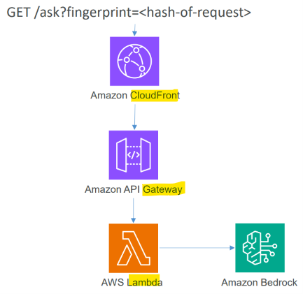

# AIP Optimization: Token

[Back](../index.md)

- [AIP Optimization: Token](#aip-optimization-token)
  - [Token Efficiency](#token-efficiency)
    - [Common Token Efficiency Techniques](#common-token-efficiency-techniques)
    - [with CloudWatch Monitors](#with-cloudwatch-monitors)
  - [Cost-Effective Model Selection](#cost-effective-model-selection)
    - [Measuring Price:Performance Ratio](#measuring-priceperformance-ratio)
  - [Maximizing Resource Utilization](#maximizing-resource-utilization)
  - [Intelligent Caching Systems](#intelligent-caching-systems)
    - [Semantic Caching](#semantic-caching)
    - [Prompt Caching](#prompt-caching)
    - [Edge Caching](#edge-caching)
  - [Building Responsive AI Systems](#building-responsive-ai-systems)
  - [Optimizing Retrieval Performance](#optimizing-retrieval-performance)
  - [Optimizing for Specific Use Cases](#optimizing-for-specific-use-cases)
  - [Optimizing Foundation Model](#optimizing-foundation-model)
    - [System Performance](#system-performance)
    - [with `SageMaker`](#with-sagemaker)
  - [Exponential Backoff](#exponential-backoff)
  - [Connection Pooling](#connection-pooling)
  - [Bedrock Cross-Region Inference](#bedrock-cross-region-inference)

---

## Token Efficiency

- Token Estimation and Tracking
  - `Bedrock` has a `CountTokens` API
    - Returns **token count** for a given request without actually running it
    - Different models behave differently
    - Costs nothing
  - **Estimate costs** prior to inference
  - **Optimize prompts** to fit within token limits
- `CloudWatch` tracks this too – also on the output side
  - `InputTokenCount`
  - `outputTokenCount`

---

### Common Token Efficiency Techniques

- `Context Window Optimization` / `Context Pruning`
  - **Chunking** RAG data, limiting # of chunks retrieved
  - **Filtering** chunks by metadata to toss irrelevant stuff
  - **Summarize** (or even toss) older parts of conversation history
- `Response Size Controls` / `Response Limiting`
  - Use `maxTokens`
  - Bake desired length in the prompt
    - e.g., respond in 50 words or less
  - Use **few-shot examples** to illustrate the desired verbosity
  - Use **JSON output** to force a given format / length
- `Prompt Compression`
  - Use a **small model** to **summarize** large chats, documents before sending to larger model
  - Use `Knowledge Bases` instead of complete documents in the prompt

---

### with CloudWatch Monitors

- use for additional optimization opportunities
- Count, time for requests
- `Time to First Token(TTFT)` (in streaming)
- **Throttles** / server **errors** / client errors on invocation
- Model **latency**, invocation **count**, **throttles**
- And again – input / output token counts

---

## Cost-Effective Model Selection

- **Cost / Capability Tradeoff**
  - Do you really need the largest, most expensive model?
  - If the “smarts” are in RAG and tool usage, maybe a smaller model will do just fine
  - Smaller models may also play a role in **pre-processing**
    - Summarization, compression, classification, chunking – doesn’t need PhD-level smarts
- **Tiered usage based on query complexity** – `Dynamic Routing`
  - AKA `Intelligent Prompt Routing`
    - (This is now a feature in Bedrock as well)
  - Route to different models **based on the complexity of the query**
    - (This is how ChatGPT works under the hood…)
  - Many ways to route
    - A conditional Flow; Lambda; Agent Squad; Strands
    - This is a great application of agents – with a tool to score “complexity”

---

### Measuring Price:Performance Ratio

- You can use tools like `Amazon Bedrock Evaluations` to measure `Foundation Model` performance against your prompt dataset
  - This can use **human** or **LLM judges**, or just **predefined metrics**
  - The compare feature in Evaluations lets you **visualize** the performance of different models with your prompts
- Pair that with token counting to **estimate costs** (or track actual costs)
- Now you can make informed tradeoffs…

---

## Maximizing Resource Utilization

- **Batching strategies**
  - **Batch** `embeddings` up for `vector stores`
  - `Bedrock Batch Inference`
    - Submit many prompts together in S3, get responses in S3
- **Capacity planning** with Bedrock
  - Work from desired `tokens per minute (TPM)`, `requests per minute (RPM)`
  - `AWS Service Quotas` has a Bedrock tool (seen here)
  - **Request a quota** increase if necessary, or provisioned throughput
- `AWS CloudFormation` **templates** can help with capacity planning
- **Tensor parallelism**
  - **Shards** LLM weights **across GPUs**
  - Better **memory utilization** per container

---

- **Provisioned throughput**
  - Bedrock allows you to **provision by Tokens or by Model Units (MU’s)** which corresponds to token throughput
  - You **must provision** for **customized models**
  - Useful for **consistent performance** with **high volume**
  - You provision for **a given model**, and must provide the **provisioned model ARN** as the modelID when running inference on it
- **Utilization monitoring**
  - `CloudWatch` is your friend, with dashboards
  - `AWS Cost Explorer` to attribute model costs to business functions
- **Auto-scaling**
  - **Serverless** solutions like `Lambda`, `Bedrock`, `OpenSearch serverless`, `AgentCore`

---

## Intelligent Caching Systems

### Semantic Caching

- **Cache embeddings of prompts & responses** instead of the prompt text
- Store in an in-memory vector store
  - `ElastiCache` for Valkey, MemoryDB
  - You **could** use `OpenSearch` too
  - For new prompts,
    - create an **embedding**,
    - find **nearest** neighbors in **cache**,
    - if similarity score > threshold, **return cached response**
- Tune the similarity threshold carefully
  - Balance **cache hits** with **relevant responses**
- Make sure the **overhead** does not outweigh the **benefits**
- Can dramatically **improve latency** for some applications.

---

### Prompt Caching

- Improves latency for supported models
  - Built into Bedrock
- You **cache a prompt prefix**
  - **Static content**, like instructions, and few-shot examples
  - Like a system prompt
  - Place dynamic content at the end
  - A **cache checkpoint** separates the two
- No need to **tokenize the prefix** again
- You might also **cache an uploaded document** that is queried **repeatedly**
- Cached content is discounted per token
  - But writes may be more expensive
- Cache reads & writes are monitored in `CloudWatch`
- `Prompt caching` is an option in `Bedrock Prompt Management` as well

---

### Edge Caching

- Use `CloudFront` when you can
  - Reduces latency and backend requests
- But wait, isn’t GenAI dynamic? What can you cache?
  - Well, some prompts / responses are common and can be cached
  - If you have a **deterministic request hash**, you can bake that fingerprint into a GET request, which `CloudFront` could cache
  - The **results** can also be fingerprinted to identify when it’s appropriate (based on model configuration values)
  - Might want an aggressive `TTL` if things change often
- There’s more to an app than the LLM piece
  - Cache that too

---

## Building Responsive AI Systems

- Use **parallel requests** for complex workflows
  - Multi-agent workflows **in parallel**
  - `Step Functions` can also do this
- Cache / pre-compute **predictable queries**
- **Response streaming**
- Latency-optimized inference for FMs
  - A feature of `Bedrock`
    - Specify `performanceConfig={'latency':'optimized’}` in your API calls
  - Optimizes
    - `Time to First Token (TTFT)`
    - `Output Tokens per Second (OTPS)`
    - `End to End Latency (E2E)`

---

- Use `Amazon Bedrock Intelligent Prompt Routing`
  - Direct requests to **different models** based on complexity
- Keep your prompts **concise**
  - Put the **important stuff** **first** in case it gets truncated
- **Context pruning**
  - **Ditch** RAG results that aren’t valuable or are redundant
- Limit **response sizes**
- **Break up complex tasks**

---

## Optimizing Retrieval Performance

- Optimize `OpenSearch` vector stores
- Optimize your `indices`
- `Hybrid search` improves relevancy
  - You can also have your own **custom hybrid scoring functions**

- Query pre-processing
  - **Normalize query** to the corpus in terms of style
  - **Break up** multi-part questions – don’t try to look up two different things at once
  - Filter out **irrelevant stuff**
  - Reduce **ambiguity**
  - **Keyword** extraction for `hybrid search`

---

## Optimizing for Specific Use Cases

- Different models have different **parameters** you can tune
- Use `A/B testing` to evaluate changes
  - `Bedrock Evaluations`
  - `CloudWatch Evidently`
- Some common parameters
  - `Temperature`
    - Amount of **randomness** in the response (0=not random, 1 = “creative”)
  - `Top_p`
    - “Nucleus sampling” – **Probability threshold** for token candidates (specify this OR temperature)
  - `Top_k`
    - How **many token options** to sample from

---

## Optimizing Foundation Model

### System Performance

- **API call profiling**
  - Find **patterns** in your **requests**
  - This might identify opportunities for caching, batching, RAG improvements
- Use **structured input and output** when possible
  - JSON, XML templates
  - Improves efficiency and accuracy
- **Chain of Thought instruction** patterns
  - “Reasoning” – forcing the FM to show the process step by step produces more accurate conclusions for **complex reasoning tasks**
- **Feedback loops** capturing user satisfaction & behavior
  - Use this to identify effective prompts

---

- `UltraServers` (Trn2, P6e-GB200)
  - **Connects EC2 instances** hosting your AI/ML workloads
  - Low **latency**, high bandwidth accelerator interconnects
- Use `Lambda endpoint lifecycle management`
  - Can automatically initialize endpoints
  - Download model artifacts from `S3`
  - …on demand, when processing is triggered

---

### with `SageMaker`

- `SageMaker AI` can deploy models up to 500GB
  - Adjust container **health check** and **download timeout quotas** to allow enough time to download them and their resources!
- 3rd party model **parallelization supported**
  - Triton, FasterTransformer, DeepSpeed
- Instance type guidance
  - Large models: `ml.p4d.24xlarge (GPU)`
  - Small models (ie, named entity recognition): `ml.c5.9xlarge (CPU)`

---

## Exponential Backoff

- How to **retry failed API calls** in a controlled manner
  - Don’t flood the poor broken service
- Custom **retry policies** in `AWS SDK` clients
  - Start at 100ms
  - **Backoff factor 2**
  - Max retry count of 3-5 attempts
  - Jitter +- 100ms to prevent synchronized retries across clients
- Oddly specific guidance in SkillBuilder…

---

## Connection Pooling

- For **HTTP clients**
- Instead of establishing a new connection for every request, maintain **a pool of open connections** that are used all the time.
  - 10-20 connections per instance
  - Connection TTL 60-300 seconds
- Balances resource utilization with **connection re-use efficiency**
- More oddly specific guidance in SkillBuilder…

---

## Bedrock Cross-Region Inference

- This comes up a lot… many features require it, many recommend it strongly
- **Distributes workloads across AWS regions** during service interruptions
  - …or restrictions from **quotas or peak usage** in specific regions
- Things like `Amazon Organizations SCP’s (service control policies)` can **block regions** on you and prevent it from working
  - Make sure SCP **allows all regions** you are enabling, or leave the region **unspecified**
- **Inference profiles**
  - Specific **geography**: selects **optimal region** within your geography
  - **Global**: selects **optimal commercial AWS region**
  - **Doesn’t work with provisioned throughput**

---

- **Geographic** `cross-region inference`
  - Useful if you have **data residency requirements**
  - **Standard** pricing
- **Global** `cross-region inference`
  - **Maximized throughput**
  - **10%** cost savings
- **Pricing** based on **where you called it from**
- You don’t have to enable these regions in your account
- Data is **encrypted** in transit, and **logged** in `CloudTrail`
