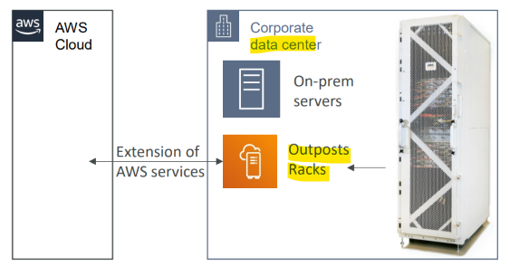

# AIP: Outposts

[Back](../index.md)

- [AIP: AppSync](#aip-appsync)
  - [AppSync](#appsync)

---

## Outposts

- `AWS Outposts`
  - a fully managed service that **brings** Amazon Web Services (AWS) infrastructure, services, APIs, and tools directly to your own **on-premises data center**, **co-location space**, or **edge site**.

- **Key Features**
  - **Hybrid Consistency**:
    - **Run** the same AWS software, programming interfaces (APIs), and tools **on-premises** that you use in the public AWS cloud.
  - **Form Factors**:
    - Available as a standard `AWS Outposts Racks` (`42U` size, scaling from 1 to 96 racks) for **data centers**, or smaller 1U/2U AWS Outposts Servers for space-constrained **edge locations**.
  - **Supported Services**:
    - Run **local compute and storage workloads** using core services like `Amazon EC2`, `Amazon ECS`, `Amazon EKS`, `Amazon EBS`, and `Amazon S3`, while **connecting** back to the **broader AWS Region** for other services.
  - **Fully Managed**:
    - AWS operates, monitors, updates, and patches the **hardware and infrastructure** for you.

---

- **Hybrid Cloud**:
  - businesses that keep an **onpremises** infrastructure alongside a **cloud infrastructure**
- Therefore, two ways of dealing with IT systems:
  - One for the **AWS cloud** (using the AWS console, CLI, and AWS APIs)
  - One for their **on-premises infrastructure**
- `AWS Outposts` are `server racks` that offers the same AWS infrastructure, services, APIs & tools to build your own applications **on-premises** just as in the cloud
- AWS will **setup and manage** `Outposts Racks` within your **on-premises infrastructure** and you can start leveraging AWS services onpremises
  - You are responsible for the Outposts Rack **physical security**

- **Benefits**:
  - **Low-latency** access to on-premises systems
  - **Local** data processing
  - Data **residency**
  - **Easier migratio**n from on-premises to the cloud
  - Fully **managed** service

- Support services:
  - `Amazon EC2`
  - `Amazon EBS`
  - `Amazon S3`
  - `Amazon EKS`
  - `Amazon ECS`
  - `Amazon RDS`
  - `Amazon EMR`

---

### GenAI

- Relevant for **data compliance** across **jurisdictions**
  - Different countries have different AI laws
- Data **privacy**
  - **On-premise** data integration
- Need **sufficient compute and storage** for your FM inference
  - Based on your on-prem data volume and requirements
  - **Local caching** can **minimize data movement**
