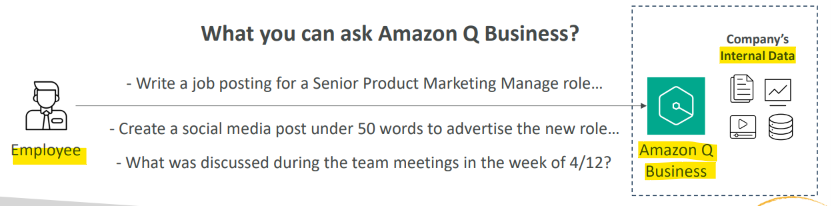
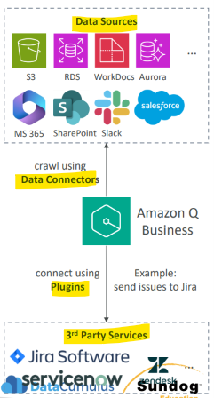
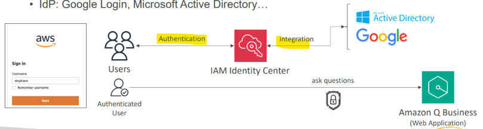
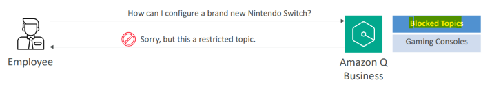

# AIP: Amazon Q Business

[Back](../index.md)

- [AIP: Amazon Q Business](#aip-amazon-q-business)
  - [Amazon Q Business](#amazon-q-business)
    - [with IAM Identity Center](#with-iam-identity-center)
    - [Admin Controls](#admin-controls)

---

## Amazon Q Business

- Fully managed **Gen-AI assistant** for your **employees**
- Based on your **company’s knowledge and data**
  - Answer questions, provide summaries, generate content, automate tasks
  - Perform routine actions (e.g., submit time-off requests, send meeting invites)
- Built on `Amazon Bedrock` (but you **can’t choose** the underlying FM)

---

- **Create Gen AI-powered apps without coding** by using natural language
- Leverages your company’s **internal data**
- Possibility to leverage **plugins** (Jira, etc…)

---

- **Data Connectors**
  - fully managed RAG
  - connects to 40+ popular enterprise **data sources**
  - e.g.,
    - Amazon S3, RDS, Aurora, WorkDocs…
    - Microsoft 365, Salesforce, GDrive, Gmail, Slack, Sharepoint…
- **Plugins**
  - allows you to **interact** with 3rd party services
  - Jira, ServiceNow, Zendesk, Salesforce…
  - **Custom Plugins**
    - connects to any 3rd party application using APIs

---

### with IAM Identity Center

- Users can be **authenticated** through `IAM Identity Center`
- Users **receive responses** generated only from the documents they have **access** to
- `IAM Identity Center` can be configured with `external Identity Providers`
  - IdP: Google Login, Microsoft Active Directory…

---

### Admin Controls

- **Controls and customize responses** to your organizational needs
- `Admin controls` == `Guardrails`
- **Block** specific words or topics
- Respond only with **internal information** (vs using external knowledge)
- **Global** controls & **topic-level** controls (more granular rules)

