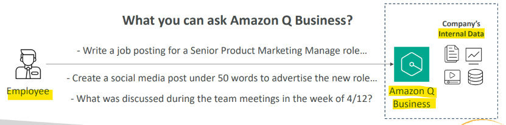

# AIP: Amazon Q Business

[Back](../index.md)

- [AIP: Amazon Q Business](#aip-amazon-q-business)
  - [Amazon Q Business](#amazon-q-business)

---

## Amazon Q Business

- Fully managed **Gen-AI assistant** for your **employees**
- Based on your **company’s knowledge and data**
- Answer questions, provide summaries, generate content, automate tasks
- Perform routine actions (e.g., submit time-off requests, send meeting invites)
- Built on `Amazon Bedrock` (but you **can’t choose** the underlying FM)

