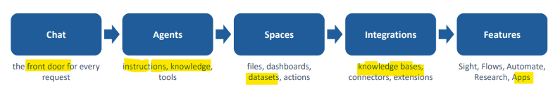
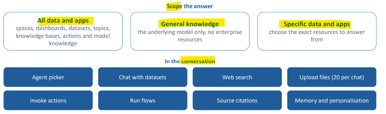
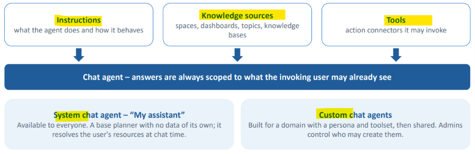
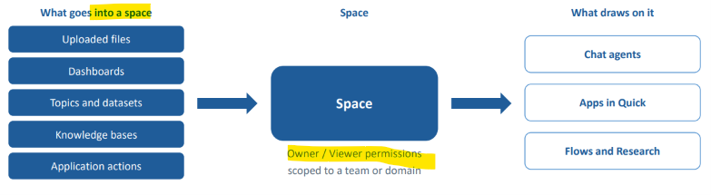
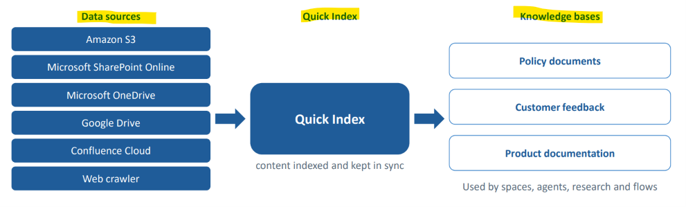
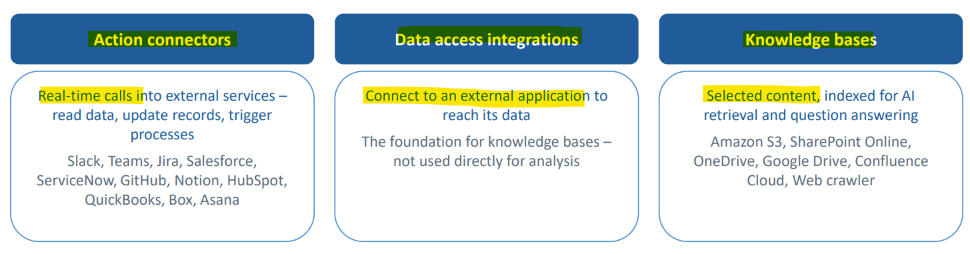
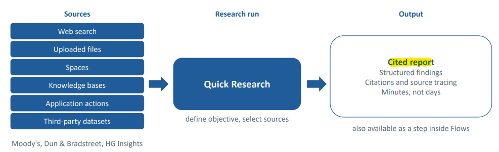
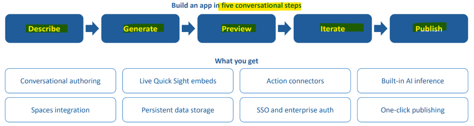
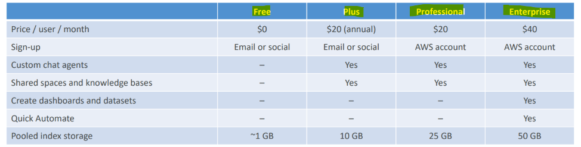

# AIP: Amazon Quick

[Back](../index.md)

- [AIP: Amazon Quick](#aip-amazon-quick)
  - [Amazon Quick](#amazon-quick)
    - [The Problems Amazon Quick Solves](#the-problems-amazon-quick-solves)
    - [vs. ChatGPT, Claude or Gemini on AWS](#vs-chatgpt-claude-or-gemini-on-aws)
    - [Layers](#layers)
  - [Chat – The Primary Interface](#chat--the-primary-interface)
    - [Chat Agents](#chat-agents)
  - [Grounding `Quick`](#grounding-quick)
    - [Spaces – Shared Context for Teams](#spaces--shared-context-for-teams)
    - [Knowledge and the Quick Index](#knowledge-and-the-quick-index)
    - [Connectors and Integrations](#connectors-and-integrations)
  - [Quick Flows – Automate Routine Tasks](#quick-flows--automate-routine-tasks)
    - [Flow Step Types – The Palette](#flow-step-types--the-palette)
    - [`Quick Flows` vs. `Quick Automate`](#quick-flows-vs-quick-automate)
  - [Research Mode](#research-mode)
  - [No-Code Web Applications](#no-code-web-applications)
  - [Security and Governance](#security-and-governance)
  - [Pricing – Four Plans](#pricing--four-plans)
  - [Limitations and Things to Watch](#limitations-and-things-to-watch)

---

## Amazon Quick

- **AI assistant** for work: chat, research, BI, automation and no-code apps in one place
- Evolved from `QuickSight`, which continues as Quick Sight inside Quick; existing APIs and integrations keep working
- **Fully managed** – no infrastructure, no models to host, no ML expertise
- Grounded in your systems through knowledge bases, connectors and structured data
- Open **standards** – `MCP` and `OpenAPI` connect anything
- Use Quick from the web, desktop app, or embedded in Chrome, Slack, Teams and Microsoft 365

---

### The Problems Amazon Quick Solves

- **Knowledge scattered** across S3, SharePoint, Confluence, Drive, Slack, Jira and CRMs
- Generic chatbots that can't see enterprise data – confident answers, no citations
- **BI** locked behind analysts; business users wait days for a number
- **Research and synthesis done by hand** across dozens of tabs
- Insight without action – the tool gives you the answer, but a person still has to open Jira or Salesforce and make the change
- Shadow AI: staff pasting **confidential data** into unapproved tools

---

### vs. ChatGPT, Claude or Gemini on AWS

- **Identity** you already run
  - IAM, IAM Identity Center, SAML 2.0, MFA, RBAC and SSO
- **Permission-aware answers**
  - agents return only what the user may already see
- **Private data** paths
  - `VPC`, `Direct Connect` and `Site-to-Site VPN` to on-premises sources
- Native **analytics** over `Redshift`, `Athena`, `S3` and `SPICE`, not a file upload
- Your **data** stays in your **control** and is not used to train someone else's models
- One AWS **agreement, bill, Region** choice and **compliance** posture

---

### Layers

- Every request flows through the **same five layers**
  - `chat` interprets it,
  - an `agent` plans it,
  - a `space` supplies the context,
  - `integrations` reach your systems,
  - and a `feature` does the work.
- Delivered through the web app, desktop app, Chrome, Slack, Microsoft Teams and Microsoft 365

---

## Chat – The Primary Interface

- One natural-language **front door**:
  - answer from data,
  - generate content,
  - run a flow,
  - start research or take an action in a connected app.

---

### Chat Agents

- An agent is **instructions** plus **knowledge sources** plus **tools**:
  - preconfigured agents stay **inside their assigned resources**,
  - unopinionated ones let chat decide the boundary.

---

## Grounding `Quick`

### Spaces – Shared Context for Teams

- A `space` is a **collection of data** and Quick **resources** scoped to a team or domain, so **agents answer only from that context**
- Owners share, link and unlink resources; viewers ask questions and download files. Sharing a space does not by itself grant access to the underlying assets.

---

### Knowledge and the Quick Index

- An **indexed collection** of content from your data sources, **optimised** for AI retrieval, semantic search and cited answers
- Many `knowledge bases` share one `Quick Index`; **access control** sits at the **knowledge base level**. Bring your own Q Business index or Bedrock knowledge base.
  - Pooled storage: **25 GB Professional, 50 GB Enterprise**.

---

### Connectors and Integrations

- Around 50 supported applications, in three **integration types**. Most support actions only – the knowledge base list is much shorter.
- Build your own with MCP servers, OpenAPI specifications or REST APIs
- Extensions embed Quick in Chrome, Slack, Teams and Microsoft 365

---

## Quick Flows – Automate Routine Tasks

- A `flow` is a **reusable sequence of steps** you define once and run whenever you need it
- Build one three ways:
  - generate it **from a chat conversation**,
  - describe it in **natural language**,
  - or assemble it in the **visual editor**
- Run it guided step-by-step, or conversationally to refine outputs and ask follow-ups
- Publish to an `admin-managed library` to share across the organisation
- No technical skills required – aimed at any **business user**

---

### Flow Step Types – The Palette

- Steps come from **five categories**

- **User input**
  - Gathers what the flow needs from the person running it
    - Text
    - Files

- **AI responses**
  - Six ways to have AI produce something
    - Chat agent
    - Research
    - Web search
    - General knowledge
    - UI agent
    - Create image

- **Data insights**
  - Pulls grounded answers from your own data
    - Spaces and knowledge bases
    - Dashboards and topics

- **Actions**
  - Reads or writes in connected apps such as Jira or Salesforce
    - Application actions

- **Flow logic**
  - Applies run instructions across one or more steps
    - Reasoning groups

- **Mix and match**
  - A flow uses as many or as few of these as it needs, in whatever order the task requires.

---

### `Quick Flows` vs. `Quick Automate`

- Two sibling automation capabilities, not tiers of one product
  - Automate is a separate builder, not Flows with the limits raised
- `Flows` lets **any business user** automate routine tasks;
- `Automate` lets power users orchestrate **end-to-end business processes** at enterprise scale

|                    | `Quick Flows`                                                                  | `Quick Automate`                                                                        |
| ------------------ | ------------------------------------------------------------------------------ | --------------------------------------------------------------------------------------- |
| Who it's for       | **Individual** users – personal and team productivity                          | Centralised and **enterprise-wide**; runs independently of any one user                 |
| Scope and duration | **Shorter tasks**: generating reports, drafting content, responding to tickets | **Long-running**, high-volume: loan applications, invoice processing, vendor compliance |
| Customisation      | A simple set of **no-code** building blocks                                    | Control flow logic, case management, error handling, custom code, human-in-the-loop     |
| Availability       | All plans                                                                      | Enterprise only – not available on Free or Plus                                         |

---

## Research Mode

- `Quick Research` runs deep, multi-source **investigations** and returns a structured, cited **report**.
  - market and competitor **analysis**, literature **reviews**, sregulatory **research**, customer **insights**

---

## No-Code Web Applications

- Describe the app in n**atural langua**ge and the **agent writes** it live while you watch
  - e.g., Intake forms, status trackers, calculators, document viewers – shared internally or published as a public site

---

## Security and Governance

- Quick runs on the **identity, network and compliance controls** your security team already approved.

- **Identity**
  - IAM, IAM Identity Center, SAML 2.0 federation, Active Directory, MFA, RBAC and SSO
- **Network**
  - Private VPC connections via elastic network interfaces, Direct Connect or Site-to-Site VPN, plus IP and VPC access restrictions
- **Encryption**
  - TLS 1.2 minimum in transit; SPICE block-level encryption at rest; KMS customer-managed keys, configured before resources are created
- **Data controls**
  - **Row-level security**, namespaces for multi-tenancy, domain allow-listing, mobile device settings, **data sovereignty controls**
- **Assurance**
  - Guardrails and toxicity filters, CloudTrail **audit logging**, existing AWS compliance programmes; your data is not used to train models

---

## Pricing – Four Plans

- 30-day trial. Free and Plus need **no AWS account**

---

## Limitations and Things to Watch

- **Region coverage**
  - `AWS GovCloud (US)` supports only classic `Quick Sight BI` – no AI features
- **Space structure**
  - Spaces **cannot nest**; at most 20 resources of each type per space
- **Space capacity**
  - 10,000 files under 10 GB; 500 MB per PDF, Word or PowerPoint file, 50 MB for other types
- **Chat uploads**
  - Regular chat conversations are limited to **20 uploaded** files
- **Sharing**
  - Sharing a space does not grant **access to its linked assets**, and deleted assets fail silently
- **Access control**
  - Per knowledge base by default; document-level ACLs are available for S3, SharePoint, Confluence and Google Drive
- **Connectors**
  - **Most** integrations support **actions** only; the knowledge base source list is much **shorter**
- **Plan gating**
  - Quick Automate, dashboard authoring and asset certification are Enterprise-only; agent hours and index overages bill separately
