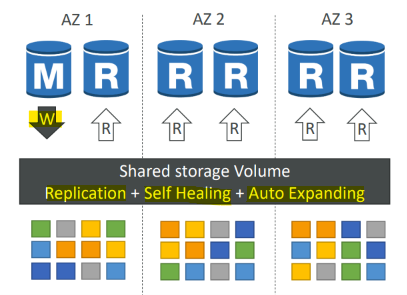
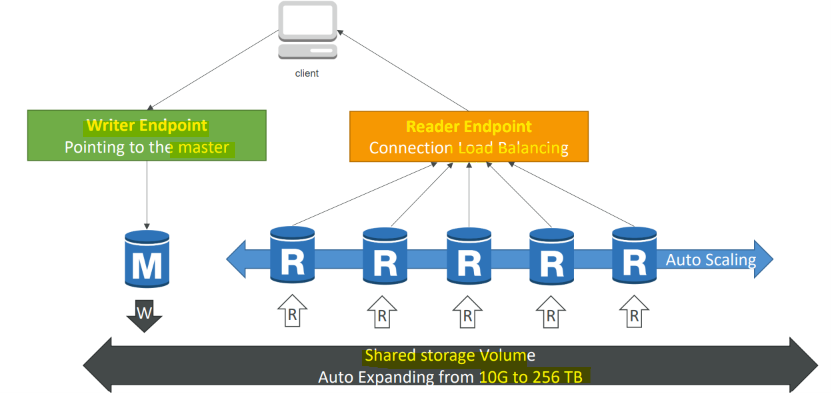

# AIP: RDS

[Back](../index.md)

- [AIP: RDS](#aip-rds)
  - [RDS](#rds)
    - [Benefits over DB on EC2](#benefits-over-db-on-ec2)
    - [Storage Auto Scaling](#storage-auto-scaling)
    - [As Vector Store with S3 Document Repositories](#as-vector-store-with-s3-document-repositories)
  - [Amazon Aurora](#amazon-aurora)
    - [High Availability and Read Scaling](#high-availability-and-read-scaling)
    - [Features of Aurora](#features-of-aurora)
    - [as a Vector Store](#as-a-vector-store)

---

## RDS

- `Amazon RDS (Relational Database Service)`
  - a fully managed SQL database service designed to simplify setting up, operating, and scaling a **relational database** in the cloud.

- Supported Database Engines
  - Open Source:
    - MySQL,
    - PostgreSQL,
    - and MariaDB.
  - Commercial:
    - Oracle
    - Microsoft SQL Server
    - and IBM Db2
  - AWS Native:
    - Amazon Aurora

---

### Benefits over DB on EC2

- RDS is a **managed** service:
  - Automated **provisioning**, OS **patching**
  - Continuous **backups** and **restore** to specific timestamp (Point in Time Restore)!
  - Monitoring **dashboards**
  - **Read replicas** for improved read performance
  - Multi AZ setup for DR (**Disaster Recovery**)
  - **Maintenance windows** for upgrades
  - **Scaling** capability (vertical and horizontal)
  - Storage **backed** by EBS
- BUT you can’t SSH into your instances

---

### Storage Auto Scaling

- Helps you **increase storage** on your RDS DB instance dynamically
  - When RDS detects you are running **out of free database storage**, it **scales automatically**
  - **Avoid manually** scaling your database storage
- You have to set `Maximum Storage Threshold` (**maximum limit** for DB storage)
- Automatically modify storage if:
  - Free storage is **less than 10%** of allocated storage
  - Low-storage lasts **at least 5 minutes**
  - **6 hours** have passed since **last modification**
- Useful for applications with **unpredictable workloads**
- Supports **all** RDS database **engines**

---

### As Vector Store with S3 Document Repositories

- RDS can also **serve as your `vector store`**
  - `RDS SQL Server Vector Store` is a thing
- A common pattern is to use `RDS` for **querying structured data**, which then **points to** something like `S3` for large **unstructured data** it refers to.
- So you could do something like this…
  - Your `vector store` for `RAG` is backed by RDS
  - The data returned just points you to content in S3

---

## Amazon Aurora

- `Aurora`
  - a **proprietary technology** from AWS (not open sourced)
- `Postgres` and `MySQL` are both **supported** as Aurora DB
  - that means your **drivers will work** as if `Aurora` was a Postgres or MySQL database
- **AWS cloud optimized** and claims **5x performance improvement** over MySQL on RDS, over **3x the performance** of Postgres on RDS
- Aurora **storage automatically grows** in increments of **10GB**, up to **256 TB**.
- Aurora can have up to **15 replicas** and the replication process is **faster** than `MySQL` (sub 10 ms replica lag)
- **Failover** in Aurora is **instantaneous**.
  - It’s **HA (High Availability)** native.
- Aurora **costs more** than RDS (20% more) – but is more efficient

---

### High Availability and Read Scaling

- Storage HA(fixed config):
  - **6 copies** of your data across 3 AZ:
    - **4 copies** out of 6 needed for **writes**
      - waits for **4 to confirm** they’ve saved it
      - If one AZ goes down, two copies are lost or unreachable, leaving **4** that can still **confirm writes**.
    - **3 copies** out of 6 need for **reads**
    - **Self healing** with peer-to-peer replication
    - **Storage** is striped across 100s of volumes
- Instance HA:
  - **One** Aurora Instance takes **writes** (**master**)
  - Automated **failover** for master in **less than 30 seconds**
  - Master + up to **15** Aurora **Read Replicas** serve reads
- Support for **Cross Region Replication**

---

- DB Cluster
  - up to 15 read replicas

---

### Features of Aurora

- Automatic **fail-over**
- **Backup** and **Recovery**
- **Isolation** and **security**
- Industry **compliance**
- Push-button **scaling**
- Automated **Patching** with **Zero Downtime**
- Advanced **Monitoring**
- Routine **Maintenance**
- Backtrack: **restore** data at **any point of time** without using **backups**

---

### as a Vector Store

- `pgvector` **extension**
  - Creates a new `vector` **column type**
  - Can compute cosine, L2, or inner product distances
  - Can do **similarity** search with `IVF` or `HNSW`
  - Also adds `vector operators` for `SQL`
    - This gives it an advantage over `OpenSearch` if you need complex filtering logic and stuff.
- Allows you to store **structured** and **vector** data in the same place
- Can be appropriate for **small / medium** `RAG` systems with mostly **structured data**
