# AIP: S3

[Back](../index.md)

- [AIP: S3](#aip-s3)
  - [Durability and Availability](#durability-and-availability)
  - [S3 Storage Classes](#s3-storage-classes)
    - [S3 Standard – General Purpose](#s3-standard--general-purpose)
    - [Infrequent Access](#infrequent-access)
    - [Glacier Storage Classes](#glacier-storage-classes)
    - [Intelligent-Tiering](#intelligent-tiering)
  - [Moving between Storage Classes](#moving-between-storage-classes)
    - [Lifecycle Rules](#lifecycle-rules)
    - [S3 Analytics – Storage Class Analysis](#s3-analytics--storage-class-analysis)
  - [Replication (CRR \& SRR)](#replication-crr--srr)
  - [Object Encryption](#object-encryption)
    - [SSE-S3](#sse-s3)
      - [Default Encryption vs. Bucket Policies](#default-encryption-vs-bucket-policies)
    - [SSE-KMS](#sse-kms)
    - [DSSE-KMS](#dsse-kms)
    - [SSE-C](#sse-c)
    - [Client-Side Encryption](#client-side-encryption)
    - [Encryption in transit (SSL/TLS)](#encryption-in-transit-ssltls)
      - [Force Encryption in Transit `aws:SecureTransport`](#force-encryption-in-transit-awssecuretransport)
  - [Access Logs](#access-logs)
  - [Access Points](#access-points)
    - [VPC Origin](#vpc-origin)

---

## Durability and Availability

- **Durability:**
  - High durability (99.999999999%, 11 9’s) of objects **across multiple AZ**
  - If you store 10,000,000 objects with Amazon S3, you can on average expect to incur a **loss** of a single object once every 10,000 years
  - **Same for all** storage classes

- **Availability:**
  - Measures how **readily available** a service is
  - **Varies** depending on storage class
  - Example: S3 standard has 99.99% availability = not available 53 minutes a year

---

## S3 Storage Classes

- `Standard`: General Purpose
- `Standard-Infrequent Access (IA)`
  - `One Zone-Infrequent Access`
- `Glacier`
  - `Instant Retrieval`
  - `Flexible Retrieval`
  - `Deep Archive`
- `Intelligent Tiering`

---

### S3 Standard – General Purpose

- **99.99%** Availability
- Used for **frequently accessed data**
- **Low latency** and high throughput
- Sustain **2 concurrent** facility failures
- Use Cases:
  - Big Data analytics,
  - mobile & gaming applications,
  - content distribution…

---

### Infrequent Access

- For data that is **less frequently accessed**, but requires **rapid access** when needed
- **Lower cost** than `S3 Standard`

- `Amazon S3 Standard-Infrequent Access (S3 Standard-IA)`
  - **99.9%** Availability
  - Use cases:
    - Disaster Recovery,
    - backups
- `Amazon S3 One Zone-Infrequent Access (S3 One Zone-IA)`
  - High durability (99.999999999%) in a single AZ; **data lost** when AZ is destroyed
  - **99.5%** Availability
  - Use Cases:
    - Storing **secondary backup** copies of **on-premises data**,
    - or data you can recreates

---

### Glacier Storage Classes

- **Low-cost** object storage meant for **archiving / backup**
- Pricing: price for **storage** + object **retrieval** cost
- `Amazon S3 Glacier Instant Retrieval`
  - Millisecond retrieval, great for data accessed **once a quarter**
  - Minimum storage duration of **90 days**
- `Amazon S3 Glacier Flexible Retrieval (formerly Amazon S3 Glacier)`:
  - `Expedited` (1 to 5 minutes), `Standard` (3 to 5 hours), `Bulk` (5 to 12 hours) – **free**
  - Minimum storage duration of **90 days**
- `Amazon S3 Glacier Deep Archive`
  - for long term storage
  - `Standard` (12 hours), `Bulk` (48 hours)
  - Minimum storage duration of **180 days**

---

### Intelligent-Tiering

- Small **monthly monitoring and auto-tiering fee**
- **Moves objects automatically** between Access Tiers based on usage
- There are **no retrieval charges** in S3 Intelligent-Tiering
  - `Frequent Access` tier (automatic): **default** tier
  - `Infrequent Access` tier (automatic): objects not accessed for **30 days**
  - `Archive Instant Access` tier (automatic): objects not accessed for **90 days**
  - `Archive Access` tier (optional): configurable from 90 days to **700+ days**
  - `Deep Archive Access` tier (optional): config. from 180 days to

---

## Moving between Storage Classes

- You can **transition** objects between storage classes
- For **infrequently accessed object**, move them to `Standard IA`
- For **archive objects** that you **don’t need fast access** to, move them to `Glacier` or `Glacier Deep Archive`
- Moving objects can be automated **using** a `Lifecycle Rules`

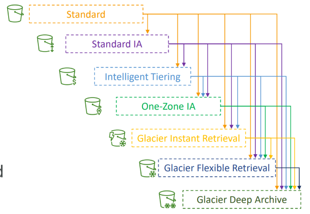

---

### Lifecycle Rules

- `Transition Actions`:
  - configure objects to **transition** to another storage class
    - Move objects to `Standard IA` class **60 days** after creation
    - Move to `Glacier` for archiving after **6 months**
- `Expiration Actions`:
  - configure objects to **expire (delete)** after some time
    - Access **log files** can be set to **delete after a 365 days**
    - Can be used to **delete old versions** of files (if `versioning` is enabled)
    - Can be used to **delete incomplete Multi-Part uploads**
- Rules can be created for a **certain prefix** (example: s3://mybucket/mp3/\*)
- Rules can be created for **certain objects Tags** (example: `Department: Finance`)

---

- Scenario
  - Your application on EC2 creates images thumbnails after profile photos are uploaded to Amazon S3. These thumbnails can be easily recreated, and only need to be kept for 60 days. The source images should be able to be immediately retrieved for these 60 days, and afterwards, the user can wait up to 6 hours.
  - How would you design this?

- Solution:
  - S3 source images can be on `Standard`, with a **lifecycle configuration** to **transition** them to `Glacier` **after 60 days**
  - S3 thumbnails can be on `One-Zone IA`, with a **lifecycle configuration** to **expire** them (delete them) **after 60 days**
    - "easily recreated"
    - "only need to be kept"

---

- Scenario
  - A rule in your company states that you should be able to recover your deleted S3 objects immediately for 30 days, although this may happen rarely. After this time, and for up to 365 days, deleted objects should be recoverable within 48 hours.

- Solution:
  - Enable `S3 Versioning` in order to have object versions, so that “deleted objects” are in fact hidden by a “delete marker” and can be recovered
  - Transition the **“noncurrent versions”** of the object to `Standard IA`
  - Transition afterwards the **“noncurrent versions”** to `Glacier Deep Archive`

---

### S3 Analytics – Storage Class Analysis

- Help you decide when to transition objects to the right storage class
- **Recommendations** for `Standard` and `Standard IA`
- **Does NOT work** for `One-Zone IA` or `Glacier`
- Report is **updated daily**
- **24 to 48 hours** to start seeing data analysis
- Good first step to **put together** `Lifecycle Rules` (or improve them)!

---

## Replication (CRR & SRR)

- **Must enable** `Versioning` in **source and destination buckets**
- `Cross-Region Replication (CRR)`
- `Same-Region Replication (SRR)`
- Buckets **can** be in **different** AWS **accounts**
- Copying is **asynchronous**
- Must give proper **IAM** permissions to S3
- Use cases:
- `CRR`:
  - compliance, lower latency access, replication across accounts
- `SRR`
  - log aggregation, **live replication** between production and test accounts

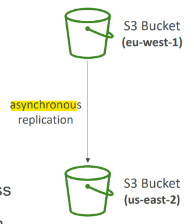

- After you enable `Replication`, **only new objects** are replicated
- Optionally, you can **replicate existing objects** using `S3 Batch Replication`
  - Replicates **existing** objects
  - Replicates objects that **failed** replication
- For `DELETE` operations
  - Can **replicate delete markers** from source to target (optional setting)
  - **Deletions with a version ID** are **not** replicated (to avoid malicious deletes)
- There is **no “chaining” of replication**
  - If bucket 1 has replication into bucket 2, which has replication into bucket 3
  - Then objects created in bucket 1 are **not** replicated to **bucket 3**

---

## Object Encryption

- You can encrypt objects in S3 buckets using one of **4 methods**
- `Server-Side Encryption (SSE)`
  - **Server-Side Encryption with Amazon S3-Managed Keys (`SSE-S3`)**:
    - Enabled by Default
    - Encrypts S3 objects using **keys handled, managed, and owned by AWS**
  - **Server-Side Encryption with KMS Keys stored in AWS KMS (`SSE-KMS`)**
    - Leverage `AWS Key Management Service (AWS KMS)` to manage encryption keys
  - **Server-Side Encryption with Customer-Provided Keys (`SSE-C`)**
    - When you want to **manage your own encryption keys**
- `Client-Side Encryption`
- It’s important to understand which ones are for which situation for the exam

---

### SSE-S3

- Encryption using **keys handled, managed, and owned by AWS**
- Object is encrypted **server-side**
- Encryption type is `Advanced Encryption Standard(AES-256)`
- Must set header `"x-amz-server-side-encryption": "AES256"`
- Enabled by **default** for new buckets & new objects

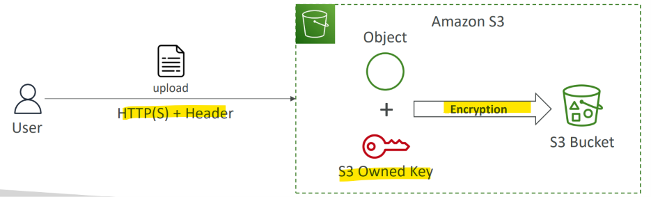

---

#### Default Encryption vs. Bucket Policies

- `SSE-S3` encryption is **automatically** applied to new objects stored in S3 bucket
- Optionally, you can **“force encryption”** using a **bucket policy**
  - **refuse** any API call to `PUT` an S3 object without **encryption headers (`SSE-KMS` or `SSE-C`)**

- Note: `Bucket Policies` are evaluated **before** “Default Encryption”

- deny kms encryption

```json
{
  "Version": "2012-10-17",
  "Statement": [
    {
      "Effect": "Deny",
      "Action": "s3:PutObject",
      "Principal": "*",
      "Resource": "arn:aws:s3:::my-bucket/*",
      "Condition": {
        "StringNotEquals": {
          "s3:x-amz-server-side-encryption": "aws:kms"
        }
      }
    }
  ]
}
```

- deny sse-c encryption

```json
{
  "Version": "2012-10-17",
  "Statement": [
    {
      "Effect": "Deny",
      "Action": "s3:PutObject",
      "Principal": "*",
      "Resource": "arn:aws:s3:::my-bucket/*",
      "Condition": {
        "Null": {
          "s3:x-amz-server-side-encryption-customer-algorithm": "true"
        }
      }
    }
  ]
}
```

---

### SSE-KMS

- Encryption using keys handled and managed by `AWS KMS (Key Management Service)`
- KMS advantages:
  - **user control**
  - **audit** key usage using `CloudTrail`
- Object is encrypted **server side**
- Must set header `"x-amz-server-side-encryption": "aws:kms"`

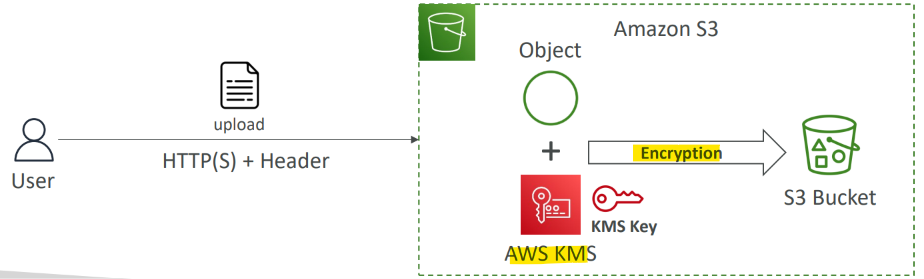

---

- Limitation

- If you use SSE-KMS, you may be **impacted by the KMS limits**
  - When you **upload**, it calls the `GenerateDataKey` **KMS API**
  - When you **download**, it calls the Decrypt KMS API
- **Count** towards the **KMS quota** per second (5500, 10000, 30000 req/s based on region)
- You can request a quota increase using the `Service Quotas Console`

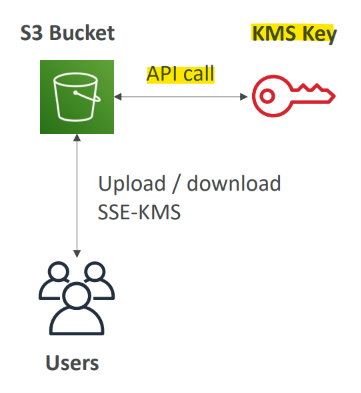

---

### DSSE-KMS

- Dual-Layer Server-Side Encryption using keys handled and managed by AWS KMS
- Ojbect is encrypted twice server side: `KMS Key`(1st layer) + `S3 Managed Key`(2nd layer)
- Must set header `"x-amz-server-side-encryption": "aws:kms:dsse"`


---

### SSE-C

- Server-Side Encryption using keys **fully managed by the customer** outside of AWS
- Amazon S3 **does NOT store** the encryption key you provide
- `HTTPS` **must** be used
- `Encryption key` must provided in **HTTP headers**, for every HTTP request made
- Only **available for CLI** not console

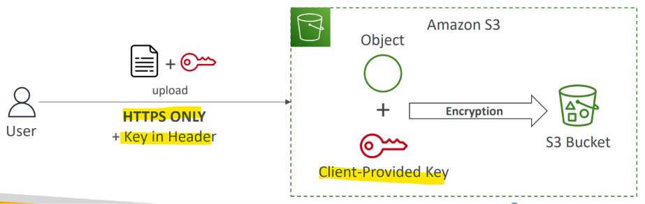

---

### Client-Side Encryption

- Use **client libraries** such as `Amazon S3 Client-Side Encryption Library`
- Clients **must encrypt** data themselves **before sending** to Amazon S3
- Clients **must decrypt** data themselves **when retrieving** from Amazon S3
- Customer **fully manages the keys and encryption cycle**

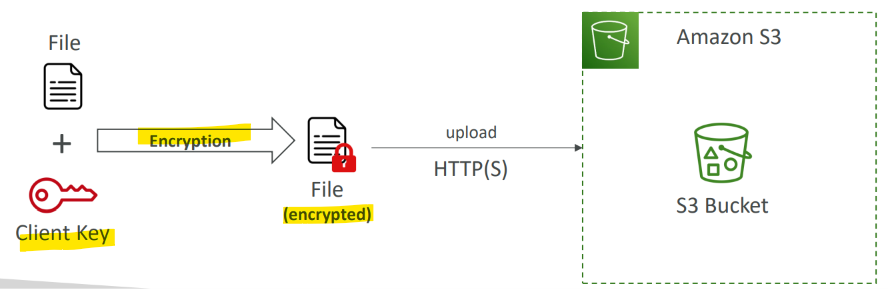

---

### Encryption in transit (SSL/TLS)

- **Encryption in flight** is also called `SSL/TLS`
- Amazon S3 exposes two endpoints:
  - `HTTP Endpoint`: non encrypted
  - `HTTPS Endpoint`: encryption in flight
- HTTPS is **recommended**
- HTTPS is **mandatory** for `SSE-C`
- Most clients would use the `HTTPS` endpoint by **default**

---

#### Force Encryption in Transit `aws:SecureTransport`

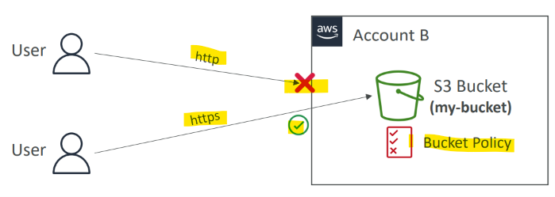

- S3 bucket policy: deny http

```json
{
  "Version": "2012-10-17",
  "Statement": [
    {
      "Effect": "Deny",
      "Principal": "*",
      "Action": "s3:GetObject",
      "Resource": "arn:aws:s3:::my-bucket/*",
      "Condition": {
        "Bool": {
          "aws : SecureTransport": "false"
        }
      }
    }
  ]
}
```

---

## Access Logs

- For audit purpose, you may want to **log all access** to S3 buckets
- **Any request** made to S3, from any account, authorized or denied, will be **logged into another `S3 bucket`**
- That data can be analyzed using data analysis tools…
- The target logging bucket **must** be in the **same AWS region**

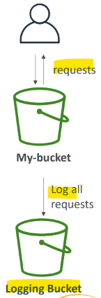

- Warning
  - **Do not** set your logging bucket to be the **monitored bucket**
  - It will create a **logging loop**, and your bucket will grow **exponentially**

---

## Access Points

- `Access Points` simplify **security management** for S3 Buckets
- Each `Access Point` has:
  - its own **DNS name** (Internet Origin or VPC Origin)
  - an access point **policy** (similar to bucket policy) – manage security at scale

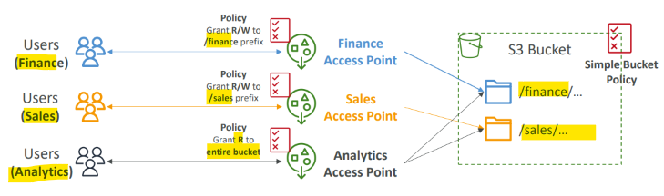

---

### VPC Origin

- We can define the `access point` to be **accessible only from within the `VPC`**
- You must create a `VPC Endpoint` to access the `Access Point` (`Gateway` or `Interface Endpoint`)
- The `VPC Endpoint Policy` must allow access to the **target bucket** and Access Point

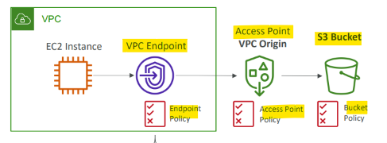

- example: vpc endpoint

```json
{
  "Version": "2012-10-17",
  "Statement": [
    {
      "Principal": "*",
      "Action": ["s3: Get0bject"],
      "Effect": "Allow",
      "Resource": [
        "arn:aws:s3:::awsexamplebucket1/*",
        "arn:aws:s3:us-west-2:123456789012:accesspoint/example-vpc-ap/object/*"
      ]
    }
  ]
}
```
