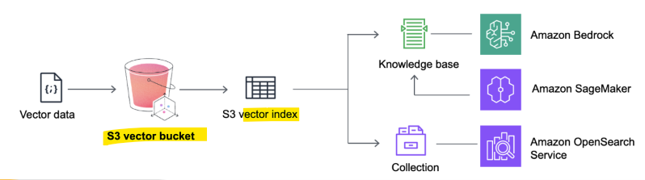
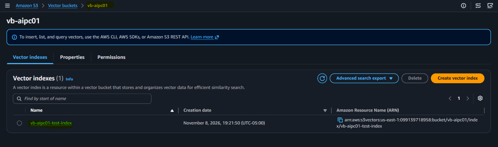
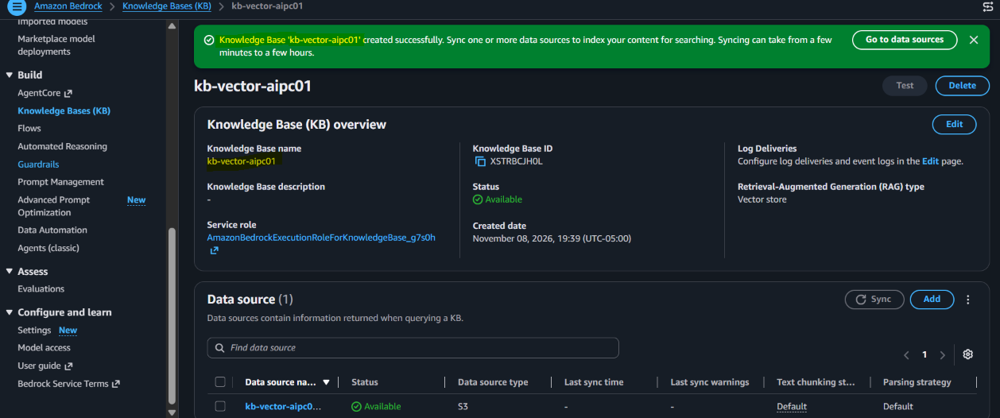
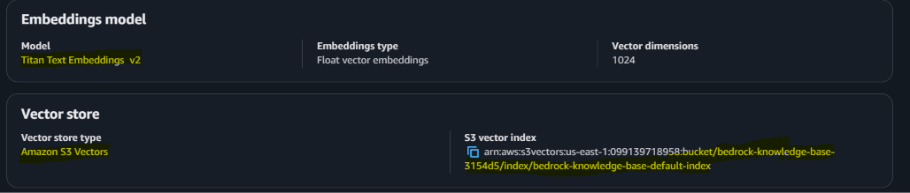
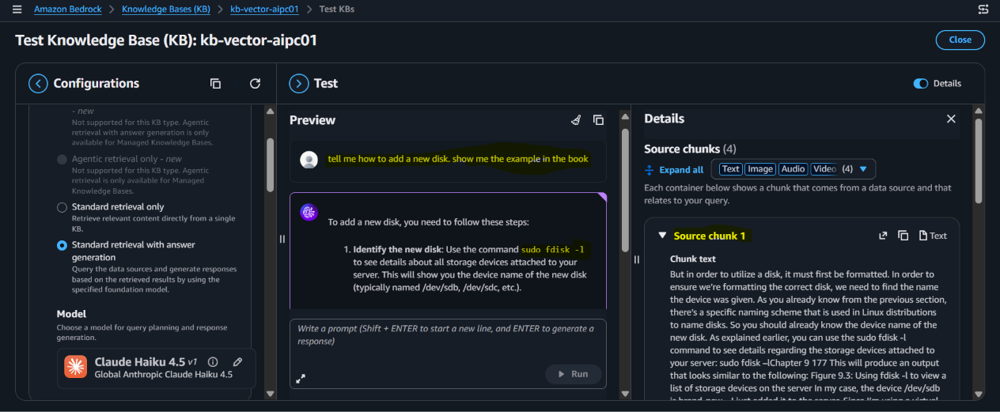
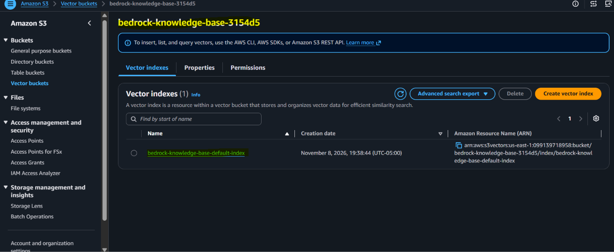

# AIP: S3 Vectors

[Back](../index.md)

- [AIP: Amazon Opensearch](#aip-amazon-opensearch)
  - [Opensearch](#opensearch)

---

## S3 Vectors

- `Amazon S3 Vectors`
  - a **serverless** feature that allows to **store and query numerical vector embeddings** directly inside `Amazon S3` without managing traditional vector databases.

- **Core Components**
  - `Vector Buckets`:
    - Specialized **S3 bucket types** optimized for high-scale vector data.
  - `Vector Indexes`:
    - **Logical containers** inside a bucket where all vectors share the same dimension count and distance metric.
  - `Dedicated APIs`:
    - A purpose-built API set to insert, filter, and query vector data at scale.

---

- Up to **90% cheaper** (and a lot simpler)
- Steps:
  - Create a `S3 vector bucket`
  - Then create a `vector index`
    - Specify **dimensions** and **distance metric**
- Now you can store your **vector embeddings** with `put_vectors`
  - Include whatever **metadata** you want
  - Query them with `query_vectorss`

---

- Generation:
  - You can **generate your own vectors** with an embedding model and **store** them
  - Or it’s fully **integrated** with `Bedrock Knowledge Bases`
    - It manages it all for you
  - Also **integrates** with Bedrock within `SageMaker Unified Studio`

---

### CLI API: `s3vectors-embed-cli`

- You can use `boto3` or the `AWS CLI`
- But there’s also a **dedicated** `S3 vectors CLI`
- Available in GitHub as open source
- `s3vectors-embed put`
  - **Converts** text or images to **embeddings** using `Bedrock`, stores them.
- `s3vectors-embed query`
  - Generates an embedding for your query, **queries** your vector index.

---

### Implementation details

- They are **strongly consistent**
  - **Newly** added data is **immediately available**
- The vector data is **automatically optimized** over time for **price performance**
- But actual performance is only advertised as `100ms-1s`
  - AWS recommends a `hybrid approach` with `OpenSearch` for performance-critical queries
  - They call this a `tiered search strategy`: use S3 for **infrequently** queried vectors only
  - `S3 Vectors` has connectivity with `OpenSearch` for this purpose
    - This `COPIES` (exports) data from S3 **into OpenSearch** – you end up **paying for both** if you’re not careful!
- You can also use `OpenSearch` with **S3 Vectors engine**
  - Only works with `OpenSearch` **managed clusters**
  - Give you OpenSearch functionality with S3 Vectors as the backend
- **Max** `indices` per bucket: **10,000** (2B vectors per index)

---

## Best Practices

- **Insert or delete** vectors in **large batches** (**500** per API call)
- Use **concurrent requests** for **smaller batches**
  - Can get up to 2500 vectors per second
- Have a **retry mechanism** for queries due to **limited throughput**
  - Only hundreds per second supported per index before you get an 429 error(Too Many Requests)
- Use **multiple indexes** when possible
  - Improves per-index **performance**
  - Also useful for data isolation, multi-tenancy
- If a **metadata field** doesn’t need to be filtered, mark it as **non-filterable**

---

## Lab: S3 Vector

### Create in S3

- Buckets > Vector buckets > "Create vector bucket"
  - name: vb-aipc01
- select created bucket > Create vector index
  - Vector index name: vb-aipc01-test-index
  - Dimension: 1024
- using aws cli or aws s3 vector cli to insert embedding
  - skip
- clean up

---

### Create with Bedrock KB

- Bedrock > Knowledge bases > "Create Knowledge Base (KB) with vector store"
  - name: kb-vector-aipc01
  - Choose data source type: S3 (Note: the source bucket,not vector bucket)
  - Configure data source
    - name: kb-vector-aipc01-source
    - S3 URI: specify the source S3 bucket
  - Configure data storage and processing
    - Embeddings model: "Titan Text Embeddings V2 v2.0"
    - Vector store > Vector store type: S3 Vectors
  - Create knowledge base
  - Syn data source

- Test

- Vector bucket

- Clean up
  - delete kb
  - delete s3 index
  - delete s3 bucket