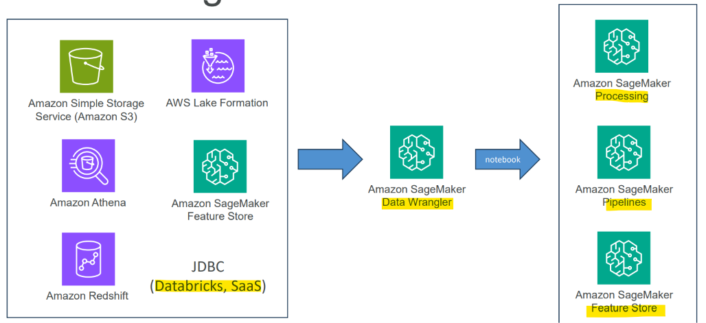

# Amazon SageMaker: Data Wrangler

[Back](../index.md)

- [Amazon SageMaker: Data Wrangler](#amazon-sagemaker-data-wrangler)
  - [Data Wrangler](#data-wrangler)
    - [Integration](#integration)
    - [Troubleshooting](#troubleshooting)

---

## Data Wrangler

- `Amazon SageMaker Data Wrangler`
  - a **low-code/no-code visual tool** within AWS designed to simplify and accelerate **data preparation** and feature engineering for machine learning (ML).
  - integrated directly into `Amazon SageMaker Canvas` and `SageMaker Studio`, allowing data scientists and analysts to **process datasets** from weeks to minutes.

- Capabilities:
  - **Import** data
  - **Visualize** data
  - **Transform** data (300+ transformations to choose from)
    - Transforming **image** data
      - Resize, enhance, corrupt images & more
    - **Balance** data
      - Random oversampling, undersampling, SMOTE
    - Impute **missing** data
    - Handle outliers
    - Dimensionality reduction (`PCA`)
  - Or **integrate** your own custom `xforms` with `pandas`, `PySpark`, `PySpark SQL`
  - “Quick Model” to **train** your model with your data and **measure** its results

---

### Integration

---

### Troubleshooting

- Make sure your `Studio` user has appropriate **IAM roles**
- Make sure **permissions** on your data sources **allow `Data Wrangler` access**
  - Add `AmazonSageMakerFullAccess` policy
- `EC2` instance limit
  - If you get “The following instance type is not available…” errors
  - May need to request a quota increase
  - Service Quotas / Amazon SageMaker / Studio KernelGateway Apps running on `ml.m5.4xlarge` instance
