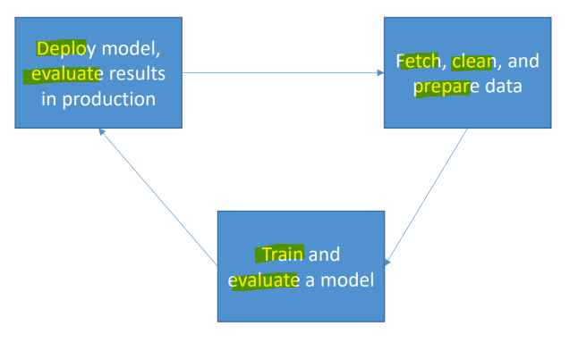
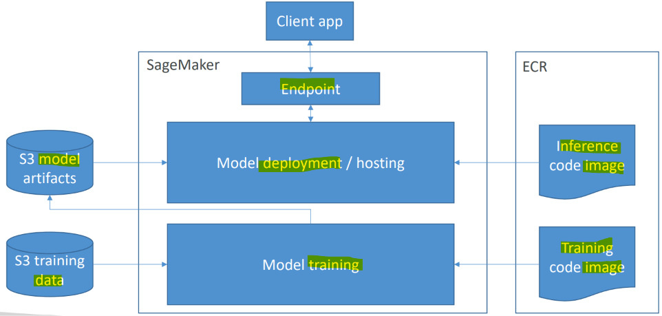
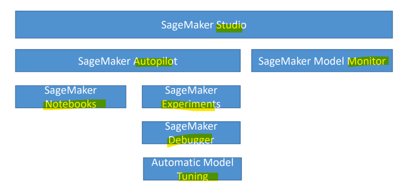
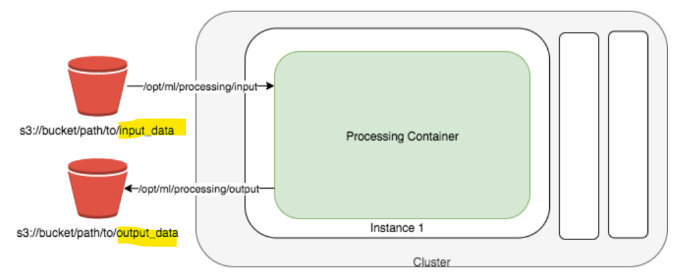
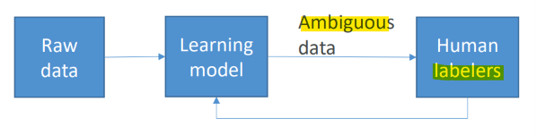
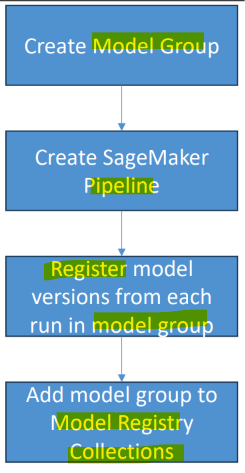
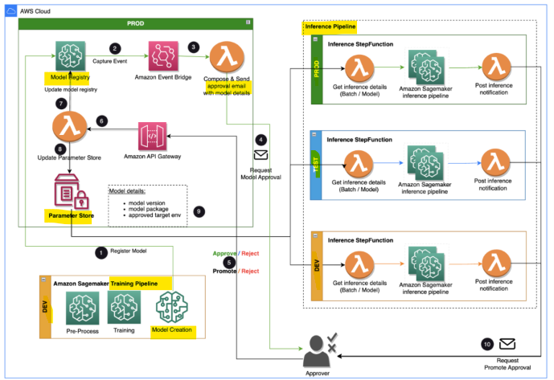
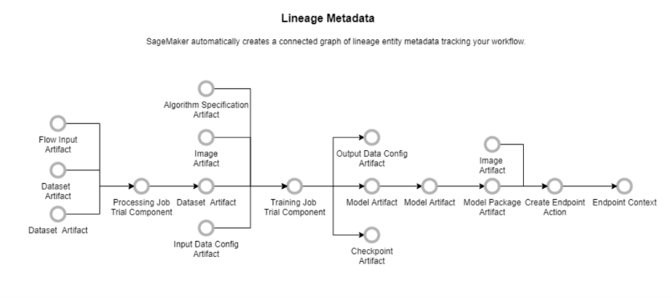

# AIP: Amazon Sagemaker AI

[Back](../index.md)

- [AIP: Amazon Sagemaker AI](#aip-amazon-sagemaker-ai)
  - [Sagemaker AI](#sagemaker-ai)
    - [Data procesing](#data-procesing)
    - [Training](#training)
    - [Deploy Trained Model](#deploy-trained-model)
      - [Deployment Safeguards](#deployment-safeguards)
    - [More Features](#more-features)
  - [Optimizing FM Deployments](#optimizing-fm-deployments)
  - [Ground Truth](#ground-truth)
    - [Ground Truth Plus](#ground-truth-plus)
    - [Ways to generate training labels](#ways-to-generate-training-labels)
  - [`Model Monitor`(depreciated)](#model-monitordepreciated)
  - [`SageMaker Clarify`](#sagemaker-clarify)
    - [Pre-training Bias Metrics](#pre-training-bias-metrics)
  - [Model Registry](#model-registry)
  - [ML Lineage Tracking](#ml-lineage-tracking)
    - [Tracking Entities](#tracking-entities)
  - [SageMaker Neo](#sagemaker-neo)
    - [Neo + AWS IoT Greengrass](#neo--aws-iot-greengrass)
  - [SageMaker Unified Studio](#sagemaker-unified-studio)
  - [SageMaker Pipelines](#sagemaker-pipelines)

---

## Sagemaker AI

- `Amazon SageMaker AI`
  - formerly known as `Amazon SageMaker`
  - a fully managed cloud service by Amazon Web Services (AWS) that lets developers and data scientists **build, train, and deploy** **machine learning (ML)** and **foundation models** at scale.
  - built to **handle** the entire machine learning **workflow**.

- key components

---

- **Notebooks can direct the process**

- `Notebook Instances` on `EC2` are spun up from the console
  - S3 **data access**
  - `Scikit_learn`, `Spark`, `Tensorflow`
  - Wide variety of built-in models
  - Ability to spin up **training instances**
  - Ability to **deploy** trained models for making predictions at scale

- So can the **SageMaker console**

---

### Data procesing

- **Data source**
  - Data usually comes from `S3`
    - Ideal **format** varies with algorithm – often it is `RecordIO` / `Protobuf`
    - Can also ingest from `Athena`, `EMR`, `Redshift`, and `Amazon Keyspaces DB`
  - `Apache Spark` **integrates** with `SageMaker`
  - `Scikit_learn`, `numpy`, `pandas` all at your disposal within a `notebook`

- **Data processing**
  - Processing jobs
    - **Copy** data from S3
    - Spin up a **processing container**
    - SageMaker built-in or user provided
    - **Output** processed data to S3

---

### Training

- Create a training job
  - URL of `S3 bucket` with **training data**
  - ML **compute resources**
  - URL of `S3 bucekt` for **output**
  - `ECR` path to **training code**

- Training options
  - Built-in training algorithms
  - Spark MLLib
  - Custom Python Tensorflow/MXNet code
  - PyTorch, Scikit-learn, RLEstimator
  - XGBoost, Hugging Face, Chainer
  - Algorthm purchased from AWS marketplace

---

### Deploy Trained Model

- **Save** your trained model to `S3`
- Can deploy two ways:
  - Persistent `endpoint` for making individual **predictions** on demand
  - `SageMaker Batch Transform` to get **predictions** for an **entire dataset**
- Lots of cool options
  - `Inference Pipelines` for more complex processing
  - `SageMaker Neo` for deploying to **edge devices**
  - `Elastic Inference` for accelerating deep learning models
  - **Automatic scaling** (increase # of endpoints as needed)
  - `Shadow Testing` **evaluates** new models against currently deployed model to catch errors

---

#### Deployment Safeguards

- `Deployment Guardrails`
  - For **asynchronous** or **real-time** `inference endpoints`
  - Controls **shifting traffic** to new models
    - `Blue/Green Deployments`
      - **All at once**: shift everything, monitor, terminate blue fleet
      - `Canary`: shift a small portion of traffic and monitor
      - `Linear`: Shift traffic **in linearly spaced steps**
  - Auto-**rollbacks**
- `Shadow Tests`
  - Compare **performance** of **shadow variant** to production
  - You monitor in SageMaker console and decide when to promote it

---

### More Features

- `SageMaker JumpStart`
  - a **machine learning (ML) hub** that provides fast access to **pre-trained foundation models**, **built-in algorithms**, **sample notebooks**, and **end-to-end solution templates**
  - One-click models and algorithms from model zoos
  - Over 150 open source models in NLP, object detections, image classification, etc.
- `SageMaker Data Wrangler`
  - Import / transform / analyze / export data within SageMaker Studio
- `SageMaker Feature Store`
  - Find, discover, and share **features** in Studio
  - Online (low latency) or offline (for training or batch inference) modes
  - Features organized into `Feature Groups`
- `SageMaker Edge Manager`
  - Software agent for **edge devices**
  - Model optimized with `SageMaker Neos`
  - Collects and samples data for monitoring, labeling, retraining
- `Asynchronous Inference` endpoints

---

## Optimizing FM Deployments

- SageMaker AI offers **single** and **multi-model** `endpoints`
  - More generally, **multi-container** `endpoints`
  - Each endpoint supports deployment guardrails, VPC, network isolation
- You can **train/tune a model** in `SageMaker AI`, and **deploy** through `Bedrock`
  - You use `Bedrock Custom Model` Import for this
  - Now your **inference** is **serverless**
- SageMaker AI Inference Components
  - Each model gets **its own scaling policy**

---

- Cross-region inference profiles
  - For endpoints on `Bedrock`
- `EC2 Auto Scaling Groups`
  - **Load balancing** in front of SageMaker AI endpoints
- Available model servers with SageMaker AI
  - `TorchServe`
  - `DJL Serving (Deep Java Library)`
    - Deep Learning Containers
    - DJL was created by Amazon, so more likely to show up on exam
  - `Triton Inference Server`

---

- Use **asynchronous inference** if **latency** isn’t important
  - SageMaker AI **async endpoints**
  - Your own queue with `SNS` / `SQS`
- Model **compression**
  - **Quantization** (of model weights)
  - **Pruning**
  - Knowledge **distillation**
    - A smaller model is trained from a larger model
- **Avoid premature** optimization
  - Measure your **performance**, **costs**, **resource utilization**
  - Don’t solve problems that don’t exist!

---

## Ground Truth

- Sometimes you don’t have `training data` at all, and it **needs to be generated by humans first**.
  - Example: training an image classification model. Somebody needs to tag a bunch of images with what they are images of before training a neural network
- `Ground Truth` **manages humans** who will label your data for training purposes
- `Ground Truth` creates **its own model** as **images** are **labeled by people**
- As this model learns, only images the model **isn’t sure** about are **sent to human labelers**
- This can **reduce the cost** of labeling jobs by 70%

- **human labelers**
  - `Amazon Mechanical Turk` workforce
  - Your own internal team
  - Professional labeling companies

---

### Ground Truth Plus

- `Turnkey` solution
  - “Our team of AWS Experts” manages the workflow and team of labelers
  - You fill out an intake form
  - They contact you and discuss pricing
- You track **progress** via the `Ground Truth Plus Project Portal`
- Get labeled data from `S3` when done

---

### Ways to generate training labels

- `Rekognition`
  - AWS service for **image recognition**
  - Automatically **classify images**
- `Comprehend`
  - AWS service for **text analysis and topic modeling**
  - Automatically **classify text** by topics, sentiment
- Any pre-trained model or unsupervised technique that may be helpful

---

## `Model Monitor`(depreciated)

- Get **alerts** on **quality deviations** on your deployed models (via `CloudWatch`)
- **Visualize data drift**
  - Example: loan model starts giving people more credit due to drifting or missing input features
- **Detect** anomalies & outliers
- **Detect** new features
- No code needed

---

- Data is **stored** in `S3` and secured
- Monitoring jobs are **scheduled** via a `Monitoring Schedule`
- **Metrics** are emitted to `CloudWatch`
  - **CloudWatch notifications** can be used to **trigger alarms**
  - You’d then take corrective action (retrain the model, audit the data)
- **Integrates** with `Tensorboard`, `QuickSight`, `Tableau`
  - Or just **visualize** within `SageMaker Studio`

---

- Monitoring Types:
  - Drift in **data quality**
    - Relative to a **baseline** you create
    - “Quality” is just **statistical properties** of the features
  - Drift in **model quality** (accuracy, etc)
    - Works the same way with a model quality baseline
    - Can **integrate** with `Ground Truth` labels
  - **Bias** drift
  - **Feature attribution** drift
    - Based on `Normalized Discounted Cumulative Gain (NDCG)` score
    - This **compares feature ranking** of training vs. live data

---

## `SageMaker Clarify`

- `Model Monitor` **Integrates** with `SageMaker Clarify`
  - `SageMaker Clarify` detects **potential bias**
    - i.e., imbalances across different groups / ages / income brackets
  - With `Model Monitor`, you can **monitor for bias** and be **alerted** to new potential bias via `CloudWatch`

- `SageMaker Clarify` also helps **explain model behavior**
  - Understand which **features contribute** the most to your **predictions**

### Pre-training Bias Metrics

- `Class Imbalance (CI)`
  - One facet (demographic group) has **fewer** training values than another
- `Difference in Proportions of Labels (DPL)`
  - **Imbalance** of positive outcomes between facet values
- `Kullback-Leibler Divergence (KL)`, `Jensen-Shannon Divergence(JS)`
  - How much outcome **distributions** of facets diverge
- `Lp-norm (LP)`
  - **P-norm difference** between distributions of outcomes from facets
- `Total Variation Distance (TVD)`
  - **L1-norm difference** between distributions of outcomes from facets
- `Kolmogorov-Smirnov (KS)`
  - **Maximum divergence** between outcomes in distributions from facets
- `Conditional Demographic Disparity (CDD)`
  - Disparity of outcomes between facets as a whole, and by subgroups

---

## Model Registry

- **Catalog** your models, manage **model versions**
- Associate **metadata** with models
- Manage **approval status** of a model
- **Deploy** models to production
- **Automate** deployment with **CI/CD**
- **Share** models
- **Integrate** with `SageMaker Model Cards`

- example

---

## ML Lineage Tracking

- Creates & stores your **ML workflow (MLOps)**
- Keep a running **history** of your models
- **Tracking** for auditing and compliance
- Automatically or manually-created **tracking** entities
- Integrates with `AWS Resource Access Manager` for crossaccount lineage

- Sample SageMaker-created lineage graph:
  

---

### Tracking Entities

- **Trial component** (processing jobs, training jobs, transform jobs)
- **Trial** (a model composed of trial components)
- **Experiment** (a group of Trials for a given use case)
- **Context** (logical grouping of entities)
- **Action** (workflow step, model deployment)
- **Artifact** (Object or data, such as an S3 bucket or an image in ECR)
- **Association** (connects entities together) – has optional AssociationType:
  - ContributedTo
  - AssociatedWith
  - DerivedFrom
  - Produced
  - SameAs

---

- **Querying Lineage Entities**
  - Use the `LineageQuery` API from Python
    - Part of the Amazon `SageMaker SDK for Python`
  - Do things like find all models / endpoints / etc. that use a given artifact
  - Produce a **visualization**
    - Requires external Visualizer helper class

---

- **Cross-Account Lineage Tracking**
- Can **trace across** organizational **boundaries**
- Use SageMaker `AddAssociation` API
  - Plus required **IAM roles & permissions**

---

## SageMaker Neo

- **Train** once, run **anywhere**
  - Edge devices
    - ARM, Intel, Nvidia processors
    - Embedded in whatever – your car?
- Optimizes **code** for **specific devices**
  - Tensorflow, MXNet, PyTorch, ONNX, XGBoost, DarkNet, Keras
- Consists of **a compiler** and

---

### Neo + AWS IoT Greengrass

- **Neo-compiled models** can be **deployed** to an `HTTPS endpoint`
  - Hosted on C5, M5, M4, P3, or P2 instances
  - Must be **same instance** type used for **compilation**
- OR! You can deploy to `IoT Greengrass`
  - This is how you get the model to an **actual edge device**
  - Inference at the **edge with local data**, using model trained in the cloud
  - Uses **`Lambda` inference applications**

---

## SageMaker Unified Studio

- **Single interface** for
  - data,
  - analytics,
  - AI,
  - and ML services
  - This includes `Bedrock`, `Q`, and `Quicksight`
  - Also `notebooks`, and all the stuff that was in the old SageMaker Studio
- **Single interface** for build / deploy / execute / monitor
- Built for **teams**
  - **Administrators** manage users/groups and what they **access**
  - A `domain` connects assets, users, and projects
- Can connect from `Visual Studio Code`

---

## SageMaker Pipelines

- `Directed Acyclic Graph (DAG)` for ML Workflows
- Can define visually in **pipeline designer**, or via `JSON`
- Integrated with `SageMaker Unified Studio` and `SageMaker AI`
