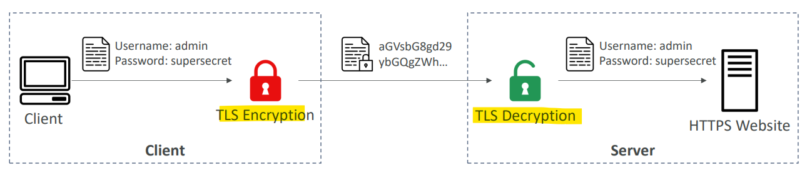
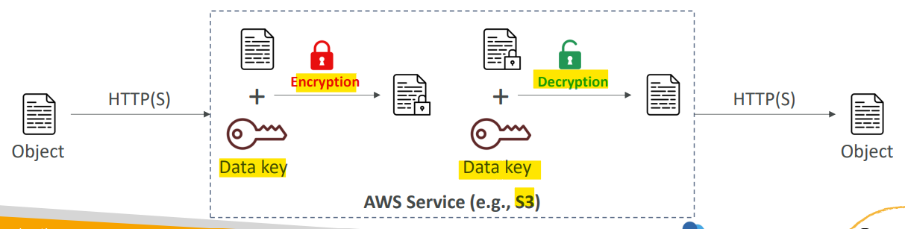
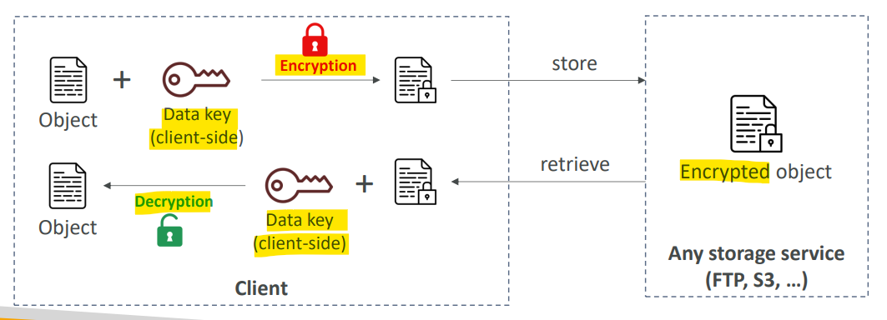

# Security

[Back](../index.md)

- [Security](#security)
  - [Principle of Least Privilege](#principle-of-least-privilege)
  - [Data Masking and Anonymization(匿名化)](#data-masking-and-anonymization匿名化)
  - [Key Salting](#key-salting)
  - [Encryption](#encryption)
    - [Encryption in flight (TLS / SSL)](#encryption-in-flight-tls--ssl)
    - [Server-side encryption at rest](#server-side-encryption-at-rest)
    - [Client-side encryption](#client-side-encryption)

---

## Principle of Least Privilege

- Grant **only the permissions required** to perform a task
- Start with **broad** permissions while **developing**
- But lock it down once you have a better idea of the exact services and operations a workload requires
- Can use `IAM Access Analyzer` to generate **least-privilege policies** based on access activity

---

## Data Masking and Anonymization(匿名化)

- Dealing with `PII` or other **sensitive data**
- Masking **obfuscates** data
  - For example, masking all but the **last 4 digits** of a **credit card** or **social security number**
- Masking **passwords**
- Supported in `Glue DataBrew` and `Redshift`

- Anonymization techniques
  - **Replace** with **random**
  - **Shuffle**
  - **Encrypt** (deterministic or probabilistic)
  - **Hashing**
- Or just delete it or don’t import it in the first place.

---

## Key Salting

- `Salting` involves **appending or prepending** a **random value**, known as a "salt," to a piece of data (often a password) **before hashing** it.
- **Prevents pre-computed "rainbow table" attacks** where adversaries use pre-generated hashes of commonly used passwords to find matches.
- Ensures that the **same piece of data** (like two **identical passwords**) doesn't produce the **same hash** across different instances due to the unique salt.
- Use strong, cryptographically secure **random values** for salts
- **Rotate** salts **periodically**
- **Each user** should have a **unique salt**
- Salt and hash passwords **before storing**

---

## Encryption

### Encryption in flight (TLS / SSL)

- Data is **encrypted before sending** and **decrypted after receiving**
- `TLS` **certificates** help with **encryption** (`HTTPS`)
- Encryption in flight ensures no `MITM` (`man in the middle attack`) can happen

---

### Server-side encryption at rest

- Data is **encrypted after being received** by the **server**
- Data is **decrypted before being sent**
- It is **stored** in an **encrypted form** thanks to a `key` (usually a `data key`)
- The encryption / decryption keys must be managed somewhere, and the server must have access to it

---

### Client-side encryption

- Data is **encrypted by the client** and **never decrypted by the server**
- Data will be **decrypted by a receiving client**
- The **server** should **not** be able to **decrypt** the data
- Could leverage `Envelope Encryption`
  - a security technique where a `Data Encryption Key (DEK)` **encrypts** your data, and a **separate** `Key Encryption Key (KEK)` **encrypts** (or "wraps") that `DEK`.

