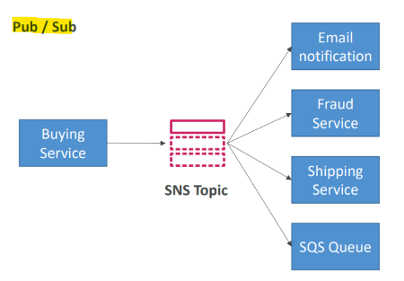
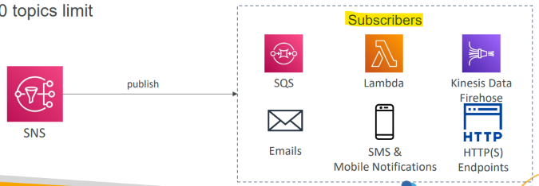
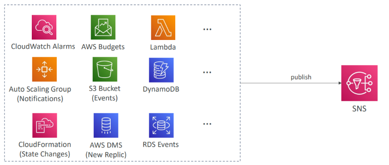

# AIP: SNS

[Back](../index.md)

- [AIP: SNS](#aip-sns)
  - [SNS](#sns)
    - [How It Works](#how-it-works)
    - [Use Cases](#use-cases)
  - [How to publish](#how-to-publish)
  - [Security](#security)

---

## SNS

- `Amazon Simple Notification Service (Amazon SNS)`
  - a fully managed, cloud-based **pub/sub (publish-subscribe) messaging service** that lets you **broadcast messages or alerts** to multiple subscribers at once.

- `fan-out pattern`
  - a software design and architecture pattern where **a single incoming request**, task, or event is **distributed into multiple parallel downstream** operations, messages, or worker threads.

---

- The “event producer” only **sends message to one `SNS topic`**
- As **many** “event receivers” (subscriptions) as we want to listen to the **SNS topic notifications**
- Each `subscriber` to the topic will get all the messages (note: new feature to **filter** messages)
- Up to **12,500,000 subscriptions** per `topic`
- **100,000** `topics` limit

- Many AWS services can **send** data directly to `SNS` for notifications

---

### How It Works

- `Topics`:
  - A topic acts as a **central communication channel or message bus**.
  - `Publishers` send a single **message** to a `topic`.
- `Publishers (Producers)`:
  - The applications or services that **send messages** to an SNS topic (e.g., an EC2 instance, a weather alert system, or an AWS CloudWatch alarm).
- `Subscribers (Consumers)`:
  - The **endpoints** that **listen** to the `topic` and automatically receive copies of the message.

---

### Use Cases

- **Decoupling Microservices**:
  - Breaking apart distributed applications using a **`fan-out` pattern**:
    - a **single event** (like a new user signup or order placement) publishes to `SNS`, which then **triggers multiple downstream** `SQS` queues, `Lambda` functions, and **audit** logs simultaneously.
- **Automated Alerts**:
  - **Notifying** DevOps teams via email or SMS when a system metric (such as high CPU usage in CloudWatch) is breached.
- **User Notifications**:
  - Sending OTPs (one-time passwords), account updates, or promotional messages to end-users.

---

## How to publish

- **Topic Publish** (using the `SDK`)
  - Create a `topic`
  - Create a `subscription` (or many)
  - **Publish** to the topic

- **Direct Publish** (for **mobile apps** `SDK`)
  - Create a **platform application**
  - Create a **platform endpoint**
  - Publish to the **platform endpoint**
  - Works with `Google GCM`, `Apple APNS`, `Amazon ADM`...

---

## Security

- **Encryption**:
  - **In-flight encryption** using `HTTPS` API
  - **At-rest encryption** using `KMS` keys
  - Client-side encryption if the client wants to perform encryption/decryption itself
- **Access Controls**:
  - `IAM policies` to regulate access to the SNS API
- **SNS Access Policies** (similar to S3 bucket policies)
  - Useful for **cross-account access** to SNS topics
  - Useful for **allowing other services** (S3…) to write to an SNS topic
