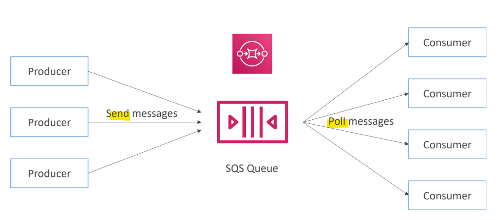
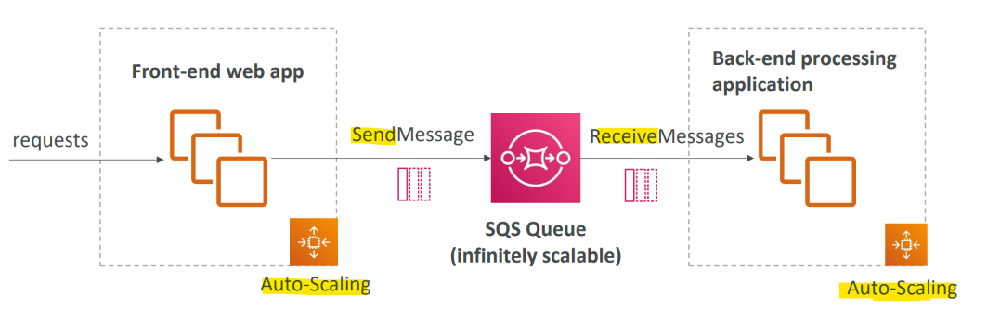
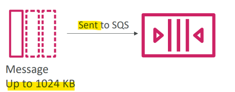
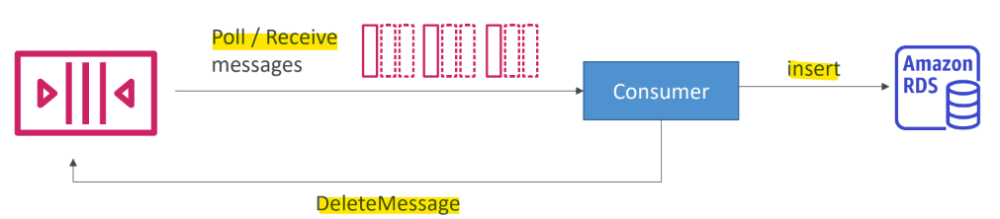
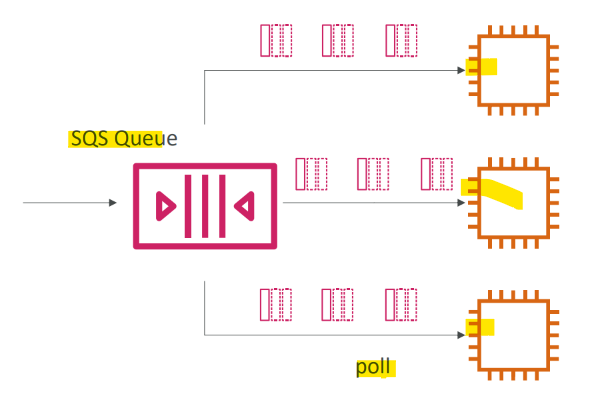
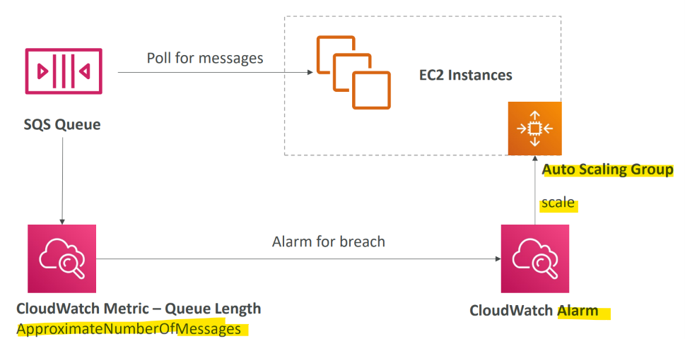

# AIP: SQS

[Back](../index.md)

- [AIP: SQS](#aip-sqs)
  - [SQS](#sqs)
    - [Security](#security)
    - [Queue](#queue)
      - [Standard Queue](#standard-queue)
  - [Producing Messages](#producing-messages)
  - [Consuming Messages](#consuming-messages)
      - [Multiple `EC2` Instances **Consumers**](#multiple-ec2-instances-consumers)

---

## SQS

- `Amazon Simple Queue Service (SQS)`
  - a fully managed **message queuing service** that lets different parts of a software system **communicate asynchronously** by acting as a **temporary "waiting area" (queue)** for data or tasks.

- **decouple**

---

### Security

- **Encryption**:
  - **In-flight encryption** using `HTTPS` API
  - **At-rest encryption** using `KMS keys`
  - **Client-side encryption** if the client wants to perform encryption/decryption itself
- **Access Controls**:
  - `IAM` policies to regulate access to the SQS API
- `SQS Access Policies` (similar to S3 bucket policies)
  - Useful for **cross-account access** to SQS queues
  - Useful for **allowing other services** (SNS, S3…) to write to an `SQS queue`

---

### Queue

- `queue`
  - a t**emporary holding buffer** where application components send, store, and receive **messages asynchronously**.

- It acts like a digital waiting line between different parts of a software system:
  - `Producers (senders)`:
    - **push** tasks, data, or events into the queue.
  - `Consumers (receivers)`:
    - **pull** those messages from the queue and process them at their own pace without needing to be online or synchronized at the same time.

---

- two main types of queues
  - `Standard Queues`:
    - Provide **unlimited throughput**, **best-effort message ordering**, and **at-least-once message delivery**.
  - `FIFO (First-In-First-Out) Queues`:
    - Process messages **strictly in the order** they are sent, ensuring each message is processed **exactly once and not duplicated**.

---

#### Standard Queue

- Oldest offering (over 10 years old)
- Fully managed service, used to **decouple** applications
- Attributes:
  - **Unlimited throughput**, **unlimited number** of messages in queue
  - Default **retention** of messages:
    - 4 days,
    - maximum of 14 days
  - **Low latency** (<10 ms on publish and receive)
  - Limitation of **1,024 KB per message** sent
- Can have **duplicate messages** (**at least once delivery**, occasionally)
- Can have out of order messages (**best effort ordering**)

---

## Producing Messages

- Produced to SQS using the `SDK` (`SendMessage` API)
- The message is **persisted** in SQS **until a consumer deletes** it
- Message retention:
  - default 4 days,
  - up to 14 days
- Example: send an order to be processed
  - Order id
  - Customer id
  - Any attributes you want
- `SQS standard`: **unlimited throughput**

---

## Consuming Messages

- **Consumers**:
  - e.g., running on EC2 instances, servers, or AWS Lambda ...
- **Poll** SQS for messages
  - receive up to **10 messages at a time**
- **Process** the messages
  - example: insert the message into an RDS database
- **Delete** the messages using the `DeleteMessage` API

---

#### Multiple `EC2` Instances **Consumers**

- **Consumers** receive and process messages **in parallel**
- **At least once delivery**
- **Best-effort message ordering**
- Consumers **delete** messages **after processing them**
- We can **scale consumers horizontally** to improve throughput of processing

---

- Horizontal scaling with `Auto Scaling Group (ASG)`
  - queue length >`CloudWatch metric`
  - trigger `CloudWatch Alarm`
  - scale via `ASG`

