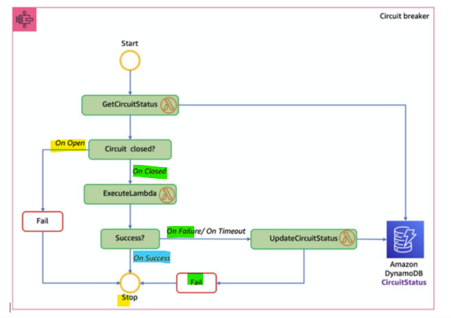

# AIP: Step Functions

[Back](../index.md)

- [AIP: AppConfig](#aip-appconfig)
  - [AppConfig](#appconfig)

---

## Step Functions

- `AWS Step Functions`
  - a **serverless orchestration service** that lets you **link microservices**, **automate processes**, and **coordinate** distributed applications through **visual workflows**.

- Use to **design workflows**
- Easy **visualizations**
- `Advanced Error Handling and Retry` mechanism outside the code
- **Audit** of the **history** of workflows
- Ability to **“Wait”** for an arbitrary amount of time
- Max **execution time** of a `State Machine` is **1 year**

---

- `State Machines`:
  - **Workflows** are defined as state machines using Amazon States Language (ASL), a JSON-based structure.
  - Your **workflow** is called a `state machine`
  - Each **step** in a workflow is a `state`

---

### Types of states

- `Task`:
  - Does something
    - Lambda,
    - other AWS services,
    - or third party API’s
- `Choice`:
  - Adds **conditional logic** via `Choice Rules` (ie, comparisons)
- `Wait`:
  - **Delays** state machine for a specified time
- `Parallel`:
  - Add separate **branches of execution**
- `Map`:
  - Run a set of `steps` for each item in a dataset, **in parallel**
  - This is most relevant to data engineering! Works with JSON, S3 objects, CSV files
- Also `Pass`, `Succeed`, `Fail`

---

### Circuit Breakers pattern

- `Circuit Breaker` is a **pattern**
  - **Prevents calling a service** that is **timing out** and **failing**
  - **Detects** when it’s functional again
  - Can be **implemented** with `Step Functions`, `Lambda`, and `DynamoDB`
- This can be used to **safeguard** your AI workflows
  - **Route** requests to **fallback models** if your model is down
  - Or enter a **degraded service mode**

---

## With GenAI

- `ReAct` patterns (`Reasoning and Acting`)
  - `Step functions` **orchestrate** steps in a structured workflow
  - `Chain of thought` reasoning
  - **Dynamic routing** to specialized FMs
- **Orchestrate** model **review** and **approval** process

- There is a **256KB limit** between **data passed** between `steps`
  - You might **squirrel data away** in `DynamoDB` or `S3` if this is a problem
- `Step Functions` is integrated with `Bedrock`
  - `InvokeModel`, `CreateModelCustomizationJob` both supported
  - You can **chain** **multiple FM calls** together using `Step Functions`
  - Note that `InvokeModel` can also include `guardrails` you specify
    - You can chain those too.
