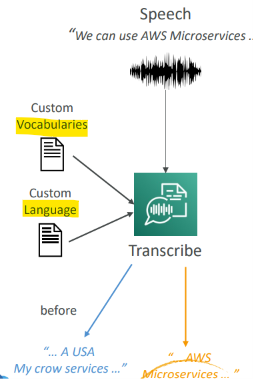

# Amazon Transcribe

[Back](../index.md)

- [Amazon Transcribe](#amazon-transcribe)
  - [Amazon Transcribe](#amazon-transcribe-1)
    - [Improving Accuracy](#improving-accuracy)
    - [Toxicity Detection](#toxicity-detection)

---

## Amazon Transcribe

- Automatically convert **speech to text**
- Uses a **deep learning process** called `automatic speech recognition (ASR)` to convert speech to text quickly and accurately
- Automatically **remove** `Personally Identifiable Information (PII)` using `Redaction`
- Supports `Automatic Language Identification` for **multi-lingual audio**
- Use cases:
  - transcribe **customer service calls**
  - automate closed **captioning and subtitling**
  - generate **metadata** for media assets to create a fully **searchable archive**

---

### Improving Accuracy

- Allows `Transcribe` to capture **domain-specific or nonstandard terms** (e.g., technical words, acronyms, jargon…)
- **Custom Vocabularies (for words)**
  - **Add** specific words, phrases, domain-specific terms
  - Good for **brand** names, acronyms…
  - Increase recognition of a new word by **providing hints** (such as pronunciation..)
- **Custom Language Models** (for context)
  - **Train** Transcribe model **on your own domain-specific text data**
  - Good for transcribing **large volumes of domain-specific** speech
  - **Learn the context** associated with a given word
- Note: use **both** for the highest transcription **accuracy**

---

### Toxicity Detection

- ML-powered, **voice-based toxicity detection** capability
- Leverages:
  - **speech cues**: tone and pitch
  - **text-based cues**
- Toxicity categories: **sexual** harassment, **hate** speech, **threat**, **abuse**, **profanity**, **insult**, and graphic….
