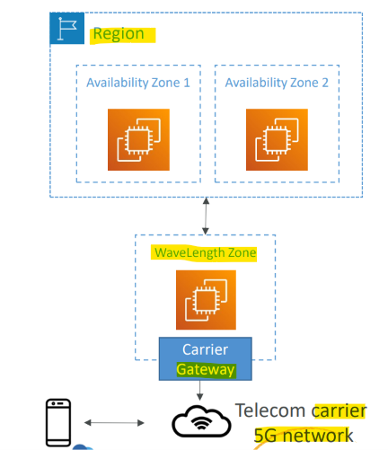

# AIP: WaveLength

[Back](../index.md)

- [AIP: WaveLength](#aip-wavelength)
  - [WaveLength](#wavelength)
    - [GenAI](#genai)

---

## WaveLength

- `AWS Wavelength`
  - an **edge computing infrastructure service** that places standard Amazon Web Services (AWS) compute and storage directly **inside telecommunication providers' 5G networks**.

- **Key Features**

- **Ultra-Low Latency**:
  - By **embedding AWS infrastructure inside 5G data centers**, mobile and connected device traffic reaches application servers without traversing multiple public internet hops, **reducing latency** to single-digit milliseconds.
- **Familiar AWS Tools**:
  - You can **extend** your existing `Amazon Virtual Private Cloud (VPC)` into a `Wavelength Zone` and deploy familiar resources like Amazon EC2 instances, EBS volumes, and EKS/ECS clusters using the same APIs.
- **Seamless Cloud Integration**:
  - Workloads running at the edge maintain **high-bandwidth**, **secure** connections back to the parent `AWS Region` for heavy lifting, databases (like Amazon DynamoDB or RDS), and analytics.
- **Data Residency & Security**:
  - Built on the `AWS Nitro System`, your **data stays within local geographic and carrier boundaries** to meet strict **regulatory and compliance requirements**.

---

- `WaveLength Zones` are infrastructure deployments embedded within the **telecommunications providers’ datacenters** at the **edge of the 5G networks**
- Brings AWS services to the edge of the 5G networks
  - Example: EC2, EBS, VPC…
- **Ultra-low latency** applications through 5G networks
- Traffic doesn’t leave the `Communication Service Provider’s (CSP)` network
- **High-bandwidth** and **secure connection** to the **parent** `AWS Region`
- **No additional charges or service agreements**
- Use cases:
  - Smart Cities,
  - ML-assisted diagnostics,
  - Connected Vehicles,
  - Interactive Live Video Streams,
  - AR/VR,
  - Real-time Gaming, …

---

### GenAI

- **Edge deployments**
- **Secure routing** between cloud and on-prem
- **Mobile foundation model apps**
- **Distribute traffic** between Wavelength Zones and parent regions based on workload
  - **Low-latency**, lighter work at the **edge**
  - **Heavier** in the `Region`
